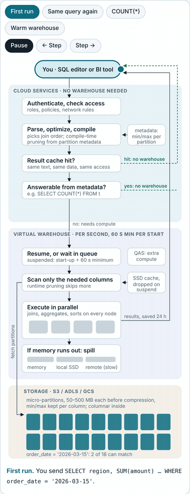

# Top 30 Claude plugins, a data & ops toolkit, the 20 to open first, Anthropic's build repos, the 27-skill list and 18 animation repos, kept current

Seven collections, each traced to its real repository, with one installer, a verifier, a field
guide, and upload-ready skill zips for the Claude app:

- **Top 30 from the post** (items 1–30, rows 1–5): coding, research, token savers, design, writing.
- **Data & ops toolkit** (items 31–56, rows 6–9): Snowflake, dbt, Airflow and data quality; AWS,
  Oracle and migrations; manager and team productivity (Jira/Confluence, DORA dashboards, AI
  adoption); production monitoring for leadership, app developers and SRE / L2 / L3.
- **[20 to open first](#20-github-projects-to-open-first)** (items 58–66, rows 10–12, plus 11 already
  here): agent harnesses, memory, token savers, product and everyday tools, with a script to test
  each one before and after.
- **[Anthropic's 6 to build with](#anthropics-6-repos-to-build-with)** (items 67–71, row 13, plus 26):
  the prompt tutorial, quickstarts, Agent SDK, Claude Code and Claude Code Action, with a working
  Snowflake SQL review agent and GitHub workflows (including Amazon Bedrock) you can copy.
- **[27 skills, one at a time](#27-skills-one-at-a-time)** (items 72–78, row 14, plus 25 and 28): notes
  and research, writing, marketing, n8n automation, and build & ship, mapped skill by skill to the
  repos they come from.
- **Picked since the posts** (items 79–83): EasyUI's animated component registry, the
  Interfaces skills its author builds with, Amicro's micro-interaction components and Cult UI's
  components and agent skills (row 4), and Busabase, a shared, reviewable memory for agents
  (row 10).
- **[18 repos to copy any animation](#18-repos-to-copy-any-animation)** (items 84–101, row 15):
  copy, style, paint, VFX, beat, captions and ship, with a `top30-motion` plugin for the parts
  the repos leave to you (beat cues, word captions, licensed sound, platform-ready exports).

**Playbooks** for putting them to work: [manager](playbooks/manager.md),
[lead data engineer](playbooks/lead-data-engineer.md), [team rollout](playbooks/team-rollout.md),
[production & SRE](playbooks/production-and-sre.md), and
[Claude features worth setting up](playbooks/claude-features.md) (fact-checked, with prompts for work), and
[loops and graphs](playbooks/loops-and-graphs.md) (agent work you approve once, not step by step), and
[Claude Code commands, fact-checked](playbooks/claude-commands.md) (15, then 20 more by layer),
[Claude Code in four folders](playbooks/claude-code-setup.md) (setup in order, fact-checked),
[Agentic AI study notes, checked](playbooks/agentic-ai-notes.md) (18 chapters, with a corrected first agent),
[Snowflake's AI products, checked](playbooks/snowflake-ai-stack.md) (CoCo, Cortex Agents, CoWork: access and cost defaults first), and a
[harness engineering reading path](playbooks/harness-engineering.md). Read
[Before you try this at work](playbooks/before-you-try-at-work.md) first.

**Field guide:** https://venkatesanps.github.io/top30ongithub/ (refreshed daily)

**Explainer: how a Snowflake query runs.** An animated walk from Run to rows (caches, pruning, warehouse, spill, credits), checked against Snowflake's docs: [`guide/snowflake-query-execution/`](guide/snowflake-query-execution/) ([what it corrects](guide/snowflake-query-execution/README.md)). The `snowflake-query-advisor` skill applies it to your own SQL.



A GitHub Action re-checks everything every day:

- **New upstream commits** are re-pinned under `sources/`, and affected skill zips are rebuilt.
- **Breakage** is caught early: repos that moved, were archived or renamed; marketplace or plugin
  names that no longer match our install commands; packages that vanished from npm/PyPI.
- **Install tests** run on a fresh Linux machine for anything that changed or is untested, and for
  everything every Monday. Dashboards are tested by pulling their images and validating their
  compose files; a few items that need your own account (marked "manual") are only checked upstream.
- **Token cost per session** is re-measured with `claude plugin details`.
- Results go to the status table below, [CHANGELOG.md](CHANGELOG.md), the field guide
  (GitHub Pages), and one open issue labelled `upstream-attention` that closes itself when all is well.

## Quick start (Claude Code on your Mac/PC)

```bash
git clone https://github.com/venkatesanps/top30ongithub.git && cd top30ongithub
./install.sh --list            # everything, with GitHub links and per-session token cost
./install.sh --status          # health from the last daily check
./install.sh --dry-run 5 30    # show the exact commands first
./install.sh 5 30              # install Superpowers + I Have ADHD (asks before running each)
./install.sh row 4             # or a whole row
./install.sh 41 42 45          # SQLGlot + SQLFluff + Jira/Confluence MCP (data & ops toolkit)
./verify.sh 5 30               # check they work
git pull                       # later: pick up fixes from the daily check
```

Restart Claude Code after installing plugins. Prerequisites only for items that need them:
Claude Code, Node 22+ (24+ for GSD), Python 3.10+ (pipx recommended), uv (MCP servers),
Docker (dashboards), Java 17+ (SQLcl), Bun (gstack, Claude-Mem), git, FFmpeg (video tools).

## 20 GitHub projects to open first

The "20 GitHub projects you should open first" list, in its own order. Eleven were already in
this kit; the other nine are items 58–66. Every one is pinned, install-tested and checked daily.
`./install.sh --show open20` prints the list, and the field guide has a "20 to open first" filter.

<!-- list:open20:start -->
| Post # | Catalog # | Name | Repo | Tokens/session | Install test |
|---|---|---|---|---|---|
| 1 | [3](#status) | ECC (Everything Claude Code) | [affaan-m/ECC](https://github.com/affaan-m/ECC) | ~35,141 | pass |
| 2 | [4](#status) | Agent Skills (Addy Osmani) | [addyosmani/agent-skills](https://github.com/addyosmani/agent-skills) | ~3,354 | pass |
| 3 | [58](#status) | Ruflo (agent swarms) | [ruvnet/ruflo](https://github.com/ruvnet/ruflo) | ~417 | pass |
| 4 | [59](#status) | wshobson agents (plugin packs) | [wshobson/agents](https://github.com/wshobson/agents) | ~492 + ~903 + ~111 | pass |
| 5 | [15](#status) | Claude-Mem | [thedotmack/claude-mem](https://github.com/thedotmack/claude-mem) | ~2,141 | pass |
| 6 | [60](#status) | planning-with-files | [OthmanAdi/planning-with-files](https://github.com/OthmanAdi/planning-with-files) | ~736 | pass |
| 7 | [9](#status) | Graphify | [Graphify-Labs/graphify](https://github.com/Graphify-Labs/graphify) | n/a (CLI skill) | pass |
| 8 | [10](#status) | Understand Anything | [Egonex-AI/Understand-Anything](https://github.com/Egonex-AI/Understand-Anything) | ~971 | pass |
| 9 | [6](#status) | Ponytail | [DietrichGebert/ponytail](https://github.com/DietrichGebert/ponytail) | ~430 | pass |
| 10 | [61](#status) | rtk (OSS edition) | [rtk-ai/rtk](https://github.com/rtk-ai/rtk) | n/a | pass |
| 11 | [13](#status) | Headroom | [headroomlabs-ai/headroom](https://github.com/headroomlabs-ai/headroom) | ~0 | pass |
| 12 | [62](#status) | context-mode | [mksglu/context-mode](https://github.com/mksglu/context-mode) | ~60 | pass |
| 13 | [23](#status) | UI UX Pro Max | [nextlevelbuilder/ui-ux-pro-max-skill](https://github.com/nextlevelbuilder/ui-ux-pro-max-skill) | ~711 | pass |
| 14 | [19](#status) | Taste | [Leonxlnx/taste-skill](https://github.com/Leonxlnx/taste-skill) | ~235 | pass |
| 15 | [63](#status) | video-shotcraft | [Vincentwei1021/video-shotcraft](https://github.com/Vincentwei1021/video-shotcraft) | n/a | pass |
| 16 | [12](#status) | Agent Reach | [Panniantong/Agent-Reach](https://github.com/Panniantong/Agent-Reach) | n/a (CLI skill) | pass |
| 17 | [64](#status) | CC Switch (desktop) | [farion1231/cc-switch](https://github.com/farion1231/cc-switch) | n/a | manual |
| 18 | [65](#status) | pm-skills | [phuryn/pm-skills](https://github.com/phuryn/pm-skills) | ~1,693 | pass |
| 19 | [66](#status) | claude-skills (380+ skills) | [alirezarezvani/claude-skills](https://github.com/alirezarezvani/claude-skills) | ~2,618 + ~66 + ~69 | pass |
| 20 | [7](#status) | Career Ops | [career-ops-hq/career-ops](https://github.com/career-ops-hq/career-ops) | ~116 | pass |
<!-- list:open20:end -->

**The post's advice, which this kit agrees with:**

1. **Start with 3, not 20:** one for memory, one for tokens, one for your actual job. For a
   manager and lead data engineer, a reasonable first three:
   - *Memory:* **15** Claude-Mem (remembers across sessions; ~2.1k tokens/session and a background
     worker), or the lighter **60** planning-with-files for long, multi-day tasks.
   - *Tokens:* **61** rtk (OSS) compresses command output before Claude reads it and adds almost
     nothing to context; **13** Headroom is the alternative.
   - *Your job:* **59** wshobson `data-engineering` as a lead data engineer, or **66** `vpe-advisor`
     (DORA and cycle-time analysis) / **65** `pm-execution` as a manager.
2. **Run the same task before and after.** Keep only what makes the result better or cheaper.
   `scripts/ab.py` does this for you: it copies a sandbox repo, runs the same prompt headless with
   the plugin off and on, and compares cost, tokens, turns and whether your check passed:

   ```bash
   ./install.sh 65
   python3 scripts/ab.py --plugin pm-execution@pm-skills --runs 3 \
     --prompt "Write a one-page PRD for a Snowflake cost dashboard into PRD.md" \
     --repo ~/sandbox --check "test -s PRD.md"
   ```

   Three runs show a direction, not proof. For a careful, placebo-controlled comparison see
   [skill-placebo](https://github.com/simonether/skill-placebo): in its September 2026 run on
   Opus 5.5, 2 of 9 popular skills beat a same-length placebo (Ponytail and Agent Skills), and
   none was measurably cheaper than no skill at all. The notes on items 4, 6 and 60 say what it found.
3. **Every plugin you add loads into context, so more isn't free.** The "Tokens/session" column
   is measured daily with `claude plugin details`. ECC (**3**) alone adds about 33k tokens to every
   session. Disable what you aren't using with `claude plugin disable <name>`.

## Anthropic's 6 repos to build with

Anthropic's own repos for learning to prompt, building an agent and running it where your team
works, in the post's order. Skills (item 26) was already here; the other five are items 67–71.
`./install.sh --show anthropic6` prints the list.

<!-- list:anthropic6:start -->
| Post # | Catalog # | Name | Repo | Tokens/session | Install test |
|---|---|---|---|---|---|
| 1 | [67](#status) | Prompt engineering tutorial | [anthropics/prompt-eng-interactive-tutorial](https://github.com/anthropics/prompt-eng-interactive-tutorial) | n/a | pass |
| 2 | [68](#status) | Claude quickstarts | [anthropics/claude-quickstarts](https://github.com/anthropics/claude-quickstarts) | n/a | pass |
| 3 | [26](#status) | Skills by Anthropic | [anthropics/skills](https://github.com/anthropics/skills) | ~759 + ~939 | pass |
| 4 | [69](#status) | Claude Agent SDK (Python) | [anthropics/claude-agent-sdk-python](https://github.com/anthropics/claude-agent-sdk-python) | n/a | pass |
| 5 | [70](#status) | Claude Code (the CLI) | [anthropics/claude-code](https://github.com/anthropics/claude-code) | n/a | pass |
| 6 | [71](#status) | Claude Code Action (GitHub) | [anthropics/claude-code-action](https://github.com/anthropics/claude-code-action) | n/a | pass |
<!-- list:anthropic6:end -->

The post's pitch: build one agent with these and you become the person your team brings AI
projects to. To make that concrete for a data team, this kit includes one:

- **[examples/sql-review-agent](examples/sql-review-agent/)**: a read-only Snowflake SQL reviewer
  built on the Agent SDK. A custom tool runs sqlglot checks, a hook blocks every write and any
  path outside the folder, and a budget cap stops runaway cost. On the samples it found all seven
  planted problems for about $0.10 with Sonnet.
- **[examples/first-agent](examples/first-agent/)**: the "30-line" text-to-SQL agent from a widely shared
  agentic-AI study guide, with its gaps closed: the row cap is told to the model, errors go back with
  `is_error`, a system prompt, a schema tool, a step limit that says so, and five test questions
  with known answers. One file, no framework; tested offline with a fake client.
- **[examples/nl-sql-assistant](examples/nl-sql-assistant/)**: ask SQLite or Snowflake a question
  in plain English. Claude writes one query through tool calling; a sqlglot guard, a read-only
  session and a read-only role each block writes on their own; personal columns are flagged and
  their values never reach the model. CLI and Streamlit, built test-first with Superpowers (5).
- **[templates/claude-code-action](templates/claude-code-action/)**: `claude.yml` (tag @claude on
  issues and PRs) and `sql-review-bedrock.yml` (reviews every PR that touches `.sql`, on Amazon
  Bedrock through GitHub OIDC, so there's no Anthropic API key and traffic stays in your AWS account).

Two things that changed upstream since these repos were written:

- **The tutorial's model was retired.** The notebooks call Claude 3 Haiku, which Anthropic
  retired on April 20, 2026. `./install.sh 67` switches them to Claude Haiku 4.5. Newer
  models (4.6 and later) reject the `temperature` and prefill settings the lessons use.
- **npm install of Claude Code is deprecated.** Item 70 uses the native installer.

## 27 skills, one at a time

A post listing 27 skills in five folders, with one piece of advice: don't install them all tonight.
The 27 skills come from nine repos. Two were already here (**25** Marketing Skills, **28** Humanizer);
the other seven are items 72–78. `./install.sh --show skills27` prints the list.

<!-- list:skills27:start -->
| Post # | Catalog # | Name | Repo | Tokens/session | Install test |
|---|---|---|---|---|---|
| 1 | [73](#status) | NotebookLM skill | [PleasePrompto/notebooklm-skill](https://github.com/PleasePrompto/notebooklm-skill) | ~75 (est., skills dir) | pass |
| 2 | [72](#status) | Obsidian Skills | [obsidianmd/obsidian-skills](https://github.com/obsidianmd/obsidian-skills) | ~481 | pass |
| 3 | [74](#status) | Hugging Face skills | [huggingface/skills](https://github.com/huggingface/skills) | ~200 (est., skills dir) | pass |
| 4 | [28](#status) | Humanizer | [blader/humanizer](https://github.com/blader/humanizer) | ~79 | pass |
| 5 | [25](#status) | Marketing Skills | [coreyhaines31/marketingskills](https://github.com/coreyhaines31/marketingskills) | ~5,062 | pass |
| 6 | [75](#status) | n8n skills | [czlonkowski/n8n-skills](https://github.com/czlonkowski/n8n-skills) | ~2,817 | pass |
| 7 | [76](#status) | Vercel agent skills | [vercel-labs/agent-skills](https://github.com/vercel-labs/agent-skills) | ~250 (est., skills dir) | pass |
| 8 | [77](#status) | Trail of Bits skills | [trailofbits/skills](https://github.com/trailofbits/skills) | ~47 | pass |
| 9 | [78](#status) | Context engineering skills | [muratcankoylan/Agent-Skills-for-Context-Engineering](https://github.com/muratcankoylan/Agent-Skills-for-Context-Engineering) | ~2,082 | pass |
<!-- list:skills27:end -->

| Folder | Skills from the post | Item |
|---|---|---|
| Notes & research | notebooklm | **73** NotebookLM skill |
| | json-canvas, defuddle, obsidian-markdown | **72** Obsidian Skills |
| | huggingface-papers | **74** Hugging Face skills |
| Writing | humanizer | **28** Humanizer |
| | emails, copy-editing, social, copywriting, content-strategy | **25** Marketing Skills |
| Marketing | ai-seo, pricing, launch, seo-audit, marketing-psychology | **25** Marketing Skills |
| Automate | n8n-validation-expert, n8n-workflow-patterns, n8n-node-configuration, n8n-expression-syntax | **75** n8n skills |
| Build & ship | deploy-to-vercel, react-best-practices, web-design-guidelines | **76** Vercel agent skills |
| | modern-python | **77** Trail of Bits skills |
| | huggingface-gradio, huggingface-local-models | **74** Hugging Face skills |
| | context-fundamentals | **78** Context engineering skills |

**The post's advice, which this kit agrees with:** pick the folder closest to your daily work and
add one skill from it; use it on real tasks for a week; keep it only if it saved time, then add the
next. Three you use every day beat 27 you never open. The `skill-trial` skill (plugin `top30-coach`,
below) keeps that score for you.

Three notes before installing:

- **73** NotebookLM drives a Chrome window signed in to your Google account. Keep it to personal notebooks.
- **76** Vercel's repo has no license file, so it installs from upstream but has no Claude app zips here.
- **75** n8n skills assume the n8n-mcp server pointed at your own n8n instance, and add edit-checking hooks.

## 18 repos to copy any animation

A post listing 18 repos under one line: copy → style → move → sound → ship. All 18 are real and
active; one of them (Openverse) is a public API rather than something to install, and two
(Tweakpane, react-postprocessing) are libraries for your own project. They are items 84–101.
`./install.sh --show motion18` prints the list.

<!-- list:motion18:start -->
| Post # | Catalog # | Name | Repo | Tokens/session | Install test |
|---|---|---|---|---|---|
| 1 | [84](#status) | reanimate | [NiazMorshed2007/reanimate](https://github.com/NiazMorshed2007/reanimate) | ~310 (est., skills dir) | pass |
| 2 | [85](#status) | Motion Design Skill (LottieFiles) | [LottieFiles/motion-design-skill](https://github.com/LottieFiles/motion-design-skill) | ~130 (est., skills dir) | pass |
| 3 | [86](#status) | 15 Motion Design Styles | [Vincentwei1021/mg-styles-15](https://github.com/Vincentwei1021/mg-styles-15) | n/a (prompts) | pass |
| 4 | [87](#status) | huashu-art-motion | [alchaincyf/huashu-art-motion](https://github.com/alchaincyf/huashu-art-motion) | ~130 (est., skills dir) | pass |
| 5 | [88](#status) | anidoodle | [alexgreensh/anidoodle](https://github.com/alexgreensh/anidoodle) | ~55 | pass |
| 6 | [89](#status) | cinetic | [Leonxlnx/cinetic](https://github.com/Leonxlnx/cinetic) | ~205 | pass |
| 7 | [90](#status) | motionmaxxing | [Tejashmakwana/motionmaxxing](https://github.com/Tejashmakwana/motionmaxxing) | ~280 (est., skills dir) | pass |
| 8 | [91](#status) | Manim (Community) | [ManimCommunity/manim](https://github.com/ManimCommunity/manim) | n/a | pass |
| 9 | [92](#status) | Blender Agent Skills | [EL4CTEO/blender-skills](https://github.com/EL4CTEO/blender-skills) | ~2,771 | pass |
| 10 | [93](#status) | three.quarks | [Alchemist0823/three.quarks](https://github.com/Alchemist0823/three.quarks) | n/a (library) | pass |
| 11 | [94](#status) | React Postprocessing | [pmndrs/react-postprocessing](https://github.com/pmndrs/react-postprocessing) | n/a (library) | pass |
| 12 | [95](#status) | Tweakpane | [cocopon/tweakpane](https://github.com/cocopon/tweakpane) | n/a (library) | pass |
| 13 | [96](#status) | EffectCraft | [storytold/effectcraft](https://github.com/storytold/effectcraft) | n/a (MCP) | manual |
| 14 | [97](#status) | Openverse | [WordPress/openverse](https://github.com/WordPress/openverse) | ~774 | pass |
| 15 | [98](#status) | librosa | [librosa/librosa](https://github.com/librosa/librosa) | n/a | pass |
| 16 | [99](#status) | WhisperX | [m-bain/whisperX](https://github.com/m-bain/whisperX) | n/a | manual |
| 17 | [100](#status) | Remotion Skills | [remotion-dev/skills](https://github.com/remotion-dev/skills) | ~340 (est., skills dir) | pass |
| 18 | [101](#status) | FFmpeg | [FFmpeg/FFmpeg](https://github.com/FFmpeg/FFmpeg) | n/a | pass |
<!-- list:motion18:end -->

| Step | Post # | Repos | Built here (`top30-motion`) |
|---|---|---|---|
| Copy | 1 | **84** reanimate (rebuild an animation and prove it matches) | `motion-forensics` in `top30-ui` diagnoses how a site's motion is built first |
| Style | 2–3, 7 | **85** motion-design principles, **86** 15 style prompts with source, **90** motionmaxxing gates | `motion-stack` picks one for the job |
| Paint | 4–5 | **87** huashu-art-motion (36 painting styles), **88** anidoodle (32 drawing styles) | |
| Move | 6, 8–9, 17 | **89** cinetic and **100** Remotion skills (films), **91** Manim (math), **92** Blender skills (3D) | `motion-director` agent runs a film end to end |
| VFX | 10–13 | **93** three.quarks particles, **94** react-postprocessing, **95** Tweakpane sliders, **96** EffectCraft compositor | |
| Sound | 14–15 | **97** Openverse, **98** librosa | `free-sound` (licence-checked downloads + credits), `beat-cues` (beats as frame numbers) |
| Captions | 16 | **99** WhisperX | `word-captions` (SRT, VTT, ASS karaoke, Remotion) |
| Ship | 18 | **101** FFmpeg | `ship-video` (Reels/Shorts/YouTube/GIF/WebM/ProRes at -14 LUFS, checked) |

**The advice this kit adds:** make one film before installing eighteen. Pick the step you're
weakest at, add one repo for it, and run the same brief with and without it.

Before using them at work:

- **100** Remotion (and **89** cinetic, **63** video-shotcraft and OpenMontage's Remotion
  pipelines, which render with it) is free for individuals and companies of up to 3 people;
  larger for-profit companies need a [company licence](https://www.remotion.dev/docs/license).
  The skills repo itself has no license file, so it has no Claude app zips here.
- **84** reanimate copies what you point it at. Another site's fonts, images and code still
  belong to its owner: copy behaviour to learn or for your own product.
- **97** Openverse files each carry their own licence; `free-sound` refuses NC and ND for a
  film by default and writes `CREDITS.md`. **85**'s optional Creator MCP and **90**'s optional
  ElevenLabs voice send your content to those services.
- **86** is about 1.2 GB with its finished films; the installer takes a sparse copy (~260 MB).
  **87**'s skill text is in Chinese. **92** adds ~2.8k tokens a session (28 skill descriptions):
  install it only if you use Blender. **99** installs PyTorch (several GB) and **96** is a
  desktop app, so neither is install-tested daily.

## Skills built here

This repo is also a Claude Code plugin marketplace with ten plugins of its own:

```bash
claude plugin marketplace add venkatesanps/top30ongithub
claude plugin install top30-data@top30ongithub    # Oracle → Snowflake, cost and query tuning, a Snowflake DE agent team, pipeline triage, any-warehouse project setup
claude plugin install top30-ops@top30ongithub     # Datadog app investigator
claude plugin install top30-coach@top30ongithub   # skill-trial: adopt one skill at a time
claude plugin install top30-agents@top30ongithub  # pattern picker, loops, graphs, /goal writer + goal gate, /batch scout, session doctor, setup audit, think-through, instincts, prompt clinic
claude plugin install top30-ui@top30ongithub      # components, registry, reviewer, motion checks, DESIGN.md, 3D sunburst, motion forensics
claude plugin install top30-private@top30ongithub # egress gate + private Claude-Mem and ECC setups
claude plugin install top30-wensity@top30ongithub # dashboards and sites on Wensity UI: data → dashboard plan, theme check, scout/builder/QA agents
claude plugin install top30-sparring@top30ongithub # mentor, devil's advocate, A-vs-B, conversation rehearsal + a decision log
claude plugin install top30-motion@top30ongithub  # animation: stack picker, beat cues, word captions, licensed sound, ship + check
claude plugin install top30-duet@top30ongithub    # your own Claude Duet: chief-of-staff folder, morning brief, permission audit, schedules
claude plugin install top30-learn@top30ongithub   # /mindmap, /sketchnotes, /flashcards, /educationalcomics + study-pack agents
```

| Plugin | Skill / agent | What it does | Always-on cost |
|---|---|---|---|
| `top30-data` | `oracle-to-snowflake` | Translates Oracle SQL with SQLGlot (`ora2sf.py`) and flags what a translator can't know: ROWNUM, `''` vs NULL, `NUMBER` losing decimals, SYSDATE timezone, date arithmetic, db links, triggers, packages, row-by-row loops. Keeps PL/SQL for a set-based rewrite, writes a per-file effort report, and `--fail-on error` blocks merges in CI. Tests: `tests/ora2sf/`. | ~150 |
| `top30-data` | `snowflake-cost-investigator` | Read-only `ACCOUNT_USAGE` queries (`sf_cost.py`) run through your MCP, CLI, a named connector connection or Snowsight exports, then a report: idle and never-suspending warehouses, costliest query patterns, remote spill, full partition scans, queuing, serverless share and storage kept only for time travel, each with the fix and the credits behind it. Hides literals in query text. Tests: `tests/sf_cost/`. | ~160 |
| `top30-data` | `snowflake-query-advisor` | Turns a query or `.sql` file (multi-statement, `$$` bodies, binds, dbt/Jinja) into an explain-style operator tree (scans with their columns and pushed-down filters, joins, aggregates, windows, sorts) and ranked fixes with rewrites: functions on filtered columns that block pruning, cartesian, OR and non-equality joins, NOT IN, SELECT *, correlated subqueries, MERGE target scans, UPDATE without WHERE, result-cache blockers. `sf_query_advisor.py queries` prints the read-only `EXPLAIN USING JSON` and metadata statements to run; feeding back EXPLAIN, `GET_QUERY_OPERATOR_STATS` and `QUERY_HISTORY` exports adds real pruning, spill, exploding joins and queueing; `QUERY_ATTRIBUTION_HISTORY` adds the credits Snowflake attributed to the run and to every run of the same query shape (otherwise a Gen1 rate × time estimate, Gen2 with `--generation 2`); `INFORMATION_SCHEMA.COLUMNS` adds type checks on joins and filters, checked date rewrites and `SELECT *` expanded to real columns. Each finding has a confidence and each rewrite says whether it was type checked. Runs as a pre-commit hook or GitHub check (`--changed-only`, `--brief`, `--fail-on`, SARIF), with a `.sf-advisor.toml` config and `-- sf-advisor: disable=rule` comments. Never connects or runs your SQL. Checked on TPC-H, TPC-DS and two Fivetran dbt packages. Tests: `tests/sf_query_advisor/`. | ~170 |
| `top30-data` | `snowflake-de-team` + `sf-researcher`, `sf-drafter`, `sf-critic`, `sf-refiner` (agents) | A four-role data-engineering team for Snowflake, adapted from a "first AI team" post: `de_team.py route` sends each request to triage, cost, tune, migrate, build, a four-lens parallel review (security, correctness, performance, style) or research, or asks when it's unclear. The researcher is read-only and reports `Finding → Source → Confidence`; the drafter writes files only; the critic runs in its own context on the other model (opus vs sonnet), rates problems Critical/Major/Minor and suggests no fixes; the refiner answers every Critical and Major by id. Files in a run folder are the handoff (`context.md` shared by all). `gate` blocks writes outside dev databases, unqualified targets, GRANTs, account/warehouse changes, ACCOUNTADMIN and DELETE/UPDATE without WHERE, and runs as a PreToolUse hook on `snow sql` and Snowflake MCP calls; `verify` checks every stage and says what's next. Reuses the cost, query-advisor, Oracle and triage tools above. Tests: `tests/sf_de_team/`. | ~180 skill + ~60 per agent (est.) |
| `top30-data` | `pipeline-failure-triage` (agent) | Read-only subagent for a failed or slow Airflow, dbt, Snowflake task, Glue or refiner run: first real error, what changed, root cause, smallest safe fix, whether a re-run is safe, and the test that would have caught it. | ~160 |
| `top30-data` | `de-project-setup` | From Aiswarya Venkit's "10 videos to learn Claude for Data Engineering" post, for any warehouse. `de_setup.py detect` finds the warehouse (profiles.yml, dependencies, `databricks.yml`, SQL dialect hints), dbt, Airflow/Dagster/Prefect, pytest and sqlfluff. `init` writes a CLAUDE.md under 100 lines with the real commands (`dbt build --select <model>+`, `airflow dags test`, `databricks bundle validate -t dev`) and a dev-only rule; a read-only `.mcp.json` (Snowflake-Labs MCP with SELECT-only config, MCP Toolbox for BigQuery/Postgres/Redshift/DuckDB, Databricks managed MCP, dbt MCP) with every secret as `${VAR}`; deny rules for prod targets and credentials; and `/de-new-model`, `/de-debug-run`, `/de-document` project skills. Never overwrites, merges JSON. `check` fails on literal secrets in `profiles.yml` or `.mcp.json` and an unignored `.env`, and warns on missing prod rules, undocumented models and no key tests. `path` maps the post's videos to a learning order. Tests: `tests/de_setup/`. | ~190 (est.) |
| `top30-data` | `warehouse-explorer` (agent) | Read-only map of the tables a task touches, through the warehouse MCP: row counts, grain and keys, freshness, orphan and fan-out checks on joins, dbt models vs. physical tables. Aggregates only, no row dumps or personal columns; writes `docs/data-map.md`. | ~150 (est.) |
| `top30-ops` | `datadog-app-investigator` | Signs in through Datadog's official plugin (OAuth) and collects one service's error logs, slow and failing endpoints, alerting monitors, SLOs, deploys, incidents and error-tracking issues into an investigation report. Read-only, masks personal data. Has a key-based fallback script (`dd_collect.py`) and a test suite (`tests/datadog/`). Install with item **57**. | ~455 + ~94 |
| `top30-coach` | `skill-trial` | The "don't install all of them tonight" rule as a skill: one skill for a week on real work, log minutes saved (`trial.py`), then keep, extend or drop on evidence, and get the next three for your role from `catalog.json`. Tests: `tests/skill_trial/`. | ~150 |
| `top30-agents` | `agent-pattern-picker` | From Rahul's "15 AI Agent Design Patterns" post: picks the smallest pattern that fits the task's kind of uncertainty, or says no agent is needed. `pattern_kit.py pick` takes yes/no flags (tool choice at runtime, unknown path, plan to approve, request types, measurable quality, independent parts, no right answer, events, risk) and returns the pattern, how it breaks, how to build it in Claude Code, and wrappers (risk adds custom logic and a human step). `scaffold` writes a design file per pattern; `audit` checks it against each pattern's breaking point (loops with no cap or check, ReAct with no step cap, self-scored refinement, critics sharing the writer's context, "parallel" branches that depend on each other, coordinators with no fallback, human steps with no reviewer, timeout or durable state, stale plans, reflexion with no lessons file, vague event triggers) and the post's ten production rules (tool descriptions as contracts, budgets, traces, irreversible tools gated by code or a person, failure-case evals). Corrections to the post in the skill. Claude app zip in `plugins/top30-agents/claude-ai/`. Tests: `tests/pattern_kit/`. | ~190 (est.) |
| `top30-agents` | `pattern-reviewer` (agent) | Read-only architecture review of an existing agent system: which pattern the code really implements (vs. what it's called), whether a smaller one would do, `file:line` findings from the audit plus what the audit can't see (budgets configured but not enforced, "checks" that are another model call). | ~140 (est.) |
| `top30-agents` | `agent-graph-designer` | Turns a pipeline described in prose into a checked graph: a four-line contract per step, arrows that must name the variable they carry (the rest are cut so steps run in parallel), model vs code per step, a real check per step, bounded loops, failure handling and human gates placed by how hard a mistake is to undo. `graph_check.py` reports parallel waves, minutes in a line vs. as a graph, and a Mermaid diagram. Tests: `tests/graph_check/`. | ~150 |
| `top30-agents` | `agent-loop` | `agent_loop.py` runs Claude Code headless in a loop you don't watch. `repair` fixes one scoped unit until a command exits 0, with a round limit, a budget, memory of past attempts, out-of-scope edit detection, early escalation when two rounds fail the same way, and a rules file of lessons learned. `hunt` finds things round by round and stops after two rounds with nothing new, remembering rejected findings too. Tests: `tests/agent_loop/` with a fake agent. | ~140 |
| `top30-agents` | `goal-writer` + goal gate (hook) | `goal_lint.py` scores a `/goal` condition (stated check, measurable end state, constraints, bound, no self-judged or irreversible steps) and has recipes for pytest, dbt, sqlfluff, `ora2sf`, reconciliation and mypy. Goal gate is a Stop hook that runs a real command and keeps Claude working until it exits 0, with a round limit and same-failure stop. It does nothing until switched on, and its settings live outside the repo. Tests: `tests/goal_tools/`. | ~180 |
| `top30-agents` | `which-command` | Matches a situation to the right built-in command (`/plan`, `/goal`, `/loop`, `/schedule`, `/batch`, `/subtask`, `/fork`, `/branch`, `/rewind`, `/compact`, `/context`, `/btw`, `/init`, `/effort`, `/advisor`, `/background`, `/verify`, `/simplify`, `/code-review`, `/autofix-pr`, `/debug`, ...) with the catch each one has. | ~190 |
| `top30-agents` | `session-doctor` | From the "before you blame the model" commands post: reads a Claude Code session transcript (`~/.claude/projects/.../*.jsonl`) offline and says which layer failed, with the command that fixes it. **Loop:** the same failing call retried, the same error across attempts, one file edited 6+ times, code edited with no test or build after (high if it then said "done") → `/rewind`, `/plan`, `/advisor`, `/effort`, `/verify`. **Context:** compactions, 150k+ token requests → `/context`, `/compact <keep>`, `/btw`, `/fork`. **Harness:** denied tool calls, an untrusted folder whose allow rules were ignored, shell commands blocking 120s+ → allow rules, `/background`, `/tasks`. **Prompt:** no CLAUDE.md, a terse opening ask, repeated corrections and interrupts → `/init`, `/memory`. `--no-snippets` keeps prompt text out of the report; exit 1 on warnings so it can follow a headless run. Tests: `tests/session_doctor/` with synthetic transcripts. | ~170 (est.) |
| `top30-agents` | `session-reviewer` (agent) | Fresh-context post-mortem of one session: runs the doctor, reads the flagged transcript lines to confirm or reject each finding, checks whether the final answer matched the ask, and names the one change that would have helped most. Read-only; treats the transcript as data. | ~120 (est.) |
| `top30-agents` | `batch-scout` (agent) | Read-only prep for `/batch`: checks the repo, splits the work into units that don't share files, assigns shared files an owner, finds a check per unit, keeps irreversible steps out, and returns the `/batch` line to paste. | ~160 |
| `top30-agents` | `harness-starter` | For work that spans many sessions, after Anthropic's long-running-agent posts. `harness_kit.py` creates `feature_list.json` (everything starts failing), `claude-progress.txt` and `init.sh`; `lock` and `guard` fail if a feature is removed, reworded or added without sign-off, so only `passes` can change; `mark` needs evidence and logs it. Tests: `tests/harness_kit/`. | ~170 |
| `top30-agents` | `harness-evaluator` (agent) | The separate, skeptical grader: runs a feature's verification steps itself from a fresh start, tries to break it, spot-checks for regressions, and records pass or fail with evidence. Never fixes code. | ~140 |
| `top30-agents` | `first-ai-team` | Designs a first small team of agents for a solo operator: a few sharp questions, one use case, 3 to 5 agents with contracts and short prompts, the workflow verified by `graph_check.py`, a lean tool stack, a QA plan, approval gates and a 7-day launch. Includes a worked example for a story video channel. Tests: `tests/first_team/`. | ~140 |
| `top30-agents` | `agent-setup-audit` | From Rahul's "30 Core Agentic Engineering Concepts" post (20 in the post): `setup_audit.py audit` checks a repo's setup by layer. **Config:** CLAUDE.md over 100/200 lines, generic advice, npm named while the lockfile is pnpm/yarn/bun, no test command, always-loaded tokens, skills with no or vague descriptions. **Capability:** `.mcp.json` plain http, literal tokens, unpinned `npx`; MEMORY.md size. **Guardrails:** `bypassPermissions`, `Bash(*)`, deny list missing secrets/`rm -rf`/force push/`curl`, no sandbox, no Bash hook, no pre-commit secrets check. **Observability:** CI that runs no tests. `--untrusted` checks a cloned repo before you trust it: hidden Unicode, injection phrases in any rules file, hook commands, `apiKeyHelper`, redirected `ANTHROPIC_BASE_URL`, auto-approved MCP servers. `guard` is a PreToolUse Bash hook: blocks `curl\|sh`, `rm -rf ~`, force push to main, reading `.env`/keys, homoglyph and invisible characters; asks on `sudo`, global installs, `reset --hard`. Corrections to the post in the skill. Claude app zip in `plugins/top30-agents/claude-ai/`. Tests: `tests/setup_audit/`. | ~200 (est.) |
| `top30-agents` | `config-trust-reviewer` (agent) | Read-only review of a cloned repo's agent config before trusting the folder: runs the audit with `--untrusted`, reads every hook, helper and MCP command it points to, and returns trust / trust after removing X / don't open, with `file:line` evidence. Never runs anything from the repo. | ~130 (est.) |
| `top30-agents` | `think-through` | Inspired by [s0md3v/overthink](https://github.com/s0md3v/overthink) (original text): deliberate reasoning for hard prompts. `think.py route` picks a depth (skip, quick, standard, deep; stakes words like prod, security, migrate force deep) and a chain of modes: **frame** (real goal, hard vs assumed constraints), **widen** (3+ structurally different options), **diagnose** (competing causes, discriminating check), **check** (claims verified outside your head, tagged), **fresh** (versions, prices, APIs looked up, not remembered), **weigh** (weighted criteria, critical fails), **commit** (choice, tradeoff, what would flip it), **taste** (point of view before judging form), **pushback** (test the premise you're about to accept), **integrate**. `template` prints a ledger; `lint` fails a ledger with one option, one hypothesis, untagged checks, unchecked fresh facts, no choice or no pushback verdict, and warns on hedges and missing carry-forward lines. Claude app zip in `plugins/top30-agents/claude-ai/`. Tests: `tests/think_through/`. | ~160 (est.) |
| `top30-agents` | `think-auditor` (agent) | Fresh-context audit of an answer and its ledger: lints it, checks what it can from the repo, and flags unsupported claims, sycophancy, stale facts, single-option designs, hidden tradeoffs, hedges and caveat dumps. Returns ship / fix first / rethink. Read-only. | ~130 (est.) |
| `top30-agents` | `instincts` | After the instinct model in ECC (**3**)'s continuous-learning-v2 (MIT), made private: no hooks, no background model, transcripts read only when you run it. `instincts.py mine` finds **corrections** (your "don't", "always", "instead" sentences, grouped across sessions), **fixes** (a command failed, a changed version worked) and **repeats** (a non-trivial command, or edit-then-run-X, in 3+ sessions), with secrets and emails redacted and `--no-snippets`. Each instinct is one Markdown file: trigger, one action, dated evidence. Confidence is computed from the evidence (0.30 start, correction +0.15, confirm +0.10, contradict -0.20, cap 0.90) and decays 0.05 per idle month. `lint` (atomic, evidenced, no secrets, injected text or hidden Unicode, duplicates, conflicts), `evolve` (CLAUDE.md rules at 0.80+, hook suggestions, `<domain>-habits` skill drafts; installs nothing), `promote` (2+ projects at 0.80+ to global), `export`/`import` in ECC's format (imports untrusted, held at 0.50 until confirmed), `prune`. Claude app zip in `plugins/top30-agents/claude-ai/`. Tests: `tests/instincts/` with synthetic transcripts. | ~200 (est.) |
| `top30-agents` | `instinct-curator` (agent) | Reads the transcript lines each candidate cites and returns keep (with the exact `new` command), merge (`observe`), or drop: one-offs, facts that belong in memory, text that came from tool output, vague or personal items. Also reviews the store for conflicts and duplicates. Read-only; treats transcripts as data. | ~130 (est.) |
| `top30-agents` | `prompt-clinic` | From [dair-ai/Prompt-Engineering-Guide](https://github.com/dair-ai/Prompt-Engineering-Guide) (MIT; original text and code). `prompt.py pick` returns zero-shot first, then only the techniques the task signals (few-shot for labels and format, PAL for dates and money, RAG for docs, ReAct for tools, chaining for stages, and 13 more); `--reasoning-model` drops manual chain-of-thought, tree-of-thoughts and self-consistency. `lint` checks the four elements (instruction, context, input data, output indicator) and 15 rules: vague sizes, don't-only rules, shouting, contradictions, label-skewed few-shot examples, secrets, hidden Unicode, reliance on the prompt staying secret, and input slots that aren't delimited or declared to be data. `attack` writes 10 cases per slot (ignore, fake system role, leaking, a delimiter break that closes your own tag, format hijack, indirect via a "retrieved document", another language, base64, zero-width characters, benign control), each asking only for a unique marker, plus a canary for the system prompt; you run them on your model and `grade` scores the outputs. References: one section per technique, defenses ranked strongest first, and context engineering for agent prompts. Claude app zip in `plugins/top30-agents/claude-ai/`. Tests: `tests/prompt_clinic/`. | ~200 (est.) |
| `top30-agents` | `prompt-reviewer` (agent) | Fresh-context review of a prompt before it ships: runs the linter, traces where each slot's value comes from, reads the prompt as the model (can the task be stated in one sentence? is the output contract exact?) and as an attacker (can untrusted text close the delimiter, claim to be the system, or reach a tool or secret guarded only by wording?). Ranked findings with replacement text. Read-only; never calls a model. | ~130 (est.) |
| `top30-ui` | `component-registry` | EasyUI's registry pipeline, reverse-engineered for any repo. `registry_kit.py` scaffolds components (meta + test), builds a shadcn `registry.json` from imports (followed all the way down), validates it against the code, audits accessibility and reduced motion, and writes `llms.txt`. Rebuilds EasyUI's own 132 items with matching dependencies and metadata. Tests: `tests/registry_kit/`. | ~160 |
| `top30-ui` | `motion-component-builder` | The standard behind those components: shared spring tokens (template adapted from EasyUI, MIT notice kept), every state designed, real elements, focus-visible rings, reduced motion, transform/opacity only, metadata and a test per component. | ~180 |
| `top30-ui` | `ui-reverse-engineer` (agent) | Point it at a live component, recording or open-source code: it writes a behavior spec (anatomy, states, motion, keyboard, screen reader), rebuilds an original in your stack, and packages it for your registry. Copies behavior, not code or branding, unless the license allows and the notice is kept. | ~130 |
| `top30-ui` | `motion-forensics` | Diagnoses how a site's motion is really built before anyone tries to copy it. `motion_probe.js` runs in the page (or `probe_page.py` in headless Chromium) and `motion_report.py` names the architecture (procedural canvas, WebGL, library timelines, smooth scroll, CSS keyframes, scroll-driven CSS, Lottie, video), why DOM copying fails, and the numbers to reuse. Ships `scroll-scene.js`, a dependency-free engine for scroll-driven canvas scenes, with a demo. Built from zeromark.io, whose motion is ~2,150 lines of hand-written Canvas 2D. Tests: `tests/motion_forensics/`. | ~180 |
| `top30-ui` | `motion-detective` (agent) | Probes a live page, explains why earlier reverse-engineering failed, writes a motion spec, rebuilds an original with the matching technique, and proves it with side-by-side scroll strips. | ~170 |
| `top30-ui` | `motion-budget` | Checks that interface motion is fast. `motion_budget.py lint` flags one-shot animations over a time budget (300 ms by default) in Motion, Tailwind and CSS, springs whose computed settle time is too long, ease-in, uncapped stagger and Recharts' 1500 ms default; loops are exempt. `spring` gives a spring's settle time and the fix. The rule is from Amicro's design system (item **82**). `motion-component-builder` also gains a `use-feedback.ts` hook for vibration and optional sound cues. Tests: `tests/motion_budget/`. | ~110 |
| `top30-ui` | `motion-perf` | Finds animation that is expensive to render. `motion_perf.py lint` flags layout properties animated (`width`, `height`, `left`, `margin`... in Motion targets and variants, motion values in `style`, CSS keyframes and transitions, Tailwind `transition-[width]`; louder when it loops), `transition-all`, scroll handlers that write styles or state, `requestAnimationFrame` loops that never stop, layout reads mixed with style writes, animated blur over 8px, and (as notes) permanent `will-change` and mixed animation libraries. `height: "auto"` and Motion's `layout` are allowed. Warnings only: it's a pattern check. From Cult UI's fixing-motion-performance skill (item **83**); on Cult UI's 141 components: 136 warnings in 51 files. Tests: `tests/motion_perf/`. | ~130 |
| `top30-ui` | `design-md` | Writes and enforces a `DESIGN.md` in Google's format (YAML tokens for colors, type, radii, spacing and components, then prose sections in a set order). `design_drift.py draft` reads starting tokens from your CSS and components; `check` catches a missing token block or name, broken `{group.token}` references, sections out of order and low-contrast component colors; `drift` finds code that strays (hex colors off the palette with the nearest token, undeclared fonts, off-scale radii, one-off shadows). Offline; `npx @google/design.md lint` stays the reference. Tests: `tests/design_md/`. | ~140 |
| `top30-ui` | `sunburst-3d` | A tilted, extruded drill-down sunburst for hierarchies (disk usage, budgets, cost breakdowns): rings drawn as slabs seen from an angle, hue by position, hover lifts a slice, click drills in with the children opening to the full circle, the center puck goes back. One dependency-free Canvas 2D module with keyboard, screen-reader table and reduced motion; `dir_to_json.py` scans a folder into its data and `build_standalone.py` makes a one-file page. Reverse-engineered from the hero chart on maczentra.com (its behavior, and its shipped script read for the technique); the code, shading, colors and data were written fresh. Tests: `tests/sunburst_3d/`. | ~130 |
| `top30-ui` | `ui-component-builder` (agent) | Builds one component to the components.build contract Cult UI's agents follow: native props extended, `ref` and `className` passed through, `data-slot` and `data-state`, controlled and uncontrolled, composable parts, `asChild`, accessible. Ships component, demo, registry entry with a description, and docs in the repo's layout, then runs motion-budget, motion-perf and design-md drift on it. DESIGN.md wins. | ~130 |
| `top30-ui` | `ui-component-reviewer` (agent) | Read-only review of components or a whole library: runs the kit's checkers, reads each component against the contract and the DESIGN.md, opens every finding before reporting it, and returns one ranked table (must fix, should fix, consider). Never edits, installs or fetches. | ~120 |
| `top30-ui` | `design-md-keeper` (agent) | Writes a DESIGN.md from the code a project already has (adding a token block above a prose-only one without rewriting it), keeps it current as UI changes, and sorts drift into code mistakes, missing tokens and questions for you. | ~120 |
| `top30-private` | egress gate (hook) | Before Bash, Skill, web and connector calls: asks when a command uploads, posts, pushes, publishes, mails or copies to another machine (`curl -d`, `git push`, `gh pr create`, `aws s3 cp`, `scp`, `codex exec`, `ecc ito`, `claude-mem login`...), when a skill sends work to another provider (`astra-review`, `multi-*`, `ito-*`, `social-publisher`, `x-api`, `email-ops`), and when any request carries personal data or secrets (emails, SSNs, Luhn-checked card numbers, phone numbers, cloud keys). Plain downloads and localhost pass. Never blocks, never sends. `TOP30_EGRESS_GATE=off`, an allow list and a PII allow list in `~/.config/top30-private/`. Tests: `tests/private_gate/`. | ~0 (hook) |
| `top30-private` | `claude-mem-private` (agent) + `cmem_private.py` | Installs Claude-Mem (**15**) with no cmem.ai sign-in, then `plan` / `apply` / `audit`: telemetry off (`DO_NOT_TRACK`, `CLAUDE_MEM_TELEMETRY=0`, `telemetry.json`), cloud sync and TeamBrain off, a local Ollama observer with no cloud fallback, screenshots and auto-update off, worker and Chroma on loopback, secret redaction on, work repos excluded. Every key comes from claude-mem's own settings file; each file is backed up first. | ~110 + ~120 |
| `top30-private` | `ecc-private` (agent) + `ecc_private.py` | Installs ECC (**3**) once (no stacked installs), adds Claude Code `ask` rules for `codex` and `ecc ito`, pins a hook profile, and audits: ECC found, learning observer off, egress gate on, no blanket allow, and any hosted MCP servers you added. | ~120 |
| `top30-wensity` | `wensity-dashboard-kit` | Dashboards on [Wensity UI](https://ui.wensity.com)'s free, MIT primitives (Sidebar, Tabs, Date Picker, Select/Combobox, Chart on Recharts, Data Table). `schema_to_ui.py` reads a CSV/JSON sample and plans the page: column types, the row key Data Table needs (`id` or `getRowId`), chart series with CSS-safe keys (each key becomes `--color-<key>`, so `Opening Bid ($)` would break it), KPIs, filters and the install command. `--format ts` writes the row type, a raw-row mapper, column specs and chart config. Says when Wensity doesn't fit (Streamlit, maps, very large tables). Tests: `tests/wensity_kit/`. | ~120 |
| `top30-wensity` | `wensity-brand-preset` | One Wensity preset (`wsty1…`) per project so dashboards and sites look alike: brand ramp, chart palette, fonts, radius, dark mode with next-themes, renaming `chili-*`. `token_check.py` (read-only, CI-ready) flags a missing `@theme inline` or `.dark` block, an incomplete ramp, leftover `chili-*`, a Wensity MCP server on `@latest`, and `.wensity-tmp/` committed. | ~130 |
| `top30-wensity` | `wensity-landing-composer` | Landing and portfolio pages: a section order mapped to Wensity's block categories with free fallbacks, one showpiece animation per page, lazy WebGL with a poster, reduced motion, copy in one typed file, no invented proof, and the Pro license rule (no Pro source in public repos). | ~130 |
| `top30-wensity` | `wensity-ui-scout` (agent) | Read-only: searches the catalog through Wensity's MCP server (pinned `@wensity/mcp@0.1.2`, project scope), checks the project, maps each zone to Free/Pro items with dependencies, and returns install plans (files, token diff, exact command). It has no install tool. | ~110 |
| `top30-wensity` | `wensity-dashboard-builder` (agent) | Data source to a working page: profile, plan, **stop for approval**, re-plan and install only if the plan is unchanged, wire the typed page, then type-check and build. Refuses with uncommitted changes, since the installer doesn't roll back package changes. | ~100 |
| `top30-wensity` | `wensity-ui-qa` (agent) | Read-only gate before merge: tsc, lint and build (the installer runs none), token check, package diff vs. the approved plan, row ids and chart keys, loading/empty/error states, reduced motion, lazy WebGL, and Pro items in a public repo. PASS/FAIL with fixes. | ~120 |
| `top30-sparring` | `sparring-partner` | The role prompts from the "Claude can do all of this" post (the one [claude-features.md](playbooks/claude-features.md) fact-checks) as one skill that pushes back instead of agreeing. Five modes: **mentor** (weakest assumption first, the question your VP will ask), **against** (strongest case against a decision you've made: three failure modes with early warning signs, a kill signal), **decide** (A vs B: second-order effects, reversibility, a recommendation with a confidence), **rehearse** (plays the other person in a hard conversation, `[coach]` notes between turns, debrief with three phrases) and **reflect** (questions only, names thinking traps; a sounding board, not therapy, with crisis signposting). `decisions.py` logs each decision with its predicted risks and confidence, lists ones due for review, and scores you later: Brier score, calibration by confidence band, and how many things that went wrong the pre-mortem predicted. Paste-ready prompts for the Claude app in `references/modes.md`, plus an upload zip in `plugins/top30-sparring/claude-ai/`. Tests: `tests/sparring/`. | ~180 (est.) |
| `top30-sparring` | `devils-advocate` (agent) | Fresh-context red team: reads only the plan (a file or pasted summary), never the conversation that argued for it, and returns load-bearing assumptions ranked by danger, a three-story pre-mortem with warning signs, what's underestimated, unanswered reviewer questions and one kill signal. Read-only (Read, Grep, Glob). | ~150 (est.) |
| `top30-motion` | `motion-stack` | Picks which of the 18 motion repos a job needs (copy, ui-motion, explainer, math, launch-film, polish, styles, art, 3d, web-vfx, composite, beat, captions, sound, ship) and checks the machine: `stack_check.py tools` (Node 22+, Bun, uv, Python 3.11+, ffmpeg 6+ with libass/loudnorm/x264, Chrome, Blender 5.2+, LaTeX, Manim, WhisperX, librosa), `skills` (which repos are installed) and `plan <job>` (first choice, alternatives, what's missing, install lines). Read-only; asks before installing. Carries the at-work rules (Remotion's company licence, copied assets, per-file sound licences, hosted services). | ~130 |
| `top30-motion` | `beat-cues` | `beat_cues.py analyze` measures a track with librosa: tempo fitted through all beats (not librosa's rounded estimate), beats, downbeats from bass energy, onsets with strength and sections with energy, all as frames at your fps. `cuts` puts N scene changes (or one every N bars) on downbeats, `snap` moves planned times onto the grid within a tolerance, `export` writes TypeScript for Remotion, GSAP labels, Manim waits, CSS variables, CSV or JSON. Tests: `tests/motion_kit/`. | ~120 |
| `top30-motion` | `word-captions` | `captions.py build` turns WhisperX word timings (unaligned words filled from their neighbours) into captions that break at pauses, sentence ends and commas, with balanced lines, minimum display time and no overlaps: SRT, WebVTT, ASS sized for the video with a karaoke word highlight, or Remotion `Caption[]` for `createTikTokStyleCaptions`. Presets `social`, `subtitle` (2 x 42, 17 chars/s), `karaoke`; `check` flags reading speed, long lines and overlaps. Tests: `tests/motion_kit/`. | ~120 |
| `top30-motion` | `free-sound` | `openverse_audio.py` searches Openverse for music and effects your use allows (commercial and editing by default, so NC and ND are out), downloads them, and keeps `credits.json` and a `CREDITS.md` with title, creator, source and licence for each file; `fetch` re-checks every licence. `license <code>` explains one. Optional `OPENVERSE_TOKEN`. Tests: `tests/motion_kit/` against a local stand-in API. | ~120 |
| `top30-motion` | `ship-video` | `ship.py run` makes Reels/TikTok/Shorts, YouTube (1080p, 4K), square, 4:5, LinkedIn/X, web WebM, GIF or ProRes from a video or image sequence: blur or pad fill for 9:16, captions burned (lifted clear of app buttons) or soft, music muxed, loudness to -14 LUFS / -1 dBTP in two passes, `veryfast` unless `--quality best`. `check` verifies size, fps, codec, yuv420p, fast start, 48 kHz, loudness and true peak with ffprobe, exit 1 on failure. Tests: `tests/motion_kit/` (real renders). | ~150 |
| `top30-motion` | `motion-director` (agent) | Makes a short film from a one-line brief: one style source, scenes cut on the music's downbeats, picture built with the chosen repo, captions and licensed sound, a contact sheet for approval, then `ship-video` and its check. Stops before installs, third-party assets and the final render; never publishes. | ~130 |
| `top30-duet` | `duet-chief-of-staff` | Builds the proactive chief of staff from Mika's "Claude Duet" course in Claude Code, and checks what the course leaves to trust. `cos_kit.py init` creates the folder (CLAUDE.md that treats inbox text as data, `memory/people` and `memory/projects` with dated promises and `Last confirmed:` lines, `/morning-brief`, `/weekly-review`, `/end-of-day`, `/prep`, four subagents, three-level `settings.json`) and never overwrites. `audit` checks the levels hold: no blanket Bash/Edit, no whole-MCP-server allows, send/move tools not allowed, pay/delete tools not allowed, WebFetch not allowed, denies for CLAUDE.md, `.claude/` and `.env`, no bypass modes, schedules in `dontAsk`, and that the folder is trusted (until it is, Claude Code ignores its allow rules and a scheduled run can't write the brief). `promises` and `stale` find late, undated and unlogged promises and unconfirmed notes with no model; `schedule` prints launchd plists (catch up after sleep), cron or Task Scheduler entries with full paths. Tests: `tests/duet/`. | ~190 (est.) |
| `top30-duet` | `cos-checker` (agent) | Read-only weekly check of the memory another agent wrote: contradictions across files, stale and UNCONFIRMED notes, late promises, names with no file, and brief lines claiming something was sent, moved or paid. Cites `file:line`, changes nothing. | ~140 (est.) |
| `top30-learn` | `mindmap` | ChatGPT's `/mindmap` for Claude Code. Claude drafts a Markdown outline (`# centre`, nested bullets, ` :: note` for hover text); `mindmap.py lint` checks 2-8 branches, short labels, depth and fan-out; `render` draws a balanced two-sided SVG and writes a collapsible HTML page, Mermaid `mindmap` and OPML for XMind/MindNode. Deterministic, standard library. | ~95 (est.) |
| `top30-learn` | `sketchnotes` | ChatGPT's `/sketchnotes`: a one-page hand-drawn-looking SVG (seeded wobbly marker lines, handwriting fonts, 25 doodle icons), `path` layout with numbered steps and serpentine arrows or `grid` for topics, plus a takeaway banner. Lint keeps it visual: 4-9 sections, 2-3 points, 10 words a point. | ~95 (est.) |
| `top30-learn` | `flashcards` | ChatGPT's `/flashcards`: Q&A and cloze cards from a source, linted for one idea per card, short backs, answers leaking into the question, duplicates and broken cloze. Outputs an Anki import file, printable double-sided cards, a self-contained study page (flip, grade, 5 Leitner boxes, tag filter) and Markdown. | ~110 (est.) |
| `top30-learn` | `educational-comics` | ChatGPT's `/educationalcomics`: a JSON script (characters, pages, panels, bubbles, one lesson per panel) rendered as SVG comic pages with an HTML reader, plus per-panel image-model prompts that repeat the character sheet so faces stay consistent. Lint: 25 words a bubble, 1-2 bubbles, known speakers, a lesson on every panel. | ~110 (est.) |
| `top30-learn` | `study-pack-builder`, `study-pack-reviewer` (agents) | Builder turns one source into all four formats with every fact traced to it; the read-only reviewer checks each claim against the source, coverage and teaching quality, and flags official-looking branding. Sample: [`examples/merchant-services-study-pack`](examples/merchant-services-study-pack). Tests: `tests/learn_kit/`. | ~150 (est.) |

Always-on costs measured with `claude plugin details` on 2026-11-04 (`top30-wensity` on 2026-11-07, `top30-motion` on 2026-11-19: ~774 in all; `top30-sparring`, `top30-duet`, `top30-learn`, the `session-*`, `pattern-*`, `agent-setup-audit`, `config-trust-reviewer`, `think-*`, `instinct*` and `prompt-*` additions to `top30-agents` and the `snowflake-de-team` + `sf-*`, `de-project-setup` and `warehouse-explorer` additions to `top30-data` estimated from description length). `top30-wensity`
works with Wensity UI, a third-party library (free tier MIT, Pro paid); this repo contains none of its code.

## Using them in the Claude app (claude.ai, desktop, mobile)

`claude-ai-skills/` holds ready-to-upload skill zips from 23 of the repos, including dbt and
Airflow skills and LottieFiles' motion-design skill (85). Upload in
Settings → Capabilities → Skills, one zip per skill. Each zip includes its project's license;
see [THIRD_PARTY_NOTICES.md](THIRD_PARTY_NOTICES.md). Start small: each enabled skill adds its
description to every chat.

## Status

<!-- status:start -->
_Checked 2026-11-22: 101 repos, 97 of 97 install-tested items passing, 1 needing attention. Token costs measured with 2.1.330 (Claude Code) on 2026-11-22._

**Top 30 from the post**

| # | Name | Repo | Stars | Upstream updated | Install test | Tokens/session | Status |
|---|---|---|---|---|---|---|---|
| 1 | Karpathy Skills | [multica-ai/andrej-karpathy-skills](https://github.com/multica-ai/andrej-karpathy-skills) | 235.1k | 2026-04-20 | pass (2026-11-16) | ~66 | OK |
| 2 | Matt Pocock Skills | [mattpocock/skills](https://github.com/mattpocock/skills) | 330.3k | 2026-11-19 | pass (2026-11-19) | ~1,169 | OK |
| 3 | ECC (Everything Claude Code) | [affaan-m/ECC](https://github.com/affaan-m/ECC) | 308.8k | 2026-11-20 | pass (2026-11-20) | ~35,141 | OK |
| 4 | Agent Skills (Addy Osmani) | [addyosmani/agent-skills](https://github.com/addyosmani/agent-skills) | 119.7k | 2026-11-18 | pass (2026-11-19) | ~3,354 | OK |
| 5 | Superpowers | [obra/superpowers](https://github.com/obra/superpowers) | 324k | 2026-11-03 | pass (2026-11-16) | ~706 | OK |
| 6 | Ponytail | [DietrichGebert/ponytail](https://github.com/DietrichGebert/ponytail) | 196.8k | 2026-11-22 | pass (2026-11-22) | ~430 | OK |
| 7 | Career Ops | [career-ops-hq/career-ops](https://github.com/career-ops-hq/career-ops) | 84.2k | 2026-11-22 | pass (2026-11-22) | ~116 | OK |
| 8 | REA (Reverse Engineer Anything) | [morluto/rea](https://github.com/morluto/rea) | 473.8k | 2026-11-22 | pass (2026-11-22) | n/a (MCP) | OK |
| 9 | Graphify | [Graphify-Labs/graphify](https://github.com/Graphify-Labs/graphify) | 151.9k | 2026-11-21 | pass (2026-11-22) | n/a (CLI skill) | OK |
| 10 | Understand Anything | [Egonex-AI/Understand-Anything](https://github.com/Egonex-AI/Understand-Anything) | 93.7k | 2026-11-22 | pass (2026-11-22) | ~971 | OK |
| 11 | Last 30 Days | [mvanhorn/last30days-skill](https://github.com/mvanhorn/last30days-skill) | 72.6k | 2026-11-22 | pass (2026-11-22) | ~67 | OK |
| 12 | Agent Reach | [Panniantong/Agent-Reach](https://github.com/Panniantong/Agent-Reach) | 114k | 2026-11-22 | pass (2026-11-22) | n/a (CLI skill) | OK |
| 13 | Headroom | [headroomlabs-ai/headroom](https://github.com/headroomlabs-ai/headroom) | 80.5k | 2026-11-22 | pass (2026-11-22) | ~0 | OK |
| 14 | BMAD Method | [bmad-code-org/BMAD-METHOD](https://github.com/bmad-code-org/BMAD-METHOD) | 55.6k | 2026-11-22 | pass (2026-11-16) | per project | OK |
| 15 | Claude-Mem | [thedotmack/claude-mem](https://github.com/thedotmack/claude-mem) | 119k | 2026-11-22 | pass (2026-11-22) | ~2,141 | OK |
| 16 | gstack | [garrytan/gstack](https://github.com/garrytan/gstack) | 142.4k | 2026-11-22 | pass (2026-11-22) | n/a (skills dir) | OK |
| 17 | Caveman | [JuliusBrussee/caveman](https://github.com/JuliusBrussee/caveman) | 122.1k | 2026-11-22 | pass (2026-11-22) | ~1,366 | OK |
| 18 | GSD (Get Shit Done) | [open-gsd/gsd-core](https://github.com/open-gsd/gsd-core) | 11.8k | 2026-11-22 | pass (2026-11-22) | n/a (commands) | OK |
| 19 | Taste | [Leonxlnx/taste-skill](https://github.com/Leonxlnx/taste-skill) | 120k | 2026-11-22 | pass (2026-11-16) | ~235 | OK |
| 20 | Archify | [tt-a1i/archify](https://github.com/tt-a1i/archify) | 98.8k | 2026-11-22 | pass (2026-11-22) | n/a (skill) | OK |
| 21 | Diagram Design | [cathrynlavery/diagram-design](https://github.com/cathrynlavery/diagram-design) | 70.2k | 2026-11-22 | pass (2026-11-22) | ~443 | OK |
| 22 | Impeccable | [pbakaus/impeccable](https://github.com/pbakaus/impeccable) | 114.9k | 2026-11-22 | pass (2026-11-19) | ~252 | OK |
| 23 | UI UX Pro Max | [nextlevelbuilder/ui-ux-pro-max-skill](https://github.com/nextlevelbuilder/ui-ux-pro-max-skill) | 152.8k | 2026-11-22 | pass (2026-11-22) | ~711 | OK |
| 24 | PPT Master | [hugohe3/ppt-master](https://github.com/hugohe3/ppt-master) | 79.3k | 2026-11-20 | pass (2026-11-20) | ~139 | OK |
| 25 | Marketing Skills | [coreyhaines31/marketingskills](https://github.com/coreyhaines31/marketingskills) | 62k | 2026-11-20 | pass (2026-11-20) | ~5,062 | OK |
| 26 | Skills by Anthropic | [anthropics/skills](https://github.com/anthropics/skills) | 198.9k | 2026-11-16 | pass (2026-11-16) | ~759 + ~939 | OK |
| 27 | OpenMontage | [OpenMontageInc/OpenMontage](https://github.com/OpenMontageInc/OpenMontage) | 82.4k | 2026-11-16 | pass (2026-11-16) | per project | OK |
| 28 | Humanizer | [blader/humanizer](https://github.com/blader/humanizer) | 72.3k | 2026-11-19 | pass (2026-11-19) | ~79 | OK |
| 29 | HyperFrames | [heygen-com/hyperframes](https://github.com/heygen-com/hyperframes) | 88.2k | 2026-11-22 | pass (2026-11-22) | ~682 | OK |
| 30 | I Have ADHD | [ayghri/i-have-adhd](https://github.com/ayghri/i-have-adhd) | 62k | 2026-10-19 | pass (2026-11-16) | ~67 | OK |

**Data & ops toolkit**

| # | Name | Repo | Stars | Upstream updated | Install test | Tokens/session | Status |
|---|---|---|---|---|---|---|---|
| 31 | Snowflake AI Kit (Cortex Code) | [Snowflake-Labs/snowflake-ai-kit](https://github.com/Snowflake-Labs/snowflake-ai-kit) | 46 | 2026-11-13 | pass (2026-11-16) | ~187 | OK |
| 32 | dbt Agent Skills | [dbt-labs/dbt-agent-skills](https://github.com/dbt-labs/dbt-agent-skills) | 767 | 2026-11-06 | pass (2026-11-16) | ~1,136 + ~305 | OK |
| 33 | dbt MCP server | [dbt-labs/dbt-mcp](https://github.com/dbt-labs/dbt-mcp) | 624 | 2026-11-18 | pass (2026-11-18) | n/a | OK |
| 34 | Astronomer Airflow agents | [astronomer/agents](https://github.com/astronomer/agents) | 463 | 2026-11-20 | pass (2026-11-20) | ~3,961 | OK |
| 35 | Snowflake cost monitoring (dbt) | [get-select/dbt-snowflake-monitoring](https://github.com/get-select/dbt-snowflake-monitoring) | 264 | 2026-03-18 | manual (2026-10-25) | n/a | OK |
| 36 | Elementary (data observability) | [elementary-data/elementary](https://github.com/elementary-data/elementary) | 2.4k | 2026-11-22 | pass (2026-11-18) | n/a | OK |
| 37 | Great Expectations | [fivetran/great_expectations](https://github.com/fivetran/great_expectations) | 11.9k | 2026-11-17 | pass (2026-11-17) | n/a | OK |
| 38 | Agent Toolkit for AWS | [aws/agent-toolkit-for-aws](https://github.com/aws/agent-toolkit-for-aws) | 3.5k | 2026-11-22 | pass (2026-11-22) | ~5,384 + ~4,232 | OK |
| 39 | AWS MCP servers (data & ops) | [awslabs/mcp](https://github.com/awslabs/mcp) | 9.9k | 2026-11-21 | pass (2026-11-21) | n/a | OK |
| 40 | Oracle SQLcl MCP server | [oracle/mcp](https://github.com/oracle/mcp) | 486 | 2026-11-20 | pass (2026-11-20) | n/a | OK |
| 41 | SQLGlot | [tobymao/sqlglot](https://github.com/tobymao/sqlglot) | 9.8k | 2026-11-21 | pass (2026-11-21) | n/a | OK |
| 42 | SQLFluff | [sqlfluff/sqlfluff](https://github.com/sqlfluff/sqlfluff) | 10k | 2026-11-22 | pass (2026-11-22) | n/a | OK |
| 43 | Informatica for Claude (IDMC) | [forcedotcom/informatica-claude-plugins](https://github.com/forcedotcom/informatica-claude-plugins) | 1 | 2026-09-15 | pass (2026-11-16) | ~234 | OK |
| 44 | Anthropic knowledge-work plugins | [anthropics/knowledge-work-plugins](https://github.com/anthropics/knowledge-work-plugins) | 36.7k | 2026-11-21 | pass (2026-11-20) | ~695 + ~868 + ~675 | OK |
| 45 | Jira & Confluence MCP (Data Center) | [sooperset/mcp-atlassian](https://github.com/sooperset/mcp-atlassian) | 6.1k | 2026-11-20 | pass (2026-11-20) | n/a | OK |
| 46 | Apache DevLake (DORA dashboards) | [apache/devlake](https://github.com/apache/devlake) | 3.2k | 2026-11-19 | pass (2026-11-19) | n/a | OK |
| 47 | Middleware (DORA metrics) | [middlewarehq/middleware](https://github.com/middlewarehq/middleware) | 1.6k | 2026-08-03 | pass (2026-11-16) | n/a | OK |
| 48 | Claude Code ROI monitoring | [anthropics/claude-code-monitoring-guide](https://github.com/anthropics/claude-code-monitoring-guide) | 394 | 2025-07-29 | pass (2026-11-16) | n/a | OK |
| 49 | ccusage | [ccusage/ccusage](https://github.com/ccusage/ccusage) | 19.5k | 2026-11-22 | pass (2026-11-22) | n/a | OK |
| 50 | Grafana OTel LGTM (all-in-one) | [grafana/docker-otel-lgtm](https://github.com/grafana/docker-otel-lgtm) | 2.2k | 2026-11-21 | pass (2026-11-20) | n/a | OK |
| 51 | Grafana MCP server | [grafana/mcp-grafana](https://github.com/grafana/mcp-grafana) | 3.7k | 2026-11-21 | pass (2026-11-21) | n/a | OK |
| 52 | Keep (alert hub & AIOps) | [keephq/keep](https://github.com/keephq/keep) | 12.6k | 2026-11-22 | pass (2026-11-22) | n/a | OK |
| 53 | HolmesGPT (AI SRE agent) | [HolmesGPT/holmesgpt](https://github.com/HolmesGPT/holmesgpt) | 4k | 2026-11-22 | pass (2026-11-22) | n/a | OK |
| 54 | Uptime Kuma (status pages) | [louislam/uptime-kuma](https://github.com/louislam/uptime-kuma) | 94.8k | 2026-11-22 | pass (2026-11-22) | n/a | OK |
| 55 | Dynatrace for AI (plugin + MCP) | [Dynatrace/dynatrace-for-ai](https://github.com/Dynatrace/dynatrace-for-ai) | 186 | 2026-11-09 | pass (2026-11-16) | ~6,364 | OK |
| 56 | PagerDuty MCP server (hosted) | [PagerDuty/pagerduty-mcp-server](https://github.com/PagerDuty/pagerduty-mcp-server) | 79 | 2026-09-04 | pass (2026-11-16) | n/a | OK |
| 57 | Datadog app investigator | [datadog-labs/claude-code-plugin](https://github.com/datadog-labs/claude-code-plugin) | 20 | 2026-11-20 | pass (2026-11-20) | ~549 + ~94 | OK |

**From '20 projects to open first'**

| # | Name | Repo | Stars | Upstream updated | Install test | Tokens/session | Status |
|---|---|---|---|---|---|---|---|
| 58 | Ruflo (agent swarms) | [ruvnet/ruflo](https://github.com/ruvnet/ruflo) | 82.3k | 2026-11-22 | pass (2026-11-22) | ~417 | OK |
| 59 | wshobson agents (plugin packs) | [wshobson/agents](https://github.com/wshobson/agents) | 42.8k | 2026-11-22 | pass (2026-11-22) | ~492 + ~903 + ~111 | OK |
| 60 | planning-with-files | [OthmanAdi/planning-with-files](https://github.com/OthmanAdi/planning-with-files) | 28.2k | 2026-11-21 | pass (2026-11-22) | ~736 | OK |
| 61 | rtk (OSS edition) | [rtk-ai/rtk](https://github.com/rtk-ai/rtk) | 87.5k | 2026-11-22 | pass (2026-11-22) | n/a | OK |
| 62 | context-mode | [mksglu/context-mode](https://github.com/mksglu/context-mode) | 34.4k | 2026-11-22 | pass (2026-11-22) | ~60 | OK |
| 63 | video-shotcraft | [Vincentwei1021/video-shotcraft](https://github.com/Vincentwei1021/video-shotcraft) | 22.1k | 2026-11-21 | pass (2026-11-21) | n/a | OK |
| 64 | CC Switch (desktop) | [farion1231/cc-switch](https://github.com/farion1231/cc-switch) | 156.4k | 2026-11-22 | manual (2026-10-26) | n/a | OK |
| 65 | pm-skills | [phuryn/pm-skills](https://github.com/phuryn/pm-skills) | 28.2k | 2026-11-08 | pass (2026-11-16) | ~1,693 | OK |
| 66 | claude-skills (380+ skills) | [alirezarezvani/claude-skills](https://github.com/alirezarezvani/claude-skills) | 30.3k | 2026-11-21 | pass (2026-11-21) | ~2,618 + ~66 + ~69 | OK |

**Anthropic's repos to build with**

| # | Name | Repo | Stars | Upstream updated | Install test | Tokens/session | Status |
|---|---|---|---|---|---|---|---|
| 67 | Prompt engineering tutorial | [anthropics/prompt-eng-interactive-tutorial](https://github.com/anthropics/prompt-eng-interactive-tutorial) | 39.7k | 2026-08-28 | pass (2026-11-16) | n/a | OK |
| 68 | Claude quickstarts | [anthropics/claude-quickstarts](https://github.com/anthropics/claude-quickstarts) | 21.1k | 2026-11-06 | pass (2026-11-16) | n/a | OK |
| 69 | Claude Agent SDK (Python) | [anthropics/claude-agent-sdk-python](https://github.com/anthropics/claude-agent-sdk-python) | 8.6k | 2026-11-20 | pass (2026-11-21) | n/a | OK |
| 70 | Claude Code (the CLI) | [anthropics/claude-code](https://github.com/anthropics/claude-code) | 156.7k | 2026-11-22 | pass (2026-11-22) | n/a | OK |
| 71 | Claude Code Action (GitHub) | [anthropics/claude-code-action](https://github.com/anthropics/claude-code-action) | 10.1k | 2026-11-21 | pass (2026-11-21) | n/a | OK |

**From the '27 skills, one at a time' post**

| # | Name | Repo | Stars | Upstream updated | Install test | Tokens/session | Status |
|---|---|---|---|---|---|---|---|
| 72 | Obsidian Skills | [obsidianmd/obsidian-skills](https://github.com/obsidianmd/obsidian-skills) | 53.4k | 2026-11-20 | pass (2026-11-20) | ~481 | OK |
| 73 | NotebookLM skill | [PleasePrompto/notebooklm-skill](https://github.com/PleasePrompto/notebooklm-skill) | 7.8k | 2026-09-10 | pass (2026-11-16) | ~75 (est., skills dir) | ⚠ Upstream repo is archived (read-only). |
| 74 | Hugging Face skills | [huggingface/skills](https://github.com/huggingface/skills) | 11.4k | 2026-11-20 | pass (2026-11-17) | ~200 (est., skills dir) | OK |
| 75 | n8n skills | [czlonkowski/n8n-skills](https://github.com/czlonkowski/n8n-skills) | 6.7k | 2026-11-18 | pass (2026-11-18) | ~2,817 | OK |
| 76 | Vercel agent skills | [vercel-labs/agent-skills](https://github.com/vercel-labs/agent-skills) | 34.7k | 2026-11-20 | pass (2026-11-21) | ~250 (est., skills dir) | OK |
| 77 | Trail of Bits skills | [trailofbits/skills](https://github.com/trailofbits/skills) | 8.3k | 2026-11-21 | pass (2026-11-16) | ~47 | OK |
| 78 | Context engineering skills | [muratcankoylan/Agent-Skills-for-Context-Engineering](https://github.com/muratcankoylan/Agent-Skills-for-Context-Engineering) | 18.4k | 2026-11-21 | pass (2026-11-21) | ~2,082 | OK |

**Picked since the posts**

| # | Name | Repo | Stars | Upstream updated | Install test | Tokens/session | Status |
|---|---|---|---|---|---|---|---|
| 79 | EasyUI | [Surajmaurya1/easyui](https://github.com/Surajmaurya1/easyui) | 346 | 2026-11-20 | pass (2026-11-20) | n/a (copied source) | OK |
| 80 | Interfaces skills | [jakubkrehel/skills](https://github.com/jakubkrehel/skills) | 12.6k | 2026-11-19 | pass (2026-11-19) | ~650 | OK |
| 81 | Busabase | [busabase/busabase](https://github.com/busabase/busabase) | 930 | 2026-11-22 | pass (2026-11-22) | ~470 (est., skills dir) | OK |
| 82 | Amicro | [Subhan-code/Amicro--Micro-transitions-](https://github.com/Subhan-code/Amicro--Micro-transitions-) | 2.8k | 2026-11-17 | pass (2026-11-17) | n/a (copied source) | OK |
| 83 | Cult UI | [nolly-studio/cult-ui](https://github.com/nolly-studio/cult-ui) | 7.6k | 2026-10-29 | pass (2026-11-16) | n/a (copied source) | OK |

**From the '18 repos to copy any animation' post**

| # | Name | Repo | Stars | Upstream updated | Install test | Tokens/session | Status |
|---|---|---|---|---|---|---|---|
| 84 | reanimate | [NiazMorshed2007/reanimate](https://github.com/NiazMorshed2007/reanimate) | 2.2k | 2026-10-31 | pass (2026-11-19) | ~310 (est., skills dir) | OK |
| 85 | Motion Design Skill (LottieFiles) | [LottieFiles/motion-design-skill](https://github.com/LottieFiles/motion-design-skill) | 3.5k | 2026-11-19 | pass (2026-11-19) | ~130 (est., skills dir) | OK |
| 86 | 15 Motion Design Styles | [Vincentwei1021/mg-styles-15](https://github.com/Vincentwei1021/mg-styles-15) | 3.8k | 2026-11-21 | pass (2026-11-21) | n/a (prompts) | OK |
| 87 | huashu-art-motion | [alchaincyf/huashu-art-motion](https://github.com/alchaincyf/huashu-art-motion) | 7.5k | 2026-11-18 | pass (2026-11-19) | ~130 (est., skills dir) | OK |
| 88 | anidoodle | [alexgreensh/anidoodle](https://github.com/alexgreensh/anidoodle) | 1.9k | 2026-11-05 | pass (2026-11-19) | ~55 | OK |
| 89 | cinetic | [Leonxlnx/cinetic](https://github.com/Leonxlnx/cinetic) | 1.4k | 2026-11-22 | pass (2026-11-19) | ~205 | OK |
| 90 | motionmaxxing | [Tejashmakwana/motionmaxxing](https://github.com/Tejashmakwana/motionmaxxing) | 1.8k | 2026-10-06 | pass (2026-11-19) | ~280 (est., skills dir) | OK |
| 91 | Manim (Community) | [ManimCommunity/manim](https://github.com/ManimCommunity/manim) | 42.8k | 2026-11-22 | pass (2026-11-22) | n/a | OK |
| 92 | Blender Agent Skills | [EL4CTEO/blender-skills](https://github.com/EL4CTEO/blender-skills) | 2.7k | 2026-11-21 | pass (2026-11-21) | ~2,771 | OK |
| 93 | three.quarks | [Alchemist0823/three.quarks](https://github.com/Alchemist0823/three.quarks) | 1.3k | 2026-11-18 | pass (2026-11-19) | n/a (library) | OK |
| 94 | React Postprocessing | [pmndrs/react-postprocessing](https://github.com/pmndrs/react-postprocessing) | 1.7k | 2026-10-21 | pass (2026-11-19) | n/a (library) | OK |
| 95 | Tweakpane | [cocopon/tweakpane](https://github.com/cocopon/tweakpane) | 4.7k | 2026-03-15 | pass (2026-11-19) | n/a (library) | OK |
| 96 | EffectCraft | [storytold/effectcraft](https://github.com/storytold/effectcraft) | 9.1k | 2026-11-22 | manual (2026-11-19) | n/a (MCP) | OK |
| 97 | Openverse | [WordPress/openverse](https://github.com/WordPress/openverse) | 760 | 2026-11-22 | pass (2026-11-22) | ~774 | OK |
| 98 | librosa | [librosa/librosa](https://github.com/librosa/librosa) | 9.1k | 2026-11-22 | pass (2026-11-21) | n/a | OK |
| 99 | WhisperX | [m-bain/whisperX](https://github.com/m-bain/whisperX) | 25.6k | 2026-11-21 | manual (2026-11-19) | n/a | OK |
| 100 | Remotion Skills | [remotion-dev/skills](https://github.com/remotion-dev/skills) | 7.8k | 2026-11-18 | pass (2026-11-19) | ~340 (est., skills dir) | OK |
| 101 | FFmpeg | [FFmpeg/FFmpeg](https://github.com/FFmpeg/FFmpeg) | 68k | 2026-11-22 | pass (2026-11-22) | n/a | OK |
<!-- status:end -->

## Things worth knowing before you pick

- **Token cost**: ECC and Marketing Skills are by far the heaviest (see the table); most single-skill plugins add under 1k tokens per session. The figures are Claude Code's own estimates and shift between CLI versions.
- **GSD moved**: `gsd-build/get-shit-done` was archived; it continues as `open-gsd/gsd-core` (Node 24+).
- **Caveman**: an independent placebo test (skill-placebo) found no significant output-token saving on Opus 5.5.
- **REA**: fake "REA.exe" copies circulate. Use only github.com/morluto/rea, rea.tools, or npm `rea-agents`.
- **gstack** asks you to add CLAUDE.md lines making Claude use its own /browse instead of Claude in Chrome.
- **OpenMontage** is AGPL-3.0; its AI generation providers need your own API keys.
- **Claude-Mem** fails Claude Code's plugin-name policy check (names can't start with "claude-") but installs and runs. Its telemetry is on by default and its installer offers a hosted cmem.ai observer; `top30-private`'s `claude-mem-private` agent sets it up with nothing leaving the machine.
- **ECC** can send diffs to OpenAI (`/astra-review`), work to other providers (`multi-*`) and requests to an external compute service (`ecc ito`); `top30-private`'s `ecc-private` agent makes each one ask first.
- **Licences in the "20 to open first" additions**: context-mode is Elastic License 2.0 (source-available, not open source); rtk's default download adds a BUSL-1.1 engine, so the installer uses the Apache-2.0 OSS edition. Everything else added there is MIT or Apache-2.0.
- **rtk** says its 60–90% figure is smaller bash output, not an equally smaller bill. `rtk init -g` adds a hook and edits your global CLAUDE.md.
- **CC Switch** is a desktop app that stores your provider API keys locally; at work, use only providers your firm approves.
- **Skills by Anthropic** (docx/xlsx/pptx/pdf) are already built into the Claude app; install them only for Claude Code.

## How it's put together

| Path | What |
|---|---|
| `catalog.json` | Single source of truth: repo, install/verify commands, notes, zip config, upstream status. |
| `install.sh`, `verify.sh` | Generated from the catalog. Bash 3.2 compatible. |
| `claude-ai-skills/` | Skill zips + `_manifest.json` (skill, source path, upstream commit, license). |
| `playbooks/` | Role playbooks and the at-work guardrails page. |
| `guide/` | Field guide page (`index.html` is generated from `template.html`) and the Snowflake query explainer (`snowflake-query-execution/`). Published to GitHub Pages. |
| `sources/` | Upstream repos as submodules, pinned to the last checked commit. `git submodule update --init --depth 1 sources/30-i-have-adhd` fetches one. |
| `plugins/`, `.claude-plugin/` | This repo's own plugin marketplace (`top30-data`, `top30-ops`, `top30-coach`, `top30-agents`, `top30-ui`, `top30-private`, `top30-wensity`, `top30-sparring`, `top30-motion`, `top30-duet`, `top30-learn`). |
| `examples/sql-review-agent/` | A working Agent SDK agent: read-only Snowflake SQL review with a custom tool, guard hook and budget cap. |
| `templates/claude-code-action/` | GitHub workflows to copy: @claude mentions, and SQL review on Amazon Bedrock. `sql_checks.py` there is a copy of the agent's `checks.py` (CI keeps them identical). |
| `examples/prompt-caching/` | Measures what prompt caching saves on your own document, from the API's usage numbers (write premium included). |
| `scripts/ab.py` | Before/after test for one plugin: same task with it off and on, cost, tokens and pass rate compared. |
| `tests/` | Tests for the skills and scripts built here (run in CI, no network). |
| `scripts/kit.py` | The maintenance tool: `check`, `bump`, `pack`, `costs`, `smoke`, `render`, `report`. |
| `.github/workflows/` | `refresh.yml` (daily), `ci.yml` (on every push/PR). |

To fix something the daily check flags: edit `catalog.json`, run `python3 scripts/kit.py render`,
and push. CI checks that generated files match the catalog.

Run the daily job by hand from the Actions tab (**Refresh → Run workflow**, optionally with
"Install-test everything"), or locally:

```bash
python3 scripts/kit.py check && python3 scripts/kit.py bump && python3 scripts/kit.py pack \
  && python3 scripts/kit.py render && python3 scripts/kit.py report
```
