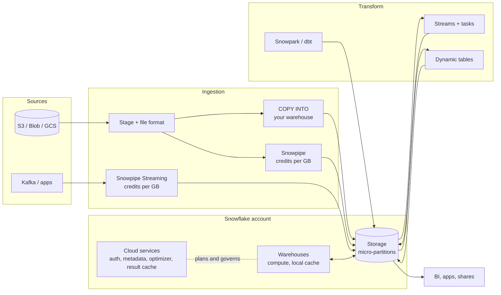
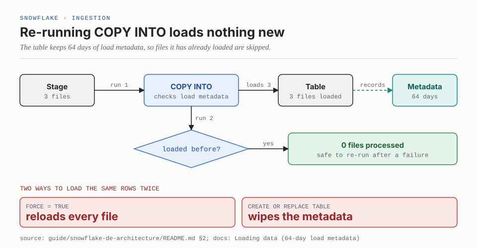
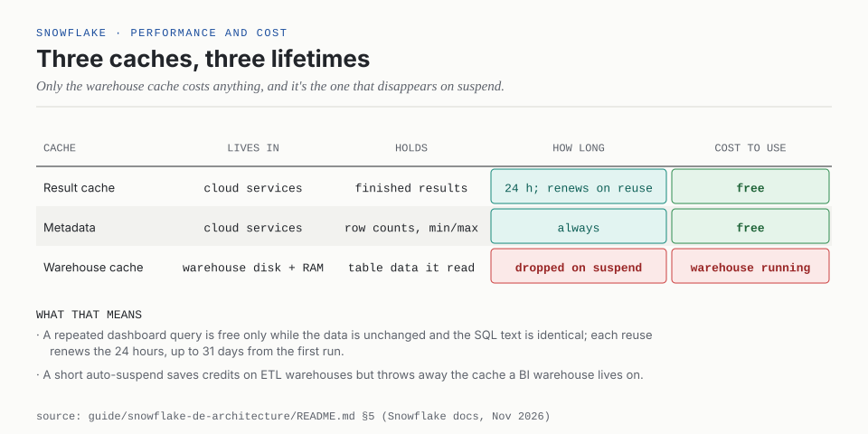

# Snowflake data engineering architecture: a study guide (checked November 2026)

Built from a widely shared one-page infographic, "Snowflake Data Engineering Architecture: Complete
Infographic & Master Cheat Sheet". It covers seven areas: ingestion, the three layers, security
and governance, transformation, performance, sharing, and an end-to-end flow.

**Verdict:** it's a good map. Every component on it exists and sits roughly where the picture
puts it. It is weakest where the money and the recovery promises are. It leaves out which edition
each feature needs, how each feature is billed, and the limits on Time Travel, Fail-safe and
caching. It also misses a few things a data engineer meets in week one, such as Iceberg tables and
the 64-day load history behind `COPY INTO`. The corrections are in
[What the infographic gets wrong or leaves out](#what-the-infographic-gets-wrong-or-leaves-out).

Credit figures below are for **Gen1 standard warehouses**. Gen2 is covered in its own note.

## How to use this

| Step | Time | What |
|---|---|---|
| 1. Read this page | 45 min | One section per area, each ending with the thing people get wrong |
| 2. Run [`lab.sql`](lab.sql) | 60–90 min | In a **trial or sandbox account**, never at work without approval. It uses one X-Small Gen1 warehouse that suspends after 60 seconds, so it should cost well under 1 credit. The last step drops everything it made. It's written from the docs and hasn't been run end to end on a live account yet, so treat a mismatch with an `-- expect:` line as a bug in the lab |
| 3. Drill the [flashcards](flashcards/) | 10 min a day | 45 cards. Download [`deck.html`](flashcards/deck.html) and open it in a browser (Space to flip, 1/2 to grade; it also goes live on the [field guide site](https://venkatesanps.github.io/top30ongithub/snowflake-de-architecture/flashcards/deck.html) when the daily Refresh next deploys), import [`deck.anki.txt`](flashcards/deck.anki.txt) into Anki, or read [`deck.md`](flashcards/deck.md) |
| 4. Answer the [self-check](#self-check-10-scenarios) | 20 min | Ten work scenarios. Answers are folded under each question |

## The whole picture

## 1. The three layers

| Layer | What it does | Billed as |
|---|---|---|
| **Cloud services** | Login, access control, metadata, parsing and optimizing, transactions, the result cache | Cloud-services credits, charged only for the part above 10% of the day's warehouse credits |
| **Compute (warehouses)** | Runs queries, loads and DML. Each warehouse is an independent cluster with its own local cache | Credits per second while running, with a 60-second minimum each time it starts |
| **Storage** | Compressed, columnar, immutable micro-partitions in the cloud provider's object storage | Per TB per month, after compression, plus Time Travel and Fail-safe copies |

Warehouses don't hold data. Two warehouses read the same tables without copying them, which is why
you can give loading, transformation and BI their own warehouses and never have them queue behind
one another.

**Gen1 credits per hour:** X-Small 1, Small 2, Medium 4, Large 8, X-Large 16. Each size doubles the
one before, up to 6X-Large at 512. A multi-cluster warehouse bills each running cluster. A
3X-Large that runs 1 cluster for an hour and 2 the next bills 64 + 128 = 192 credits.

**Gen2 (only if you choose it):** Gen2 standard warehouses use newer hardware. They bill about 35%
more per hour on AWS and GCP and 25% more on Azure; an X-Small is 1.35 credits per hour on AWS.
They usually finish DML-heavy work faster, so the total can go either way. Measure it, don't
assume it.
- **Check what you're getting.** Snowflake's Gen2 page says a new standard warehouse defaults to
  Gen2 wherever Gen2 is available (the general warehouses page still says it isn't the default). Run `SHOW WAREHOUSES` and read the `resource_constraint`
  column. To keep a new warehouse on Gen1, create it with `RESOURCE_CONSTRAINT = STANDARD_GEN_1`,
  as `lab.sql` does.
- **QAS comes along.** A new Gen2 warehouse has the Query Acceleration Service switched on by
  default.

**What people get wrong:** "a bigger warehouse costs more". Not per query, if the query scales:
a Medium that finishes in 1 minute costs the same as an X-Small that takes 4. A bigger warehouse
only wastes money when the query can't use the extra nodes, or when the warehouse sits idle before
it suspends.

## 2. Ingestion

| Method | How it runs | Latency | Billed as | Use it for |
|---|---|---|---|---|
| `COPY INTO <table>` | You run it on your warehouse, usually from a task or an orchestrator | Batch | Warehouse time | Scheduled batch loads, backfills |
| **Snowpipe** (auto-ingest) | Cloud event (S3 → SQS) triggers serverless loads | About a minute | **0.0037 credits per GB** since December 2025. Text files are billed at uncompressed size, and there's no per-file fee | Files arriving all day |
| **Snowpipe Streaming** | Rows sent through the SDK or REST API, no files | Seconds | Credits per uncompressed GB in the high-performance architecture | Kafka, CDC, events |
| External tables | Query files where they sit. Read-only, slower | Query time | Warehouse time | Rarely queried archives |
| **Iceberg tables** (missing from the infographic) | Snowflake tables stored as Apache Iceberg in your bucket | Like a normal table | Warehouse time, plus your own cloud storage | Data other engines must also read |

Supporting objects:
- **Storage integration:** holds the IAM trust to your bucket, so nobody pastes keys into a stage.
- **Stage:** where the files are. Internal or external, and a stage can have a **directory table**
  listing its files.
- **File format:** how to parse the files.

**What people get wrong:** re-running `COPY INTO` doesn't reload files it already loaded.
Snowflake keeps **64 days** of load metadata per table, so a second run says "0 files loaded".
That is a safety feature, not a bug. `FORCE = TRUE` overrides it and duplicates your data, and
`CREATE OR REPLACE TABLE` wipes that metadata, so the next COPY reloads every file still in the stage.

## 3. Storage and objects

- **Micro-partitions** hold 50–500 MB of data each, measured *before* compression; on disk they
  are smaller. They are immutable, so an UPDATE writes new micro-partitions and the old ones
  become Time Travel history.
- **Pruning** skips micro-partitions using the per-column min/max metadata. It's the single
  biggest reason a query is fast or slow.
- **Clustering keys** make pruning work on large tables. Automatic Clustering then keeps them
  clustered, on serverless credits you pay for.
- **Hierarchy:** account → database → schema → objects. The objects are tables (permanent,
  transient, temporary, external, Iceberg, dynamic, hybrid), views (standard, secure,
  materialized), stages, file formats, sequences, streams, tasks, pipes, UDFs and procedures.

**What people get wrong:** "Snowflake has no indexes, so nothing to tune". You tune by loading
data in an order that matches the filters, by choosing clustering keys on very large tables, and
by writing filters that can prune: no functions wrapped around the filter column.

## 4. Transformation and automation

| Tool | You write | Snowflake handles | Pick it when |
|---|---|---|---|
| **Streams + tasks** | A stream (change tracking on a table) and a task that MERGEs from it, on a schedule or a task graph | Offsets: a stream advances only when a DML statement consumes it | You need procedural control, or the logic doesn't fit one query |
| **Dynamic tables** | One SELECT and a `TARGET_LAG` | Dependencies, scheduling, incremental or full refresh | The pipeline is a chain of SELECTs. Set `REFRESH_MODE` explicitly in production |
| **Snowpark / procedures / UDFs** | Python, Java, Scala or SQL code | Runs it on the warehouse | Logic SQL can't express |
| **dbt** (outside Snowflake) | Models and tests in Git | Nothing: dbt sends SQL to Snowflake | Your team already lives in Git and CI |

Tasks run on a warehouse you name, or serverless if you leave it out. Gate a task with
`WHEN SYSTEM$STREAM_HAS_DATA('<stream>')` so it skips the run, and doesn't start a warehouse,
when there's nothing to do.

**What people get wrong:** `TARGET_LAG = '10 minutes'` means the data may be up to 10 minutes
stale. It doesn't mean a refresh every 10 minutes, and it's a target, not a guarantee. Set
intermediate tables to `TARGET_LAG = DOWNSTREAM`, so only the tables people query drive the
schedule.

## 5. Performance and cost

Three caches, often confused:

| Cache | Lives in | Holds | How long | Cost to use |
|---|---|---|---|---|
| **Result cache** | Cloud services | Finished query results | 24 hours; each reuse resets the clock, up to 31 days from the first run | Free: no warehouse needed. Requires the same query text, unchanged data, and no functions like `CURRENT_TIMESTAMP()` |
| **Metadata** | Cloud services | Row counts, min/max per micro-partition | Always | Free: `COUNT(*)` and `MIN`/`MAX` on a whole table often need no warehouse |
| **Warehouse (local) cache** | The warehouse's local disk and memory | Table data it has read | **Dropped when the warehouse suspends** | You pay while the warehouse stays up to keep it |

| Feature | Fixes | Edition | Billed as |
|---|---|---|---|
| Multi-cluster warehouse | Queueing from many concurrent users (not slow single queries) | Enterprise | Each running cluster |
| Query Acceleration Service | Outlier queries with big scans and selective filters | Enterprise | Serverless, capped by `QUERY_ACCELERATION_MAX_SCALE_FACTOR` |
| Search optimization | Point lookups on high-cardinality columns | Enterprise | Storage plus serverless maintenance |
| Materialized views | A repeated aggregation on one table (no joins) | Enterprise | Storage plus serverless maintenance |
| Clustering keys | Pruning on very large tables | All | Serverless re-clustering |

**What people get wrong:** setting auto-suspend to the lowest value everywhere. For a BI
warehouse that runs the same dashboards all day, 60 seconds throws away the warehouse cache
between queries. For ad hoc and ETL warehouses, short is right.

## 6. Protection: Time Travel, Fail-safe, cloning

| Table type | Time Travel | Fail-safe |
|---|---|---|
| Permanent | Default 1 day. Up to 90 days on Enterprise; Standard is 0 or 1 | **7 days**, recoverable only by Snowflake Support |
| Transient | 0 or 1 day | **None** |
| Temporary | 0 or 1 day, ends with the session | **None** |

- **Time Travel:** `SELECT ... AT(OFFSET => -3600)`, `AT(TIMESTAMP => ...)`,
  `BEFORE(STATEMENT => '<query id>')`, and `UNDROP TABLE | SCHEMA | DATABASE`.
- **Zero-copy clone:** shares micro-partitions until either side changes them, so it's instant
  and costs nothing until the copies diverge. You can clone a past state:
  `CREATE TABLE t_fix CLONE t BEFORE(STATEMENT => '...')`.
- **Clone fine print:**
  - Grants aren't copied, unless you add `COPY GRANTS` or you clone a whole database or schema;
    the children of a cloned container keep their grants.
  - Pipes that read from internal stages aren't cloned.
  - External tables aren't cloned.
  - Internal named stages are cloned only with `INCLUDE INTERNAL STAGES`.
  - Load history doesn't come along.

**What people get wrong:** "we have 7 days of Fail-safe, so we're backed up". You can't query or
restore Fail-safe yourself; it's Snowflake's disaster recovery, by support ticket. ETL work tables
should be **transient**, so you don't pay 7 days of Fail-safe storage for data you can rebuild.

## 7. Security and governance

- **RBAC:** privileges go to roles, and roles go to users and to other roles.
  - The system roles: `ACCOUNTADMIN` sits over `SECURITYADMIN` (which sits over `USERADMIN`) and
    over `SYSADMIN`. Every role inherits `PUBLIC`.
  - Create objects as `SYSADMIN`, or as custom roles granted to it, so the admins can still
    see them.
- **Policies:**

  | Policy | What it does | Edition |
  |---|---|---|
  | Masking | Hides column values from some roles | Enterprise |
  | Tag-based masking | Applies a masking policy to every column with a given tag | Enterprise |
  | Row access | Filters rows by role or a mapping table | Enterprise |
  | Aggregation, projection | Limits how data can be queried | Enterprise |
  | Object tags | Label objects and columns (cost centre, PII) | All since May 2025; tag propagation and the Snowsight screens need Enterprise |
  | Data classification | Find PII and set tags | Check your edition |

- **Network and authentication:** network policies (IP allow and block lists), SSO, MFA and
  authentication policies.

**What people get wrong:** granting `ACCOUNTADMIN` as the working role for engineers, or
creating objects with it, so nobody else can manage them. Use it to administer the account and
nothing else.

## 8. Sharing

- **How a share works:**
  - The provider puts objects in a **share**: tables, and secure views and functions.
  - The consumer mounts it as a read-only database.
  - Nothing is copied. The provider pays for storage, and the consumer pays for the compute it
    queries with.
- **Reader accounts:** for consumers without Snowflake. The provider creates and owns the reader
  account and **pays for its compute**, with no limit unless you add a resource monitor.
- **Marketplace:** the same mechanism, listed publicly or privately.
- **Other regions and clouds:** direct shares work within one region and cloud. Elsewhere, use
  listings with cross-cloud auto-fulfillment, or replication.

**What people get wrong:** sharing a plain view. Share **secure views** only, or the consumer
can see your view definition.

## What the infographic gets wrong or leaves out

| The infographic says | What's true | Why it matters |
|---|---|---|
| X-Large is "16+ credits" | Gen1 X-Large is exactly 16 per hour. Bigger sizes go up to 6X-Large (512); Gen2 costs more per hour | Budgeting |
| Multi-cluster "auto scale" for anyone | Multi-cluster warehouses need **Enterprise** | Standard accounts can't use them |
| Time Travel "0–90 days, default 1 day" | 90 days needs **Enterprise**. Transient and temporary tables get 0 or 1 day | Recovery promises |
| Fail-safe: "data recovery by Snowflake" | Right, but only for **permanent** tables, and only through Support | Don't count it as your backup |
| Result cache "(24 hours)" | 24 hours, renewed on reuse up to 31 days. Needs the same query text and unchanged data | Why a dashboard is sometimes instant and sometimes not |
| Warehouse cache "caches data in warehouse memory" | Local disk and memory, **dropped on suspend** | The auto-suspend trade-off |
| Search optimization "secondary index" | A maintained search access path, not an index you query. Enterprise, with ongoing cost | Cost |
| Query acceleration "on large tables" | Offloads parts of eligible scans to serverless compute. Enterprise. On by default on new Gen2 warehouses | Unexpected serverless spend |
| Snowpipe: "serverless, near real-time" | Also: billed **0.0037 credits per GB** since December 2025, with no per-file charge | It's now cheap to estimate |
| Dynamic tables: "automatically maintained" | Maintained to a `TARGET_LAG` (a staleness target), with incremental or full refresh | Freshness SLAs |
| Ingestion options list | No **Iceberg tables**, and nothing on the 64-day load metadata that stops `COPY INTO` reloading files | Open formats and idempotent loads |
| Sharing: "consumers query data in their own account" | Consumers pay their own compute. **Reader accounts' compute is billed to the provider** | Who pays |
| Zero-copy clone | Doesn't copy grants, external tables, pipes on internal stages, or load history | Surprises when cloning PROD to DEV |
| Editions | Not mentioned. Masking, row access, aggregation and projection policies, materialized views, search optimization, QAS and multi-cluster are all **Enterprise** | Check before you design around a feature |

## Self-check: 10 scenarios

1. A nightly COPY INTO is re-run after a failure and loads 0 rows. Bug?

No. The files loaded in the first run are in the table's 64-day load metadata, so they're skipped.
Check `COPY_HISTORY` to confirm. Use `FORCE = TRUE` only if you truncated the table first.

2. Fifty analysts hit one Medium warehouse at 9am and queries queue. Bigger size or more clusters?

More clusters: a multi-cluster warehouse (Enterprise) with `MAX_CLUSTER_COUNT` 2–4. A bigger size
makes single queries faster; it doesn't add concurrency slots in proportion to its cost.

3. Someone ran DELETE without a WHERE an hour ago on a permanent table. Fastest fix?

`CREATE TABLE t_restored CLONE t BEFORE(STATEMENT => '<delete query id>')`, check it, then swap
the tables. Or insert the missing rows back from `t AT(OFFSET => -3600)`.

4. Your staging tables are rebuilt every run. What table type, and why?

Transient. You can rebuild the data, so you don't need Fail-safe, and you stop paying 7 days of
Fail-safe storage on every rewrite.

5. A dashboard's query runs in 20 ms in the morning and 40 s after lunch. Nothing changed in the SQL. Why?

The morning hit the result cache. After lunch the underlying table had been loaded (the data
changed), so the cache entry was no longer valid and the query ran on the warehouse. The warehouse
may also have suspended and lost its local cache.

6. Files land in S3 every few minutes all day. COPY on a schedule, or Snowpipe?

Snowpipe with auto-ingest: no warehouse kept running, billed per GB, and latency of about a
minute. A scheduled COPY would start a warehouse many times a day, with a 60-second minimum
each time.

7. A three-step SELECT pipeline needs data no more than 15 minutes old. Streams and tasks, or dynamic tables?

Dynamic tables. The final table gets `TARGET_LAG = '15 minutes'`, the intermediate ones
`DOWNSTREAM`, and `REFRESH_MODE` is set explicitly. Streams and tasks are for logic that doesn't
fit SELECTs.

8. You clone PROD to DEV. Engineers can't see any tables. Why?

If you cloned tables one by one, grants weren't copied. Grant them again, or use `COPY GRANTS`.
If you cloned the database, the child objects kept their grants, but the database itself didn't,
so grant `USAGE` on the new database.

9. A partner without Snowflake needs your data. What do you set up first, and what's the cost risk?

A reader account with a share of secure views. Its compute is billed to you, so put a resource
monitor on its warehouse before you hand over the login.

10. A new warehouse bills 1.35 credits an hour at X-Small. What happened?

It was created as Gen2 (AWS), which is now the default in regions that have it. Check
`SHOW WAREHOUSES` → `resource_constraint`. Recreate or alter it with
`RESOURCE_CONSTRAINT = STANDARD_GEN_1` if your team standardizes on Gen1, or benchmark both.

## Sources

- Warehouses and Gen1 credits:
  [Overview of warehouses](https://docs.snowflake.com/en/user-guide/warehouses-overview).
- Gen2 warehouses: [Gen2 standard warehouses](https://docs.snowflake.com/en/user-guide/warehouses-gen2).
  Rates are in the
  [Service Consumption Table](https://www.snowflake.com/legal-files/CreditConsumptionTable.pdf).
- Caching: [Persisted query results](https://docs.snowflake.com/en/user-guide/querying-persisted-results)
  and [Optimizing the warehouse cache](https://docs.snowflake.com/en/user-guide/performance-query-warehouse-cache).
- Storage: [Micro-partitions & data clustering](https://docs.snowflake.com/en/user-guide/tables-clustering-micropartitions).
- Time Travel and Fail-safe: [Time Travel & Fail-safe](https://docs.snowflake.com/en/user-guide/data-availability)
  and [their storage costs](https://docs.snowflake.com/en/user-guide/data-cdp-storage-costs).
- Cloning: [Cloning considerations](https://docs.snowflake.com/en/user-guide/object-clone).
- Loading: [Loading data](https://docs.snowflake.com/en/user-guide/data-load-considerations-load)
  (the 64-day load metadata).
- Cloud-services billing: [Understanding compute cost](https://docs.snowflake.com/en/user-guide/cost-understanding-compute)
  (the 10% adjustment).
- Snowpipe: [Snowpipe costs](https://docs.snowflake.com/en/user-guide/data-load-snowpipe-billing)
  and the [Snowpipe Streaming high-performance architecture](https://docs.snowflake.com/en/user-guide/snowpipe-streaming-high-performance-overview).
- Dynamic tables: [Target lag](https://docs.snowflake.com/en/user-guide/dynamic-tables-target-lag)
  and [refresh modes](https://docs.snowflake.com/en/user-guide/dynamic-tables-refresh).
- Performance features: [Query Acceleration Service](https://docs.snowflake.com/en/user-guide/query-acceleration-service)
  and [Optimizing storage for performance](https://docs.snowflake.com/en/user-guide/performance-query-storage).
- Sharing: [Reader accounts](https://docs.snowflake.com/en/user-guide/data-sharing-reader-create).
- Editions: [Snowflake editions](https://docs.snowflake.com/en/user-guide/intro-editions).

The two figures are built with the `explainer-figures` skill in `top30-learn`; their scripts are
in `plugins/top30-learn/skills/explainer-figures/examples/`.

To see how a single query moves through these layers, read the companion explainer
[How a Snowflake query runs](../snowflake-query-execution/). To review your own SQL, use the
`snowflake-query-advisor` skill in `top30-data`.
