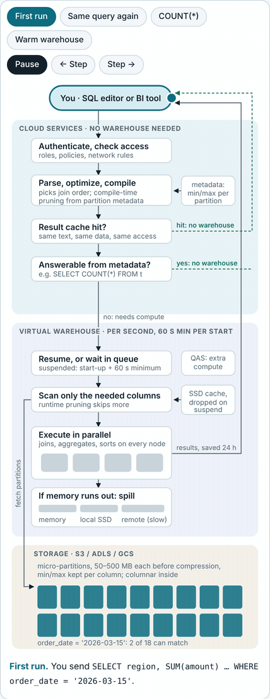

# How a Snowflake query runs

An animated, phone-friendly explainer of what happens between pressing Run and getting rows back:
cloud services, the result cache, metadata-only answers, warehouse resume and queueing,
micro-partition pruning, parallel execution and spilling, and what each step costs.

- Open `index.html` in a browser (one self-contained page). Pick a scenario: first run, the same
  query again, `COUNT(*)`, a warm warehouse. Each one takes a different route through the map.
- Published with the field guide at
  https://venkatesanps.github.io/top30ongithub/snowflake-query-execution/ (after the next daily refresh).
- `?static` shows the finished picture with no controls (used for `infographic.png`); the page
  respects reduced motion.

[Full infographic (PNG)](infographic.png)

## What changed from the community infographic

A rework of a community infographic by Abhisek Sahu, which is a good one-page summary. Some of
what follows it simplified on purpose. Checked against Snowflake's documentation on 19 Nov 2026;
the facts and their sources are in
[`plugins/top30-data/skills/snowflake-query-advisor/references/execution-facts.md`](../../plugins/top30-data/skills/snowflake-query-advisor/references/execution-facts.md).

1. **Pruning.** Shown by micro-partition min/max ranges (50-500 MB units) rather than monthly
   buckets, so you can see why clustering decides how much gets skipped.
2. **Two pruning passes.** Compile time in cloud services (`EXPLAIN` shows it without a
   warehouse), then runtime pruning such as join filters in the warehouse.
3. **Metadata-only answers.** `SELECT COUNT(*)` and similar queries skip the warehouse.
4. **The full result-reuse conditions.** Privileges on every table, no per-run functions such as
   RANDOM or UUID_STRING, no external functions, no hybrid tables. Even then, reuse is never
   guaranteed.
5. **Gen2.** It's the default for new warehouses and costs 1.35x (AWS, GCP) or 1.25x (Azure) per
   hour. It isn't offered at 5XL or 6XL.
6. **Cloud services billing.** Billed only above 10% of each day's warehouse credits.
7. **Resume and queueing.** A suspended warehouse adds start-up time and a 60-second minimum; a
   busy one makes the query wait.
8. **Query Acceleration Service.** Added, with its scale-factor cost cap.

To review a query of your own, use the `snowflake-query-advisor` skill in the `top30-data` plugin.
