# Merchant Services: End-to-End Payment Data & Process Flow

An onboarding guide for developers and data engineers joining a merchant services (card acquiring) technology team. It follows a card payment from the merchant's terminal, website or phone through authorization, settlement, funding, fees and chargebacks to the reports merchants pull from the portal. It ends with the merchant hierarchy that every one of those steps hangs off.

*Compiled November 2026 from public sources, which are linked in each section. Points marked **Confirm internally** are where public material stops and internal runbooks and data dictionaries take over. Diagrams are written in Mermaid and render on GitHub.*

## Contents

**[Part 1: End-to-end payment flow](#part-1-end-to-end-payment-flow)**

- [Purpose and the five parties](#purpose-and-the-five-parties)
- [Big picture](#big-picture)
- [Glossary of terms and IDs](#glossary-of-terms-and-ids)
- [Layer 1: Entry points and front-end hosts](#layer-1-entry-points-and-front-end-hosts)
- [Layer 2: Authorization and switching](#layer-2-authorization-and-switching)
- [Layer 3: Capture, batching and settlement](#layer-3-capture-batching-and-settlement)
- [Layer 4: Funding](#layer-4-funding)
- [Layer 5: Fees and billing](#layer-5-fees-and-billing)
- [Layer 6: Chargebacks and disputes](#layer-6-chargebacks-and-disputes)
- [Layer 7: Reporting and the merchant portal](#layer-7-reporting-and-the-merchant-portal)
- [Message standards: ISO 8583 and file formats](#message-standards-iso-8583-and-file-formats)
- [Card network mechanics](#card-network-mechanics)
- [Payment services beyond credit cards](#payment-services-beyond-credit-cards)
- [Industry roles: who does what](#industry-roles-who-does-what)
- [Across providers: same layers, different names](#across-providers-same-layers-different-names)
- [Data model view](#data-model-view)
- [Worked example: one $100 online order](#worked-example-one-100-online-order)
- [Onboarding checklist and references](#onboarding-checklist-and-references)

**[Part 2: Card transaction scenarios](#part-2-card-transaction-scenarios)**

- [What Chase sells for each channel](#what-chase-sells-for-each-channel)
- [Scenario 1: In store](#scenario-1-in-store) · [Scenario 2: On your website](#scenario-2-on-your-website) · [Scenario 3: On the go](#scenario-3-on-the-go) · [Scenario 4: Invoices, links, virtual terminal, recurring](#scenario-4-invoices-payment-links-virtual-terminal-and-recurring-billing)
- [Side by side](#side-by-side)
- [What the acquirer does, and how each scenario affects it](#what-the-acquirer-does-and-how-each-scenario-affects-it)

**[Part 3: Fee dictionary](#part-3-fee-dictionary)**

- [How to read a fee line](#how-to-read-a-fee-line)
- [Where every fee dollar goes](#where-every-fee-dollar-goes)
- [Interchange, discount rate and qualification](#interchange-discount-rate-and-qualification)
- [Mastercard fees](#mastercard-fees) · [Visa fees](#visa-fees) · [Discover fees](#discover-fees)
- [Chase account and processing fees](#chase-account-and-processing-fees)
- [Penalty fees as data-quality signals](#penalty-fees-as-data-quality-signals)

**[Part 4: Merchant hierarchy](#part-4-merchant-hierarchy)**

- [The tree at a glance](#the-tree-at-a-glance)
- [Each level, top to leaf](#each-level-top-to-leaf): [PE](#processing-entity-pe) · [CO](#company-co) · [BU](#business-unit-bu) · [TD](#transaction-division-td)
- [Funding, reporting groups and tax ID](#funding-reporting-groups-and-tax-id)
- [Follow one sale up the tree](#follow-one-sale-up-the-tree)
- [Where each process touches the hierarchy](#where-each-process-touches-the-hierarchy)
- [Older hierarchies you will still meet](#older-hierarchies-you-will-still-meet)
- [How the hierarchy shows up in merchant reports](#how-the-hierarchy-shows-up-in-merchant-reports)
- [Modelling the hierarchy in the warehouse](#modelling-the-hierarchy-in-the-warehouse)

---

# Part 1: End-to-end payment flow

## Purpose and the five parties

Every card payment Merchant Services touches moves through the same seven layers: entry, authorization, capture and settlement, funding, fees, chargebacks, and reporting. This part walks a new developer through each layer, the systems that run it, and the data each one produces.

Read it top to bottom once, then use the glossary and data-model sections as a reference.

| Party | Role | Example |
| --- | --- | --- |
| Cardholder | Pays with a card or wallet | A shopper at checkout |
| Merchant | Accepts the card; the acquirer's client | An online retailer or a store chain |
| Acquirer / processor | Authorizes, settles and funds the merchant; carries chargeback liability | Chase Merchant Services (legal entity Paymentech, LLC) |
| Card network | Routes auths, clears and settles between acquirer and issuer; sets interchange and rules | Visa, Mastercard, Discover, Amex, PIN-debit networks |
| Issuer | Holds the cardholder's account; approves or declines; starts disputes | The cardholder's bank |

Two money flows run in opposite directions. The sale amount flows issuer → network → Chase → merchant. Fees flow the other way: the merchant pays Chase, and Chase pays interchange to issuers and assessments to networks.

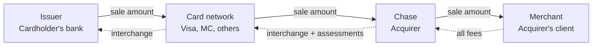

Solid arrows carry the sale amount toward the merchant; dotted arrows carry fees back toward the issuer.

Amex and some other brands can be **conveyed** rather than **settled**: Chase passes the transaction to that brand, which funds the merchant directly. JPMorgan's reporting glossary marks every record as Settled (S) or Conveyed (C) for this reason.

## Big picture

A payment enters through a terminal, Orbital or a direct host link, gets authorized in real time through a host and the switch, then settles, funds and reports in batch.

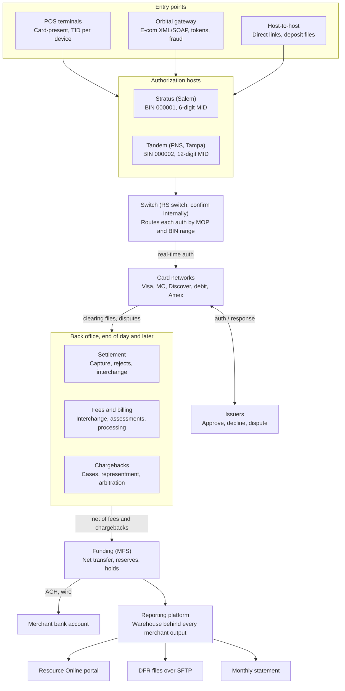

The top half (entry to issuer) runs in about a second per transaction. Everything from the back office down runs on daily and monthly cycles, which is where most data and reconciliation work lives.

## Glossary of terms and IDs

Most data bugs in merchant services come from joining on the wrong ID or the wrong level of the merchant hierarchy. Learn these first.

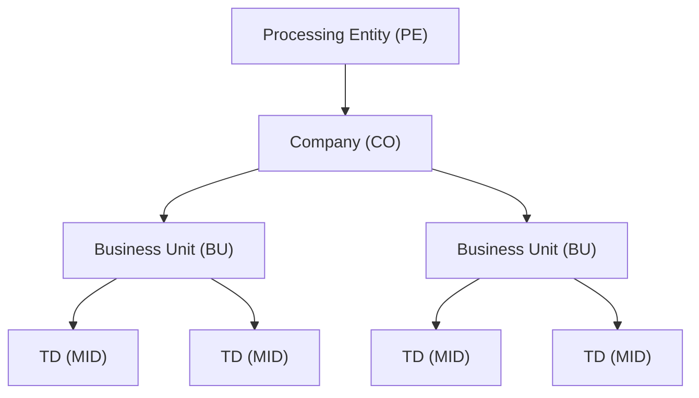

Transactions post at the Transaction Division (TD); reports roll up the tree. Fees and funding can be set at higher levels. [Part 4](#part-4-merchant-hierarchy) explains every level in detail.

| Term | Meaning | Why it matters to a developer |
| --- | --- | --- |
| Merchant hierarchy | Processing Entity (PE) → Company (CO) → Business Unit (BU) → Transaction Division (TD) | Reports roll up along this tree; fees and funding can be set at different levels |
| Transaction Division (TD) / MID | The lowest merchant account that transactions post to | The main join key across auth, deposit, fee and chargeback data |
| Salem MID | 6-digit merchant number on the Stratus (Salem) host; equals the Salem TD number | Orbital requests on Salem carry this |
| PNS MID | 12-digit merchant number on the Tandem (PNS / Tampa) host | Different length and format from Salem; normalize before joining |
| BIN 000001 / 000002 | Orbital's routing value: 000001 = Salem / Stratus, 000002 = PNS / Tampa | Tells you which host a gateway transaction went to |
| TID | Terminal ID; one per device or station | Batches are often per terminal in retail |
| Order ID | Merchant's own reference, sent on the auth and deposit | Merchant-facing key; not guaranteed unique |
| TxRefNum | Orbital's transaction reference number returned on the auth | Gateway-side key for follow-on capture, void and refund |
| Action code | Merchant-supplied code for the transaction type (e.g. AU = authorize only, DP = unconditional deposit, AR = auth reversal, RF = refund) | Drives how a record is classified; grouped as DEPOSITS, AUTHORIZATIONS or NON-FINANCIAL |
| MOP | Method of payment (VI, MC, AX, DI, EC for e-check, PIN debit networks) | Decides network, interchange and settled vs conveyed |
| Batch | Group of captured transactions submitted together for settlement | Unit of the settlement file and of many rejects |
| Settled vs conveyed | Settled = Chase funds the merchant; conveyed = passed to a brand such as Amex that funds directly | Conveyed volume is reported but not in Chase funding |
| Financial vs non-financial | Whether a record moves money for the merchant (FIN / NON) | The data-level version of transaction vs non-transaction events |
| Interchange qualification / downgrade | Which interchange rate a transaction earned; a downgrade reason code explains a worse rate | Biggest driver of fee questions from merchants |
| Reserve | Funds Chase holds back against chargeback or credit risk | Shows up as funding adjustments, not transactions |
| PDE | Paymentech data exchange reports, e.g. PDE-0017 Chargeback Activity | Report codes you will see in file names and portal menus |

Salem / PNS MID lengths and BIN values are from public gateway integration docs ([Zuora](https://docs.zuora.com/en/zuora-payments/manage-payment-gateway-integrations-and-payment-methods/set-up-payment-gateway-integrations/chase-orbital-payment-gateway-integration/set-up-and-configure-a-chase-orbital-payment-gateway-instance/configuration-fields-for-chase-orbital-payment-gateway-integration)). The hierarchy levels, action codes and financial flags are from JPMorgan's [reporting attribute glossary](https://developer.payments.jpmorgan.com/docs/commerce/optimization-protection/capabilities/reporting/attribute-glossary).

## Layer 1: Entry points and front-end hosts

A transaction enters through one of three doors, and every door lands on one of two authorization hosts: Stratus (Salem) or Tandem (PNS). Which host a merchant is boarded on decides its MID format, its message specs and much of its downstream data shape.

**The three doors**

- **POS terminals and integrated POS** — card-present retail. Devices dial or connect over IP to a host, usually with a TID per station.
- **Orbital gateway** — Chase's XML/SOAP internet gateway for e-commerce, call centres and software partners. It authenticates the merchant, then forwards to Salem (BIN 000001) or PNS (BIN 000002). It also handles non-financial services: tokens and customer profiles, fraud scoring, account updater.
- **Host-to-host** — large merchants and processors connect straight to a host using its native message format and send batch deposit files.

**The two hosts**

| | Stratus (Salem) | Tandem (PNS, Tampa) |
| --- | --- | --- |
| Origin | Paymentech's Salem, NH platform | Paymentech Network Services (ex-Gensar), Tampa |
| Typical merchants | Card-not-present and larger merchants | Retail and smaller merchants |
| Orbital BIN | 000001 | 000002 |
| MID format | 6 digits (TD number) | 12 digits |
| Hardware heritage | Stratus fault-tolerant servers | Tandem / HP NonStop |

Despite the names, both hosts run in both Tampa and Salem data centres for resilience. Merchants are assigned to a platform when boarded.

**What this layer produces:** the authorization request and response, plus gateway logs (TxRefNum, order ID, AVS/CVV results, fraud score). Orbital also creates non-financial events such as profile adds and token requests.

**Confirm internally:** which merchants are still on each host, any migration plans between them, and where host-level auth logs land in the data platform.

Sources: platform split from Chase's description quoted by [Abila / netFORUM](https://nfesupport.zendesk.com/hc/en-us/articles/10638899417101); BIN mapping from [Stax Bill](https://support.staxbill.com/hc/en-us/articles/8374450804755-Setting-Up-the-Chase-Paymentech-Gateway).

### Front-end detail from Chase's Resource Online guides

The Tandem (PNS) front end runs in three modes, and the mode decides who holds the batch and which clock the timestamps use.

| System | What it does | Data note |
| --- | --- | --- |
| HCS, Host Capture System | The host holds the open batch and closes it | Times are Eastern; the host capture "toggle date" runs 5 a.m. to 5 a.m. ET |
| TCS, Terminal Capture System | The terminal holds the batch and uploads it | Times are the device's local time; upload number and status are tracked |
| TAS, Terminal Authorization System | Authorization only; settlement can happen through another processor | Auth records with no matching Chase deposit |

- **Two merchant numbers on the front end.** The PNS Merchant # is used for authorization and capture. The Reporting Merchant # identifies the outlet in reporting. Debit adjustments and debit chargebacks key on PNS Merchant # plus the network trace number, not the TD.
- **Three hierarchies exist.** Front end: Client → Division → Merchant location. Chase back end: Company → Transaction Division, with up to four non-processing parent companies above. Merchants settling on an FDMS back end use Business → Bank → Agent → Corporate → Chain → Merchant.
- **Suspense batches.** A batch that fails edit checks at upload is held in suspense and not settled. It shows on the Suspense Batch Summary report until fixed.
- **Capture vs direct, per brand.** For Amex, Discover, Diners and JCB the merchant record carries C (capture: settles through the back end) or D (direct: sent in a settlement file to that brand). This flag is where settled vs conveyed starts.
- **Record and transaction types.** Record types are EDC, Auth, Reversal, Error, Pass Thru and Merch Control. Transaction types include Sale, Return, Prior, Auth Only, Cash Advance and Balance Inquiry.
- **Durbin flag.** A Fee Program Indicator marks each debit BIN as regulated or exempt.

These guides date from 2012 to 2014, so treat names and screens as a starting point. Sources: [Resource Online Reports Guide](https://merchantservices.chase.com/content/dam/chase/merchant-services/support/us/documents/resource_online_reports_guide.pdf), [Resource Online PRO User Guide](https://merchantservices.chase.com/content/dam/chase/merchant-services/support/us/documents/resource_online_pro_user_guide.pdf).

## Layer 2: Authorization and switching

Authorization is the real-time question "will the issuer stand behind this amount?", answered in about a second. No money moves; the issuer only places a hold on the cardholder's available credit.

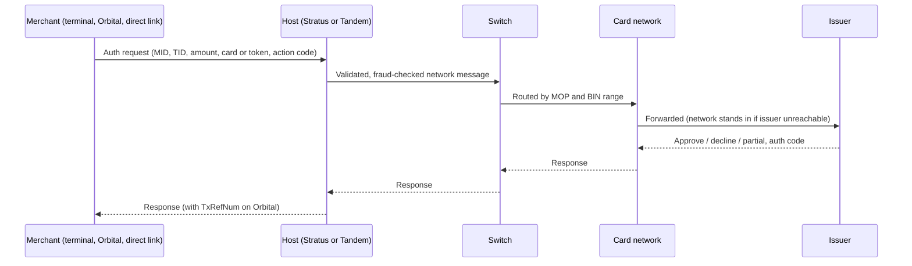

1. The terminal, Orbital or host-to-host client sends an auth request: MID, TID, amount, card data or token, entry mode, AVS/CVV data, action code.
2. The host (Stratus or Tandem) validates the merchant, applies merchant-level rules and fraud checks, and builds the network message.
3. The **switch** routes the message by MOP and BIN range: Visa, Mastercard and Discover over their networks; PIN debit to networks such as STAR, NYCE, Pulse or Accel, with least-cost routing where allowed; Amex and other conveyed brands to the brand.
4. The network forwards to the issuer, which approves, declines or partially approves, and returns an auth code.
5. The response returns along the same path. The host logs it, and the gateway returns it to the merchant with its TxRefNum.

**Variants you will see in the data:** authorize-only (capture later), auth-and-capture in one step, pre-auth vs final auth, incremental auths (hotels, car rental), auth reversals, $0 verification, refund authorizations, and stand-in approvals when an issuer is unreachable.

**Why the auth record matters later:** interchange qualification checks that a deposit has a matching, timely auth with the right data (for example ACI, AVS, 3-D Secure). Missing or stale auths are a common downgrade reason.

**Confirm internally:** what "RS switch" refers to in your stack. Public sources don't describe it. Ask whether it is the internal network-routing switch between the hosts and the card networks, which hosts feed it, and where its message logs are stored.

## Layer 3: Capture, batching and settlement

Settlement turns approved authorizations into real money claims. The merchant submits captured transactions, the back end prices and qualifies them, and Chase clears them with the networks, usually once a day.

1. **Capture.** The merchant marks auths for capture (Orbital mark-for-capture) or sends deposits. Retail may be terminal capture (the device holds the batch) or host capture (the host holds it).
2. **Batch close.** At end of day, or on a schedule, the batch closes. Host-to-host merchants send a deposit file instead.
3. **Edit and reject.** The back end validates each item: merchant setup, card data, duplicate checks, amount limits. Failing items become **rejects** that the merchant must fix and resubmit.
4. **Interchange qualification.** Each deposit is matched to its auth and checked against network programs. It earns a rate or gets a downgrade reason code (for example "Transaction greater than 2 days old" or "No Level 2 data").
5. **Clearing.** Settled brands go out to Visa, Mastercard and Discover in clearing files. Conveyed brands such as Amex are passed on to the brand.
6. **Network settlement.** The networks net amounts between acquirers and issuers and move funds to Chase, less interchange and assessments.

**Records this layer produces:** settled sales, settled refunds, conveyed sales and refunds, rejects, and interchange qualification and downgrade results. In JPMorgan reporting these appear as category codes SALE and REF, with fee service codes such as LC130 (settled sales) and LC132 (conveyed sales).

**Typical reports:** ACT-0010 Deposit Detail and ANS-0013 Interchange Qualification.

Category and service codes are from the JPMorgan [reporting attribute glossary](https://developer.payments.jpmorgan.com/docs/commerce/optimization-protection/capabilities/reporting/attribute-glossary); report codes from [Optimized Payments](https://docs.optimizedpayments.com/harmonize/chase).

## Layer 4: Funding

Funding is the money Chase actually sends to the merchant's bank account. It is a net figure: settled deposits minus refunds, chargebacks, fees (if billed daily), reserve holds and adjustments.

```math
\text{Funded} = \text{Settled sales} - \text{Refunds} - \text{Chargebacks} \pm \text{Adjustments} - \text{Fees (if netted)} \pm \text{Reserve movements}
```

**How it works**

- The merchant funding system (MFS) keeps a running balance per funding entity and creates a funds transfer on the merchant's schedule.
- Funds transfer frequency is Daily, Weekly, Monthly or Manual. Transfer methods include ACH, same-day ACH, wire, book transfer to a Chase account, and EFT, SEPA or BACS outside the US.
- Next-business-day funding is offered to eligible merchants who deposit into a Chase business checking account, with an 11:59 pm ET cutoff for settled transactions.
- Transfer status is tracked as Effective, Pending, On Hold or Rejected (EFEFT, PENDFT, HOLDFT, REJFT).
- Amex and other conveyed volume is not in Chase funding; the brand pays the merchant directly.

**Non-transaction events here:** reserve set-up, top-up and release; funding holds; balance transfers between merchant accounts (service code AD401); rejected ACH and re-sends; bank-account changes.

**What a merchant sees:** the Funding Summary on the statement shows each funding date with gross amount, charges and fees, chargebacks and reversals, financial adjustments, and amount transferred.

**Confirm internally:** the funding-entity level (which hierarchy level funds), cutoff times per host, and the MFS tables that hold balances and transfers.

Sources: [JPMorgan reporting attribute glossary](https://developer.payments.jpmorgan.com/docs/commerce/optimization-protection/capabilities/reporting/attribute-glossary), [Chase statements and fees help](https://www.chase.com/business/support/payments/statements-and-fees), [iQmetrix / Chase funding terms](https://iqmetrix.com/partners/chase).

## Layer 5: Fees and billing

Every fee is either tied to a transaction (priced per item or per dollar) or tied to the merchant account (monthly, periodic or event-based). JPMorgan's own reporting splits them this way, with a dedicated "Paymentech Non-Transaction Fees" subcategory (code NON).

Every individual fee name, its trigger and how to check it is in [Part 3: Fee dictionary](#part-3-fee-dictionary).

| Fee group | Category / subcategory code | Transaction or non-transaction | Examples |
| --- | --- | --- | --- |
| Interchange | IA / IC | Transaction | Issuer's rate by card type, entry mode and qualification |
| Assessments | IA / AS | Transaction | Visa, Mastercard and Discover network fees |
| Authorization fees | PFEE / AUTH | Transaction | Per-auth fee, 3rd-party auth fees |
| Deposit fees | PFEE / DEP | Transaction | Settled deposit fee (LC100), conveyed deposit fee (LC101) |
| Chargeback fees | CB | Transaction (per case) | Fee per chargeback received |
| Monthly fees | PFEE / MONTH | Non-transaction | Statement, service, minimum shortfall |
| Non-transaction fees | PFEE / NON | Non-transaction | PCI, gateway, account maintenance |
| Equipment fees | PFEE / EQUIP | Non-transaction | Terminal rental |
| Funds transfer fees | PFEE / FT | Non-transaction | Wire or ACH transfer fees |

**Pricing models:** interchange pass-through (interchange + assessments at cost, plus a Chase markup) and tiered or flat-rate pricing for small merchants.

**Billing cycle decides where a fee lands.** Merchants are billed daily, weekly or monthly. Daily-billed fees net out of that day's funding; monthly fees post as one debit. The same fee can therefore look transactional in one merchant's data and not in another's.

**Statement generation:** the monthly statement summarizes deposits, funding, chargebacks and reversals, financial adjustments, and charges and fees per hierarchy level. It is published to the portal around the 1st or 2nd of the month.

Codes from the JPMorgan [reporting attribute glossary](https://developer.payments.jpmorgan.com/docs/commerce/optimization-protection/capabilities/reporting/attribute-glossary); billing cycles from the [Merchant Statement FAQ](https://commercesolutions.jpmorganchase.com/faq_merchant_statements.html); statement timing from [Chase support](https://www.chase.com/business/support/payments/statements-and-fees).

### Pricing plans and network fee names

Chase's statement help names four pricing plans. The plan code is printed at the bottom left of the statement.

| Plan | How the fee is set |
| --- | --- |
| Swiped / Keyed (DRSK) | Lower rate for tap, insert or swipe; higher rate for manual entry, online and phone orders |
| Interchange Pass-Through (IPT or IC+) | Interchange at cost per transaction, plus a processing fee (fixed, percentage or both) |
| Flat Rate (DNBB) | One rate for credit and one for debit |
| Tiered | Qualified, mid-qualified and non-qualified rates by transaction category |

**Fee arithmetic on the statement.** A percentage fee is Sales Amount × Rate. A per-item fee is Items × Item Charge. Both pairs of columns appear in Charges & Fees, so a fee line can be recomputed.

**Monthly vs daily billing.** With monthly billing the merchant receives full daily deposits and fees are collected at month end, for a 0.03% monthly billing fee. Daily billing nets fees from each day's funding.

**Network pass-through fees you will see as line items**

- **Mastercard:** NABU (Network Access and Brand Usage), Merchant Location Fee, AVS access fees, Account Status, Processing Integrity, Cross-Border Assessment.
- **Visa:** Network Acquirer Processing Fee (NAPF), Fixed Acquirer Network Fee (FANF), Misuse of Authorization, Zero Floor Limit, Transaction Integrity, Zero-dollar Account Verification, International Service Assessment.
- **Discover:** Data Usage, International Service Fee, International Processing Fee.

Some of these punish missing follow-up events. Mastercard's Processing Integrity fee applies when an unused authorization isn't reversed within 24 hours (card-present) or 72 hours (card-not-present). In reporting data the Visa equivalents show up as action codes MU (misuse of authorization) and ZM (zero floor limit).

Interchange rates are set by the brands and can change twice a year, in April and October.

Source: [Chase statements and fees help](https://www.chase.com/business/support/payments/statements-and-fees).

## Layer 6: Chargebacks and disputes

A chargeback is the issuer pulling money back from Chase, which Chase then debits from the merchant. Each stage is tied to the original transaction, but the money posts as merchant-level funding adjustments, days or weeks later.

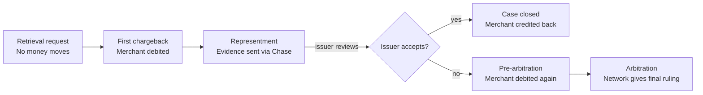

A case stops at whichever stage one side accepts: the merchant takes the debit, or the issuer accepts the representment.

| Stage | Who acts | Money movement for the merchant | Reporting codes |
| --- | --- | --- | --- |
| Retrieval / copy request | Issuer asks for proof of the sale | None | Fulfilment AUTO (auto-fulfilled) or RESP (merchant must respond) |
| First chargeback | Issuer disputes with a reason code | Debit of the disputed amount | Category CB; service AD720 (CBs from current balance); dispute usage code 1, or 9 for Visa Claims Resolution |
| Representment | Merchant sends evidence through Chase | Credit back if accepted | AD726; dispute category REPR or PARREP (partial) |
| Second chargeback / pre-arbitration | Issuer rejects the representment | Debit again | Usage code 2 (3 = Mastercard second chargeback); IPA_INF / IPA_REC / IPA_DEC for incoming pre-arb |
| Arbitration | Network decides | Final debit or credit | AD732 (incoming arbitration) |
| Return to merchant | Chase can't represent; liability stays with the merchant | Debit stands | RTM / PARRTM |

**Non-transaction side of chargebacks:** chargeback fees billed monthly, network excessive-chargeback programme fines, chargeback-ratio monitoring, and reserve increases triggered by dispute risk.

**Data tips**

- Link every chargeback to its original deposit by case or sequence number and the original transaction reference. Expect partial amounts and several cycles per case.
- Inventory reports track Beginning, Received, Represented, Returned and Ending counts per period (BEGINV, RECD, ENDINV).
- Reason codes differ by network and change over time. Keep them in a reference table, not hard-coded.

**Typical reports:** PDE-0017 Chargeback Activity, PDE-0039 Chargebacks Won/Lost Summary, ACT-72 Chargeback Summary. Merchants work cases online in the Chargeback Management tool under Recon Solution.

Sources: [JPMorgan reporting attribute glossary](https://developer.payments.jpmorgan.com/docs/commerce/optimization-protection/capabilities/reporting/attribute-glossary), [Online Retrieval Request & Chargeback Processing Guide](https://merchantservices.chase.com/content/dam/chase/merchant-services/support/us/documents/online-chargeback-management-guide.pdf).

### How Chase's chargeback system works day to day

Chase's own guide (revised March 2022) shows that many cases never need merchant action: the system decides first, then an analyst, then the merchant.

1. **Match.** An incoming chargeback is matched to the original sale in the Transaction History database and a case is opened.
2. **Automatic triage.** The case is auto-represented (stored data refutes it), auto-returned to merchant (the chargeback is valid), or queued for a Chase chargeback analyst.
3. **Analyst review.** The analyst represents it, asks the merchant for information, or returns it to the merchant (RTM).
4. **Merchant decision.** In Chargeback Management the merchant can Accept, Challenge (upload documents, also called recourse) or Submit Info.
5. **Exception processing.** Pre-arbitration, arbitration, good-faith collection and pre-compliance are handled by senior analysts outside the normal queue. Their settlements carry reason code 98.

**Rules that shape the data**

- Visa, Mastercard and Discover allow the acquirer only one representment.
- Mastercard has a second chargeback. Visa, Discover and the debit networks do not; an incoming pre-arbitration or arbitration takes its place.
- Partial representment splits one case into a represented amount and an amount returned to the merchant.
- Debit has two kinds of record: merchant-initiated adjustments and issuer-initiated chargebacks. Only issuer-initiated ones can be represented. A merchant can reverse its own adjustment within 10 business days.
- Merchant roles are separate logins: a queue administrator assigns cases and sets auto-accept or auto-assign rules; analysts work them. Rules saved today apply the next calendar day.

**Time limits and retention**

| Item | Limit |
| --- | --- |
| Visa / Mastercard card-not-present retrieval | Auto-fulfilled by Chase from stored data in 2 to 3 business days |
| Retail and Discover retrieval | Merchant responds within 21 days; for Discover, Chase sends the stored facsimile if nothing arrives by day 25 |
| Pre-compliance rebuttal | 14 days from the initiated date |
| Discover outgoing arbitration | Within 45 calendar days of the dispute close date |
| Good-faith collection, Visa and Mastercard | Over US$50 and less than 1 year old |
| Sales-draft retention | Visa and Mastercard 13 months; Discover 36 months |
| Healthcare (IIAS) retrievals | Up to 4.5 years after the sale |
| Online case data | 2 years; documents 6 months from the last status change |

**Case status code families**

| Prefix | Stage | Examples |
| --- | --- | --- |
| `RR_` | Retrieval request | `RR_REC` received, `RR_FFR` fulfil requested, `RR_FFL` fulfilled, `RR_AFL` auto-fulfilled, `RR_DEC` declined, `RR_EXP` expired |
| `CB_` | First chargeback | `CB_REC` received, `CB_ARP` auto-represent, `CB_ART` auto RTM, `CB_RTM` returned to merchant, `CB_CLG` challenged, `CB_REP` represented, `CB_ACC` accepted, `CB_RCD` recourse denied, `CB_ESC` escalated |
| `2C_` | Second chargeback | `2C_REC` received, `2C_RTM` returned to merchant, `2C_CLG` challenged, `2C_RCD` recourse denied |
| `PD_` | Pre-dispute | `PD_REC` received, `PD_RDR` rapid dispute resolve, `PD_RTM` returned to merchant |
| `OPA_` | Outgoing pre-arbitration (Visa) | `OPA_REQPND` pending, `OPA_REQACC` accepted, `OPA_DEN` denied |

Recourse-denied statuses (`CB_RCD`, `CB_DRE`, `2C_RCD`) do not appear on PDE-0017. The guide tells merchants to query them daily, so any feed built only on PDE-0017 will miss them.

**Dispute report family**

| Report | Content |
| --- | --- |
| PDE-0017 | Chargeback activity: received, represented, returned to merchant, recourse, ending inventory |
| PDE-0021 / PDE-0029 | Retrievals received / retrieval activity, with requests outstanding for up to 21 days |
| PDE-0036 | Debit adjustment detail: merchant-initiated adjustments and issuer-initiated debit chargebacks |
| PDE-0039 / PDE-0043 | Chargebacks won / lost summary, overall and by user; built on data from 3 months earlier so later cycles are counted |
| PDE-0040 / 0041 / 0042 | User efficiency, aging by days since initiation, work-queue summary |
| PDE-0065 | Pre-dispute detail; not shown in other chargeback reports |
| FIN-0010 / FIN-0011 | Deposit Activity Summary (net financial impact) / Service Charge Detail (fees) |
| ACT-0062 | E-image upload exceptions for bulk document submission |

**Keys on a case record:** Sequence # (Chase's case number), Merchant Order #, Acquirer Reference Number (ARN, 23 digits), association case number, reason code, due date, case status and status-change date, and CO / BU / TD. Debit cases add Trace # and PNS Merchant #.

Source: [Online Retrieval Request & Chargeback Processing Guide](https://merchantservices.chase.com/content/dam/chase/merchant-services/support/us/documents/online-chargeback-management-guide.pdf). Reason codes by brand are in Chase's [Chargeback Reason Code User Guide](https://merchantservices.chase.com/content/dam/chase/merchant-services/support/us/documents/chargeback-reason-code-user-guide.pdf) (not reviewed for this guide).

## Layer 7: Reporting and the merchant portal

Everything the earlier layers produce lands in the reporting platform, which feeds three outputs: the online portal, scheduled report files, and the monthly statement. Most of a data engineer's work sits here.

**Front-end vs back-end reporting.** There are two views of the same activity, and they don't always match on a given day.

- **Front-end** (Virtual Transaction Manager): batch and transaction activity on the authorization platform, visible within seconds.
- **Back-end** (Recon Solution / Resource Online): settled batches and transactions, deposits and funding, retrievals and chargebacks, exceptions and statements.

**Delivery channels**

| Channel | What merchants get | Notes |
| --- | --- | --- |
| Resource Online / Paymentech Online portal | Dashboards, report screens, statements; download as PDF, CSV or Excel | Recon Solution menu includes Chargeback Management |
| Delimited File Reporting (DFR) over SFTP | Daily and monthly delimited files per report code | Used by large merchants and partners for automated reconciliation |
| Monthly statement | PDF summary by hierarchy level | Also emailed; posted around the 1st or 2nd of the month |
| JPMorgan Payments developer portal (3000-series reports) | Newer report types with a published attribute catalog | Good public reference for field definitions |

**Common report codes**

| Report | Area | Content |
| --- | --- | --- |
| ACT-0036 | Authorization | Authorization detail |
| ACT-0010 | Settlement | Deposit detail, transaction level |
| ANS-0013 | Fees | Interchange qualification and downgrades |
| ACT-72 | Chargebacks | Chargeback summary |
| PDE-0017 | Chargebacks | Chargeback activity, daily and monthly versions |
| PDE-0039 | Chargebacks | Chargebacks won / lost summary |

Portal deposit detail is commonly kept online for about 35 days, with older data in monthly folders. Treat that as a merchant-facing limit, not warehouse retention.

**Confirm internally:** the warehouse or lake that feeds the portal and DFR, the batch schedule (cutoffs and SLAs), the full DFR record-layout spec, and which reports are being moved to the newer reporting platform.

Sources: [Resource Online setup (Chase Canada)](https://www.chase.ca/en/rol), [Resource Online Quick Reference](https://merchantservices.chase.com/content/dam/chase/merchant-services/support/us/documents/resource_online_quick_reference_guide.pdf), [Optimized Payments](https://docs.optimizedpayments.com/harmonize/chase), [Tyler deposit detail note](https://tylernow.atlassian.net/wiki/spaces/KA/pages/1265238067/Chase+Report+Deposit+Detail).

### Inside Resource Online

Resource Online is a set of modules, and each module reads a different layer of the flow.

| Module | Reads from | Main reports |
| --- | --- | --- |
| Virtual Transaction Manager (VTM) | Front end, seconds after the event | Batch Summary, Card Type Summary, All Transactions, Transaction Search, Suspense Batch Summary, Merchant and Terminal Detail |
| Recon Solution | Back end, after settlement | All Transactions, Batch Summary, Settlement Summary, Card Type Analysis, Statements, Chargeback Management |
| Merchant Search / Merchant Updates | Merchant set-up records | Lookup and changes to merchant records |
| Gift Card Reports | Stored-value platform | Liability and transaction summaries by card range |
| Instant Alerts | Monitoring | Notifications on activity |

Small-business users land on an Instant Dashboard with six panels: Quick Search, Statements, Sales Summary, Settlement Summary, Card Summary and Recap Summary.

**Behaviours worth knowing before you build on these reports**

- Recon reports label each transaction **Paid By** Paymentech or Others, and Batch Summary splits **Settled Amt**, **Non-Settled Amt** and **Adj Amt**. This is settled vs conveyed as merchants see it.
- Recon Batch Summary filters on **process date**, not batch date or transaction date. Date mismatches between VTM and Recon often come from this.
- VTM All Transactions shows settled items in closed batches only: no auth-only records, errors or voids.
- Excel export stops at 65,000 rows; larger results download as CSV. Sessions time out after 15 minutes.
- Merchants can have a custom reporting hierarchy of up to three levels. If it changes, month-to-month comparisons may break.

### Statement sections, in order

1. Cover page: company number, merchant number, statement period, summary and messages
2. Deposit summary: submitted batches by day and card type, rejects, net deposits, amount funded
3. Funding summary: each funding date with deposits, chargebacks and reversals, adjustments, fees and amount transferred
4. Credit card summary: sales, refunds, net sales and average ticket by card type, plus tax ID match status
5. Chargebacks and reversals: date, case number, reason, count and amount
6. Pre-disputes: transactions flagged before a chargeback is filed
7. Financial adjustments: corrections to the account balance
8. Charges and fees: every fee with its rate or per-item basis

Statements stay in Chase Business Online for up to seven years. In Resource Online, statements older than 18 months move to Archived Statements. Sign convention flips in two sections: red in parentheses normally means money out, but in Financial Adjustments and Charges & Fees black is money out and red is money back. Parse those sections separately.

Sources: [Resource Online Reports Guide](https://merchantservices.chase.com/content/dam/chase/merchant-services/support/us/documents/resource_online_reports_guide.pdf), [Resource Online PRO User Guide](https://merchantservices.chase.com/content/dam/chase/merchant-services/support/us/documents/resource_online_pro_user_guide.pdf), [Chase statements and fees help](https://www.chase.com/business/support/payments/statements-and-fees).

## Message standards: ISO 8583 and file formats

Card networks and most hosts speak ISO 8583, a fixed message standard where a 4-digit Message Type Indicator (MTI) says what the message is. Gateways like Orbital wrap this in XML or JSON for merchants, but the host and switch translate to ISO 8583 toward the networks.

| MTI | Message | Where you see it |
| --- | --- | --- |
| 0100 / 0110 | Authorization request / response | Dual-message credit and signature debit; no money moves |
| 0120 / 0130 | Authorization advice | Stand-in approvals the issuer learns about after the fact |
| 0200 / 0210 | Financial request / response | Single-message PIN debit: auth and clearing in one message |
| 0220 / 0230 | Financial advice | Completions, for example a fuel pump's final amount |
| 0400 / 0410, 0420 / 0430 | Reversal request / advice | Auth reversals, timeouts, voids |
| 0800 / 0810 | Network management | Sign-on, echo tests, key exchange; no transaction |

**Dual vs single message**

- **Dual message** (Visa and Mastercard credit, signature debit): an auth message in real time, then a separate clearing record in the end-of-day file. Your data has two linked records per sale.
- **Single message** (PIN debit networks, some Visa/Mastercard debit): one 0200 message authorizes and clears. Settlement data comes from that same message, so there is no separate capture step.

**Fields developers meet most:** primary account number or token (field 2), processing code (3), amount (4), STAN (11), POS entry mode (22), retrieval reference number (37), auth code (38), response code (39), terminal ID (41), and card acceptor ID or MID (42).

**Batch formats:** clearing travels in network files (Visa BASE II, Mastercard IPM), ACH in NACHA files, and merchant reporting in delimited or fixed-width extracts. Expect to parse all three types.

**Confirm internally:** the host-specific message specs, which are proprietary formats in front of the ISO 8583 layer.

## Card network mechanics

Each network runs its own auth rails, clearing system, interchange programmes and dispute rules. The acquirer translates all of them into one merchant experience, so differences hide in code and reference data.

| Network | Auth / clearing systems | Interchange qualification | Dispute framework | Settled or conveyed at Chase |
| --- | --- | --- | --- | --- |
| Visa | VisaNet: BASE I (auth), BASE II (clearing) | CPS programmes (Retail, Card Not Present, e-Commerce, etc.) | Visa Claims Resolution since April 2018: allocation (Visa decides on data) vs collaboration (merchant responds) | Settled |
| Mastercard | Banknet (auth), GCMS clearing with IPM files | Merit programmes, plus enhanced and World tiers | Mastercom; first chargeback, second presentment, pre-arbitration, arbitration | Settled |
| Discover (incl. Diners, Pulse) | Discover Network | Discover programme tiers | Discover dispute rules | Usually settled by the acquirer |
| American Express | Amex network | Amex pricing (no classic interchange outside OptBlue) | Amex inquiries and chargebacks | OptBlue: settled by the acquirer; full-service Amex: conveyed |
| PIN debit (STAR, NYCE, Pulse, Accel, etc.) | Single-message networks | Network fee schedules; Durbin caps for regulated issuers | Network-specific adjustment rules | Settled |

**Monitoring programmes.** Networks fine acquirers whose merchants run high fraud or dispute rates, and acquirers pass that on. On April 1, 2025 Visa retired its separate dispute (VDMP) and fraud (VFMP) programmes and replaced them with one Visa Acquirer Monitoring Program (VAMP), with stricter thresholds phased in through 2026. Mastercard runs its own Excessive Chargeback Program.

**Pre-dispute tools.** Verifi (Visa) and Ethoca (Mastercard) send alerts or order details before a chargeback is filed, so merchants can refund instead. These create events that look like refunds, not chargebacks, in the data.

**Industry change to know:** Capital One closed its acquisition of Discover on May 18, 2025 and is moving debit and some credit cards onto the Discover network. Expect Discover volume and routing patterns to shift.

Sources: [Chargeback Gurus on VAMP](https://www.chargebackgurus.com/visa-acquirer-monitoring-program-vamp), [Capital One Q2 2025 results summary](https://vectorshift.ai/research/companies/capital-one-financial/earnings/2025-q2), [PaymentsJournal on the Discover migration](https://www.paymentsjournal.com/after-moving-debit-cards-to-discover-capital-one-turns-to-credit-card-migration/), dispute usage codes from the [JPMorgan reporting attribute glossary](https://developer.payments.jpmorgan.com/docs/commerce/optimization-protection/capabilities/reporting/attribute-glossary).

## Payment services beyond credit cards

Credit card is the template, but each other payment method or value-added service changes at least one layer. This table shows where each one departs from the card flow and what that means for the data.

| Service | How it differs from the card flow | Data to expect |
| --- | --- | --- |
| PIN debit | Single message; routed to debit networks; Regulation II (Durbin) caps fees for large issuers and requires two unaffiliated networks | No separate capture; network-specific fee lines; adjustments instead of chargebacks |
| ACH / e-check (ECP) | Runs on NACHA, not card networks; authorization type set by SEC code (PPD, WEB, TEL, POP, ARC); optional pre-note and account verification | Returns instead of chargebacks (category ERET), grouped as insufficient funds, unauthorized, administrative or misc; re-deposit actions; ECP reserves |
| Digital wallets and network tokens | Apple Pay, Google Pay and others send a device token (DPAN) and cryptogram, not the card number | Wallet brand and token flags on auths; separate wallet-related dispute and interchange attributes |
| Merchant tokenization and profiles | Orbital stores the card and returns a token or profile ID for card-on-file and recurring | Non-financial events: token request, register, unregister |
| Account updater | Refreshes stored cards when issuers reissue | Non-financial results: new account number, new expiry, account closed, contact cardholder |
| Fraud scoring (Safetech) and 3-D Secure | Score requested with the auth; 3DS authenticates the cardholder and can shift fraud liability to the issuer | Fraud score request and response codes; ECI / CAVV fields; ACI values that affect interchange |
| Level 2 / Level 3 data | Tax, PO number and line items for commercial and purchasing cards | Lower interchange when complete; downgrade codes when missing |
| Stored value / gift cards | Issued and redeemed on the processor's own platform; no card network | Issuance, activation, add value, redemption, reversals |
| Alternative payments | PayPal and other APMs via the gateway | Own action codes and settlement records; often conveyed |
| Payouts (AFT / OCT) | Account Funding pulls money in; Original Credit pushes money to a card | AFT authorization and deposit, OCT deposit records |
| Multi-currency and FX | Cardholder pays in one currency, merchant is funded in another | Converted settled amounts (service codes CC130, CC131) next to presentment amounts |
| Recurring and card-on-file | Stored credentials with initial and subsequent indicators | Recurring ACI codes; account-updater dependency; higher dispute risk |

Action codes, ECP categories and service codes are from the JPMorgan [reporting attribute glossary](https://developer.payments.jpmorgan.com/docs/commerce/optimization-protection/capabilities/reporting/attribute-glossary).

## Industry roles: who does what

The same company can play several roles at once, and new hires often confuse them. Chase is unusual in owning most of the stack: bank, acquirer, processor, gateway and reporting.

| Role | What it does | Carries risk? | Examples |
| --- | --- | --- | --- |
| Acquiring / sponsor bank | Network member that sponsors merchants; settles with networks | Yes, ultimately | JPMorgan Chase Bank, U.S. Bank (Elavon), sponsor banks behind non-bank processors |
| Processor (front end) | Runs the authorization hosts and switch | No | Chase Stratus and Tandem hosts, Fiserv front-end platforms, TSYS |
| Processor (back end) | Settlement, interchange qualification, funding, billing, disputes, reporting | No | Chase back office, Fiserv and Global Payments back ends |
| Gateway | Secure internet entry point; tokens, fraud tools; may route to many processors | No | Chase Orbital, Authorize.net, Cybersource |
| ISO / agent | Sells merchant accounts under a bank's sponsorship; may share revenue | Sometimes | Independent sales organizations and banks' referral partners |
| Payment facilitator (PayFac) | Master merchant that onboards many sub-merchants under its own MID | Yes, for its sub-merchants | Stripe, Square, Shopify Payments |
| ISV / platform | Software (POS, e-commerce, ERP) that embeds payments, often via a gateway or PayFac | No | Commerce platforms, vertical SaaS |
| Merchant of record | The entity on the cardholder's statement, liable for refunds and disputes | Yes | The merchant, or the marketplace for marketplace sales |

**Why it matters in data:** for PayFac and ISV merchants, one Chase MID may cover many sub-merchants. Sub-merchant IDs and soft descriptors become the real business keys, and reporting must be split one level below the TD.

## Across providers: same layers, different names

Every acquirer runs the same seven layers. What differs is whether they sit on one modern platform or several legacy ones, and what each layer is called. Use this table to translate when a merchant, vendor or new hire arrives with another provider's vocabulary.

| Provider | Model | Entry / gateway | Merchant reporting | Settlement and payout data |
| --- | --- | --- | --- | --- |
| Chase Merchant Services | Bank-owned acquirer, processor and gateway | Orbital; Stratus (Salem) and Tandem (PNS) hosts | Resource Online / Paymentech Online; DFR files | ACT, ANS and PDE reports; funding summary |
| Fiserv (First Data) | Large US acquirer; ISO of several sponsor banks; several legacy platforms | Carat (enterprise), Clover (SMB) | ClientLine Enterprise, Business Track; Dispute Manager | Platform-specific extracts through ClientLine |
| Global Payments (incl. Worldpay since Jan 2026) | Pure-play merchant acquirer after selling issuer processing (TSYS) to FIS | Worldpay cnpAPI and eProtect (card-not-present), plus Global Payments gateways | Worldpay iQ; Global Payments portals | iQ Daily Totals and settlement reports; Worldpay states settlement by 5 am ET, visible in iQ by 8 am |
| Elavon (U.S. Bank) | Bank-owned acquirer | Elavon Payment Gateway (formerly Converge) | Elavon Connect | Settlement and chargeback reports in Elavon Connect |
| Adyen | Single global platform: gateway, acquirer and processor in one | Adyen API and terminals | Customer Area | Settlement details report (SDR) per payout batch; aggregate SDR; received payment details |
| Stripe | PayFac / platform model; merchants are Stripe accounts | Stripe API | Stripe Dashboard | Balance transactions ledger; payout reconciliation report |

**Concept translation**

- **Deposit detail** (Chase ACT-0010) ≈ Adyen settlement details report ≈ Stripe balance transactions.
- **Funding** ≈ Adyen and Stripe **payout**; a funding entity ≈ a payout batch or balance account.
- **Transaction Division / MID** ≈ Adyen merchant account ≈ Stripe connected account.
- **Non-transaction fees** ≈ Adyen invoice and balance adjustments ≈ Stripe fee and adjustment balance transactions.

**What changes for data teams:** legacy acquirers (Chase, Fiserv, Global Payments) expose several report families per platform that you join yourself. Single-platform providers (Adyen, Stripe) give one ledger per payout, which is easier to reconcile but less detailed on interchange and network data.

**Industry changes:** Global Payments completed its Worldpay acquisition on January 12, 2026, and FIS took over Global Payments' issuer business (TSYS) at the same time. Expect Worldpay product names to change over the next few years.

Sources: [Fiserv reporting and analytics](https://merchants.fiserv.com/content/dam/s7/firstdata/us/en/cmm/experiences/ReportingAnalytics.pdf), [Fiserv merchant support](https://merchants.fiserv.com/en-us/customer-center/merchants/), [Open Banking Expo on Global Payments / Worldpay](https://www.openbankingexpo.com/news/global-payments-completes-acquisition-of-worldpay/), [AJC on deal completion](https://www.ajc.com/business/2026/01/georgia-is-a-payments-giant-a-blockbuster-deal-in-that-world-is-complete), [Worldpay iQ Quick Start Guide](https://empower2.fisglobal.com/rs/092-EMI-875/images/iQ%20Quick%20Start%20Guide-%20R%26R.pdf), [FIS / Worldpay product collection](https://www.fisglobal.com/products/in-store/product-collection), [Elavon status page](https://status.elavon.eu/issues/6a26bd8f967c3adc1507e4b8), [Adyen settlement details report](https://docs.adyen.com/reporting/settlement-reconciliation/transaction-level/settlement-details-report), [IXOPAY on Adyen and Stripe reporting](https://www.ixopay.com/blog/adyen-stripe-reporting-fees-reconciliation-cost-transparency).

## Data model view

Think of the data as one merchant dimension plus five fact streams. Transaction-level facts link through a transaction reference; account-level facts link only through the merchant hierarchy and a date.

| Entity | Grain | Main keys | Links to | Level |
| --- | --- | --- | --- | --- |
| Merchant hierarchy | One row per PE / CO / BU / TD | TD (MID), parent IDs, platform (Salem or PNS) | Every fact table | Dimension |
| Authorization | One auth or reversal | MID, TID, order ID, TxRefNum, auth code, auth date | Deposit (for qualification) | Transaction |
| Deposit / settlement | One settled or conveyed sale or refund | MID, batch, order ID, transaction ref, deposit date, MOP, action code | Auth, fee, chargeback, funding | Transaction |
| Fee | One fee line | MID or hierarchy level, category and subcategory code, service code, billing period | Deposit (transaction fees) or none (non-transaction fees) | Both |
| Funding | One funds transfer or adjustment | Funding entity, funding date, transfer method and status | Deposits, fees and chargebacks netted into it | Account |
| Chargeback / dispute | One case, many cycles | Case or sequence number, original transaction ref, reason code, usage code | Original deposit; funding adjustments | Transaction, posted at account level |
| Reserve | One reserve movement | Funding entity, reserve type, date | Funding | Account |

**Rules of thumb**

- Normalize the MID first: Salem MIDs are 6 digits and PNS MIDs are 12. Store platform and MID together.
- Use the Financial / Non-financial flag and the fee subcategory (NON, MONTH, EQUIP, FT) to tag non-transaction events, rather than inferring from amounts.
- Expect late-arriving facts: chargebacks months after the sale, monthly fees after month end, network non-transactional fees one to two months later.
- Reconcile in this order: auths → deposits → fees → funding. A funding break almost always traces back to an earlier layer.
- Keep settled and conveyed volume separate; only settled volume appears in Chase funding.

## Worked example: one $100 online order

A single $100 e-commerce sale through Orbital creates records in every layer over several weeks. The timing below is illustrative; actual cutoffs depend on host, schedule and funding setup.

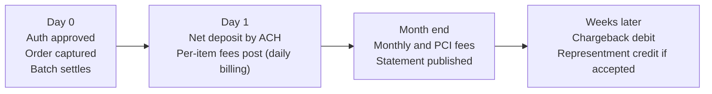

| When | Event | Layer | Record created | Transaction or non-transaction |
| --- | --- | --- | --- | --- |
| Day 0, checkout | Shopper pays; Orbital sends auth to Salem (BIN 000001); issuer approves | Authorization | Auth record with TxRefNum and auth code | Transaction |
| Day 0, shipment | Merchant marks the order for capture | Capture | Capture request on the open batch | Transaction |
| Day 0, end of day | Batch closes, deposit qualifies for a CNP rate, cleared to Visa | Settlement | Settled sale (SALE / LC130); qualification result | Transaction |
| Day 1 | Net deposit sent by ACH (next-day funding into a Chase account) | Funding | Funds transfer, status Effective | Account-level, built from transactions |
| Day 1 or month end | Interchange, assessments and per-item fees posted | Fees | Fee lines (IA, PFEE / AUTH / DEP) | Transaction |
| Month end | Monthly and PCI fees, statement published | Fees / Reporting | Fee lines (MONTH, NON); statement | Non-transaction |
| Weeks later | Cardholder disputes; issuer raises a chargeback | Chargebacks | Case record; CB debit (AD720) in next funding | Transaction, posted at account level |
| After that | Merchant represents with proof of delivery; issuer accepts | Chargebacks | Representment credit (AD726) | Transaction |

In the portal, the merchant sees this order in front-end reporting on day 0, in deposit detail (ACT-0010) after settlement, in the funding summary on day 1, and in chargeback reports (PDE-0017) when the dispute arrives.

## Onboarding checklist and references

**First two weeks**

- [ ] Read this guide end to end, then Chase's statements and fees help page
- [ ] Get read access to the merchant hierarchy tables and find one test merchant on Salem and one on PNS
- [ ] Trace one transaction from auth to funding in the data, using the worked example above
- [ ] Pull sample ACT-0010, ANS-0013 and PDE-0017 files and map their fields to the warehouse tables
- [ ] Walk through Resource Online and the Chargeback Management screens with a support analyst
- [ ] Read the DFR record-layout spec for the reports your team owns

**Open questions to confirm internally**

- What "RS switch" is in the architecture, what feeds it, and where its logs land
- Which systems hold auth logs, settlement, funding (MFS) and chargeback data, and how they reach the warehouse
- Batch schedules and cutoffs per host, and the SLA for portal and DFR refresh
- Which hierarchy level funds and bills for each merchant segment
- Current status of any Salem / PNS consolidation or reporting-platform migration

**Public references**

- [JPMorgan Payments reporting attribute glossary](https://developer.payments.jpmorgan.com/docs/commerce/optimization-protection/capabilities/reporting/attribute-glossary) — field definitions, action codes, fee and dispute categories
- [Chase statements and fees help](https://www.chase.com/business/support/payments/statements-and-fees) — current statement walkthrough
- [Online Retrieval Request & Chargeback Processing Guide](https://merchantservices.chase.com/content/dam/chase/merchant-services/support/us/documents/online-chargeback-management-guide.pdf)
- [Resource Online User Guide](https://merchantservices.chase.com/content/dam/chase/merchant-services/support/us/documents/resource_online_user_guide.pdf)
- [Resource Online Reports Guide](https://merchantservices.chase.com/content/dam/chase/merchant-services/support/us/documents/resource_online_reports_guide.pdf) (187 pages, Jan 2014): field definitions for every VTM and Recon report
- [Resource Online PRO User Guide](https://merchantservices.chase.com/content/dam/chase/merchant-services/support/us/documents/resource_online_pro_user_guide.pdf) (Dec 2012): dashboard, hierarchy and report navigation
- [Resource Online Quick Reference Guide](https://merchantservices.chase.com/content/dam/chase/merchant-services/support/us/documents/resource_online_quick_reference_guide.pdf)
- [Chargeback Reason Code User Guide](https://merchantservices.chase.com/content/dam/chase/merchant-services/support/us/documents/chargeback-reason-code-user-guide.pdf): reason codes, time limits and required evidence by brand
- [JPMorgan Orbital API developer docs](https://developer.jpmorgan.com/products/orbital-api)
- [Zuora — Chase Orbital configuration fields](https://docs.zuora.com/en/zuora-payments/manage-payment-gateway-integrations-and-payment-methods/set-up-payment-gateway-integrations/chase-orbital-payment-gateway-integration/set-up-and-configure-a-chase-orbital-payment-gateway-instance/configuration-fields-for-chase-orbital-payment-gateway-integration) — Salem vs PNS MIDs and BINs
- [Optimized Payments — Chase setup](https://docs.optimizedpayments.com/harmonize/chase) — SFTP report codes

---

# Part 2: Card transaction scenarios

The same card payment takes a different path, carries different data and creates different risk depending on where the customer pays: in store, on a website, on the go, or from an invoice or link.

## What Chase sells for each channel

Chase Payment Solutions groups acceptance into four channels. Two are card-present and share one rate; two are card-not-present and cost more.

| Channel | Chase products | How the card is read | Card present? | Published rate | Funding claim |
| --- | --- | --- | --- | --- | --- |
| In store | Chase POS Terminal, Chase Card Reader with the Chase POS app, Tap to Pay on phone, standalone terminals | Tap, dip (chip) or swipe | Yes | 2.6% + 10¢ | As soon as same day into a Chase Business Complete Banking account |
| On the go | Chase POS app with Tap to Pay on phone, or a paired card reader | Tap on the phone's NFC, or tap, dip, swipe on the reader | Yes | 2.6% + 10¢ | As soon as same day |
| On your website | Authorize.net payment gateway with Chase processing: shopping-cart integrations, hosted payment form, APIs | Shopper types the card or uses a wallet | No | 2.9% + 25¢, monthly fee from $9.95 | As soon as next day into a Chase business checking account |
| Billing and invoicing | Invoicing, payment links, virtual terminal, recurring billing | Customer types the card from a link, or the merchant keys it | No | 3.5% + 10¢ | Depends on product |

- **Keyed is card-not-present even face to face.** Chase's pricing page says a manually keyed sale is treated as card-not-present whether or not the customer is standing there.
- **Two product families.** QuickAccept products (POS app, card reader, POS terminal) are built into the business checking account for simple needs. Standalone terminals and integrations (TouchBistro, NCR Voyix Silver, Authorize.net) serve larger or multi-location merchants.
- **Brands accepted:** Visa, Mastercard, American Express, Discover, JCB, plus Apple Pay and Google Pay.
- **Who the acquirer is.** Every page carries the line that merchant services are provided by Paymentech, LLC, a subsidiary of JPMorgan Chase Bank.

One inconsistency to note: the pricing page gives the keyed and payment-link rate as 3.5% + 10¢, while the main page FAQ says 3.5% + 15¢.

Sources: [Chase Payment Solutions](https://www.chase.com/business/payments), [Chase merchant fees](https://www.chase.com/business/payments/merchant-fees), [E-commerce payment gateway](https://www.chase.com/business/payments/ecommerce-payment-gateway), [Tap to Pay on phone](https://www.chase.com/business/payments/tap-to-pay).

## At a glance

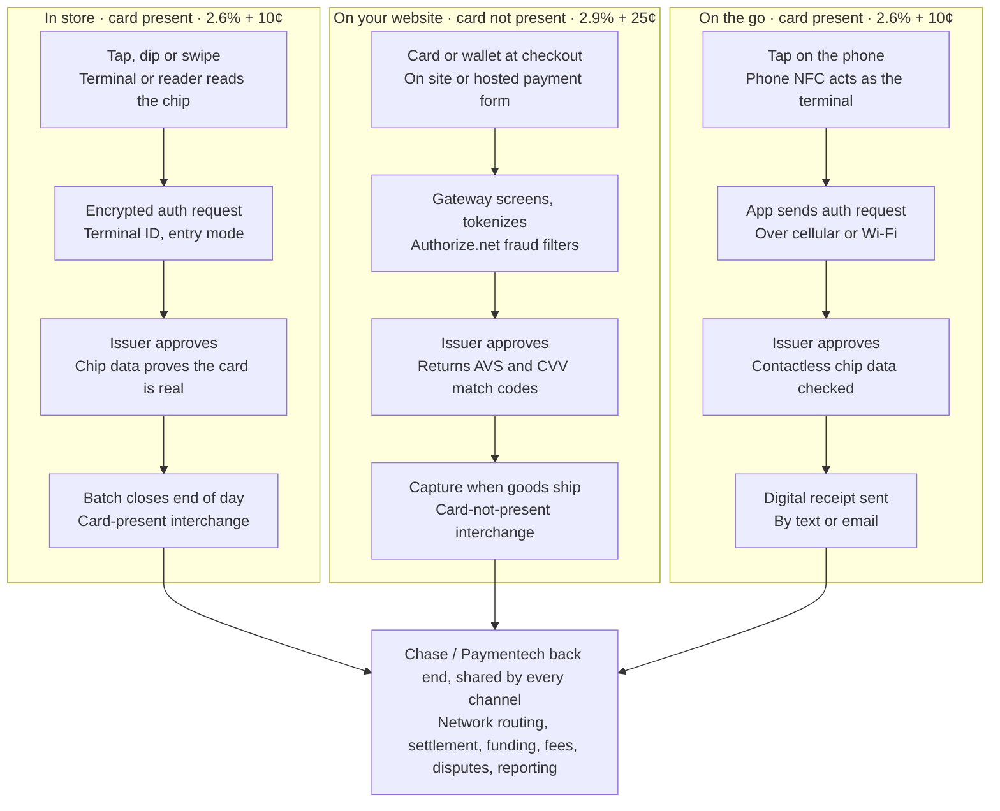

The channel changes the first steps; the back end stays the same. Invoices, payment links and keyed sales follow the website lane, at 3.5% + 10¢.

## Scenario 1: In store

A customer pays at the counter by tapping, inserting or swiping a card. This is the lowest-risk, lowest-cost flow because the physical card, and usually its chip, is present.

| Step | What happens | Data created | What the acquirer does |
| --- | --- | --- | --- |
| 1. Ring up | Staff enter the sale on the POS terminal or app; tip may be added | Amount, terminal ID, clerk, items | Nothing yet; the device was boarded and configured earlier |
| 2. Read the card | Tap (contactless), dip (chip) or swipe (magnetic stripe fallback). The chip produces a one-time cryptogram; debit may prompt for a PIN | Entry mode, chip data, encrypted card data, PIN block | Supplies certified devices and encryption keys |
| 3. Authorization request | The device sends the request to Chase's front end | Auth request with MID, TID, amount, entry mode | Validates the merchant, runs risk checks, routes to the card network; for PIN debit, picks the debit network |
| 4. Issuer decision | The issuer checks the cryptogram, funds and fraud rules, then approves or declines | Auth code, response code | Passes the response back in about a second |
| 5. Complete the sale | Receipt is printed or sent. Restaurants adjust for tips; mistakes are voided | Tip adjustment, void or reversal records | Sends reversals so the cardholder's hold is released |
| 6. Close the batch | At end of day the batch closes, on the host or from the terminal | Batch header, settled sale records | Edits the batch; rejects or suspends bad items |
| 7. Clear and qualify | Each sale is matched to its auth and sent to the network | Interchange qualification, clearing record | Earns card-present interchange if data and timing are right |
| 8. Fund | Net proceeds go to the merchant's bank account | Funding record; fee lines | Pays the merchant, as soon as same day for QuickAccept with a Chase account |
| 9. Afterwards | Refunds go back through the same device. Disputes and retrieval requests may arrive weeks later | Refund, retrieval and chargeback records | Works the dispute; retail merchants must supply the sales slip when asked |

**What makes this flow different**

- **Fraud liability.** When a chip or contactless read is used, counterfeit-card fraud is generally the issuer's loss. If a chip card is swiped on a non-chip device, liability shifts to the merchant side.
- **Debit routing.** A debit card can travel over more than one network. The acquirer's routing choice changes cost on every debit sale.
- **Availability matters most.** A terminal outage stops sales at the counter, so front-end uptime and stand-in rules are the operational priority.
- **Devices are part of the product.** The acquirer ships, certifies, updates and supports hardware, which online channels never need.

## Scenario 2: On your website

A shopper types card details, or uses a wallet, on the merchant's site. Nobody sees the card, so the flow replaces the chip with data checks and puts a gateway between the website and Chase.

| Step | What happens | Data created | What the acquirer does |
| --- | --- | --- | --- |
| 1. Checkout | The shopper enters the card or picks Apple Pay or Google Pay, on the merchant's cart page or a hosted payment form | Card number, expiry, security code, billing address, email, order number | Nothing yet |
| 2. Gateway intake | The Authorize.net gateway receives the details securely, swaps the card for a token and runs its fraud filters | Token, fraud-screen result, gateway transaction ID | Chase is the processor behind the gateway; larger merchants connect to Chase's own gateway, Orbital |
| 3. Authorization request | The gateway sends the request to Chase, flagged as e-commerce, with address and security-code data | Auth request with e-commerce indicator, AVS and CVV fields | Validates the merchant and routes to the network |
| 4. Issuer decision | The issuer approves or declines and returns address-match and security-code-match results | Auth code, AVS result, CVV result | Returns the response to the gateway |
| 5. Merchant accepts the order | The site, or the gateway's rules, decides whether to accept a mismatch | Order accepted or cancelled; auth reversal if cancelled | Processes reversals |
| 6. Capture | Physical goods are captured when they ship, which may be days later and in several shipments. Digital goods capture at once | Capture records, possibly several per order | Matches each capture to the auth; stale auths may need re-authorizing |
| 7. Clear and qualify | Sales clear at card-not-present interchange | Qualification result; downgrade code if address data is missing or capture is late | Sends clearing; applies fees |
| 8. Fund | Proceeds reach the merchant's account | Funding record | Funds as soon as next day into a Chase business checking account |
| 9. Afterwards | Refunds, "item not received" disputes and fraud chargebacks | Refund and chargeback records | Auto-answers Visa and Mastercard retrieval requests from stored data; represents or returns chargebacks |

**What makes this flow different**

- **The merchant carries fraud by default.** Without the chip, a fraud chargeback usually lands on the merchant unless the cardholder was authenticated with 3-D Secure.
- **Auth and capture are separate events.** The gap between them creates expired auths, partial captures and reversals that in-store data rarely has.
- **The order ID becomes the main key.** There is no terminal or batch slip; order number, token and gateway reference link everything.
- **Card data security moves to the gateway.** A hosted payment form keeps card numbers off the merchant's servers and shrinks its PCI obligations.
- **Repeat customers use stored credentials.** Tokens and account updater keep cards on file working, and network rules require each stored-card charge to be flagged as such.

## Scenario 3: On the go

A plumber at a house call or a seller at a pop-up market takes payment on a phone. The phone, or a small reader paired to it, acts as the terminal, so the sale is still card-present.

| Step | What happens | Data created | What the acquirer does |
| --- | --- | --- | --- |
| 0. One-time setup | The merchant activates QuickAccept inside a Chase Business Complete Banking account, then signs in to the Chase POS app and turns on Tap to Pay | Merchant account linked to the checking account; device enrolment | Underwrites and boards the merchant, largely from the banking relationship |
| 1. Start a sale | The merchant enters an amount or picks catalog items in the app | Amount, items, user | Nothing yet |
| 2. Tap | The customer holds a contactless card or wallet to the top of an iPhone or the back of an Android phone. With a paired reader they can also dip or swipe | Contactless chip data, entry mode, device ID | Relies on the phone maker's secure tap feature and its own app security |
| 3. Authorization | The app sends the request over cellular or Wi-Fi; the issuer answers as in store | Auth request and response | Routes and returns the answer |
| 4. Receipt | The app shows a done checkmark and offers a digital receipt | Receipt record, customer contact if given | Nothing extra |
| 5. Settle and fund | The sale settles and funds as soon as the same day into the Chase account | Settled sale, funding record | Funds the merchant, often before the networks have paid Chase |
| 6. Afterwards | Refunds and disputes work as in store | Refund and chargeback records | Works disputes; little paper evidence exists beyond the digital receipt |

**What makes this flow different**

- **No hardware to ship.** Tap to Pay needs only an iPhone XS or later, or an Android 11+ phone with NFC. That removes device cost but limits acceptance to contactless.
- **Fallback is expensive.** If a card can't be tapped and the merchant keys it in, the sale becomes card-not-present at 3.5% + 10¢ and loses chip protection.
- **The merchant has no fixed location.** Address-based risk signals are weaker, and connectivity decides whether a sale can happen at all.
- **Onboarding is near-instant.** Because the service is switched on from a bank account, the acquirer's first line of defence is what the bank already knows about the customer.

Source for setup steps and device requirements: [Tap to Pay on phone](https://www.chase.com/business/payments/tap-to-pay).

## Scenario 4: Invoices, payment links, virtual terminal and recurring billing

These are all card-not-present flows where the merchant starts the payment rather than a shopping cart. Chase prices them highest, at 3.5% + 10¢.

| Variant | How it runs | What is distinctive in the data |
| --- | --- | --- |
| Invoice | The merchant creates an invoice from the business bank account. The customer opens it and pays by card on a hosted page | Invoice number and due date; payment may arrive days after the invoice |
| Payment link | The merchant texts or emails a secure link; the customer enters the card | Link ID; customer contact; no cart or shipping data |
| Virtual terminal | The merchant types in a card given over the phone or by mail | Keyed entry mode; the security code and address may be missing |
| Recurring billing | The first payment stores the card; later charges run on a schedule without the customer present | Stored-credential and recurring indicators; declines, retries and card updates |

The authorization, settlement and funding steps then follow Scenario 2.

**What makes these flows different**

- **Keyed sales carry the most fraud and dispute risk**, because the least is known about the cardholder. That is the reason for the highest rate.
- **Recurring charges create their own dispute types**, such as "cancelled subscription", and depend on account updater to survive card reissues.
- **Invoices add a receivable.** The time between invoice and payment sits outside the card system until the customer pays.

Sources: [Chase Payment Solutions](https://www.chase.com/business/payments), [Chase merchant fees](https://www.chase.com/business/payments/merchant-fees).

## Side by side

The four scenarios differ most in who verifies the cardholder and who bears fraud; the rate follows from that.

| | In store | On the go | Website | Invoice, link or keyed |
| --- | --- | --- | --- | --- |
| Card present | Yes | Yes | No | No |
| How the card arrives | Tap, dip, swipe | Tap on phone, or reader | Typed by shopper, or wallet | Typed by customer or merchant |
| Proof of the cardholder | Chip cryptogram, PIN on debit | Contactless chip data, wallet biometrics | Address and security-code match, optional 3-D Secure | Address and security code if collected |
| Published rate | 2.6% + 10¢ | 2.6% + 10¢ | 2.9% + 25¢ | 3.5% + 10¢ |
| Fraud loss by default | Issuer, when chip or contactless is read | Issuer | Merchant, unless 3-D Secure authenticated | Merchant |
| Common disputes | Duplicate charge, wrong amount | Same as in store | Item not received, fraud | Fraud, cancelled service |
| When it is captured | Same-day batch | Same day | At shipment, possibly days later | At payment |
| Funding claim | As soon as same day | As soon as same day | As soon as next day | Depends on product |
| Keys in the data | Terminal ID, batch, entry mode | Device, app user, entry mode | Order ID, token, AVS and CVV results, e-commerce indicator | Invoice or link ID, recurring indicator |

The "common disputes" row describes typical patterns, not Chase statistics.

## What the acquirer does, and how each scenario affects it

Paymentech, trading as Chase Merchant Services or Chase Payment Solutions, is the acquirer in every scenario. It stands between the merchant and the card networks and is financially answerable to the networks for the merchant's transactions.

**The acquirer's jobs, the same in every channel**

1. **Underwrite and board** the merchant: identity checks, business type, a merchant ID and pricing.
2. **Provide the way in:** devices, the POS app, or a gateway connection, each certified with the networks.
3. **Authorize:** route each request to the right network and return the issuer's answer.
4. **Clear and settle** with the networks and qualify each sale for interchange.
5. **Fund** the merchant, net of refunds, chargebacks and fees.
6. **Bill** its fees and pass through interchange and network fees.
7. **Handle disputes** on the merchant's behalf.
8. **Monitor risk and compliance:** fraud, chargeback ratios, PCI and network rules.
9. **Report** everything back through the portal, files and statements.

**How the channel changes the business**

| | In store | On the go | Website | Invoice, link or keyed |
| --- | --- | --- | --- | --- |
| Revenue per sale (published) | 2.6% + 10¢ | 2.6% + 10¢ | 2.9% + 25¢, plus gateway monthly fee | 3.5% + 10¢ |
| Main cost drivers | Hardware, device support, debit routing | App development, phone-platform dependencies | Gateway, fraud tools, higher card-not-present interchange | Higher interchange, dispute handling |
| Main risk to the acquirer | Low; device tampering, refund abuse | New, lightly known merchants; keyed fallback | Fraud and disputes; goods not yet delivered if the merchant fails | Highest fraud and dispute rates |
| Operational load | Terminal uptime, batch exceptions, tip adjustments | Device compatibility, connectivity support | Integration support, auth and capture mismatches, chargeback volume | Evidence is thin, so more cases are lost or returned to the merchant |
| Monitoring focus | Refund and void patterns | Location and velocity patterns | Network fraud and dispute programmes, which target card-not-present volume | Keyed-entry share, recurring-billing complaints |

**Three things that explain most of the acquirer's behaviour**

- **It carries the merchant's credit risk.** If a merchant cannot cover its chargebacks or refunds, the acquirer pays. Exposure is greatest where delivery comes after payment: online orders, deposits, subscriptions and invoices. Reserves and funding holds exist for this reason.
- **Fast funding is a loan in disguise.** With same-day deposits the merchant is paid before the networks pay Chase, so the acquirer is advancing funds on every sale. Being part of the bank that holds the merchant's account makes that advance cheaper and safer.
- **The rate ladder mirrors the risk ladder.** Card-present sales with chip data are cheapest to accept and cheapest to price. Each step away from the physical card adds interchange cost, fraud loss and dispute work, and the published rates rise in the same order.

For Chase specifically, payments are sold as a feature of the business bank account: QuickAccept is activated inside checking, funds land there the same day, and processing over $2,000 a month can waive the account's monthly fee. Acquiring therefore also serves to win and keep deposits.

## Sources and points to confirm internally

**Chase pages read for this part (November 2026)**

- [Chase Payment Solutions overview](https://www.chase.com/business/payments)
- [Credit card processing fees](https://www.chase.com/business/payments/merchant-fees)
- [E-commerce payment gateway](https://www.chase.com/business/payments/ecommerce-payment-gateway)
- [Tap to Pay on phone](https://www.chase.com/business/payments/tap-to-pay)

Product facts, rates and funding claims come from those pages. The step-by-step mechanics (chip cryptograms, liability, auth and capture, stored credentials) are standard card-industry practice, not statements from Chase's pages.

**Confirm internally**

- Which processing platform each product runs on: QuickAccept and the Chase POS app, standalone terminals, and Authorize.net traffic (Stratus, Tandem or a newer platform)
- Batch cutoff times behind "same day" and "next day" funding, and how fees are netted for QuickAccept merchants
- Whether QuickAccept merchants appear in the same hierarchy, reports and chargeback system as traditional merchant accounts
- The correct keyed and payment-link rate: 3.5% + 10¢ or 3.5% + 15¢

---

# Part 3: Fee dictionary

Every fee on a Chase merchant statement comes from one of three parties: the issuer (interchange), the card brand (assessments and per-item network fees), or Chase itself (processing and account fees). Knowing which party, and what event triggers the fee, explains almost every fee question from merchants and finance.

## How to read a fee line

Every fee in the Charges & Fees section is either a percentage of volume or a count of items times a price, and the statement prints the inputs, so any line can be recomputed.

```math
\text{Percentage fee} = \text{Sales Amount} \times \text{Rate} \qquad \text{Per-item fee} = \text{Items} \times \text{Item Charge}
```

Chase's examples: $1,000 × 2% = $20, and 50 items × $0.10 = $5.

**Where fees show up on the statement**

| Statement section | What it shows about fees |
| --- | --- |
| Cover page | Total charges and fees for the period |
| Funding summary | Fees deducted on each funding date, if billed daily |
| Charges and fees | Every fee line: description, sales amount and rate, or items and item charge |
| Financial adjustments | Fee corrections and credits |

**Rules that trip people up**

- **The sign flips.** Elsewhere on the statement black is money in and red (in parentheses) is money out. In Charges & Fees and Financial Adjustments it is reversed: black is a charge, red is a credit back.
- **Billing frequency moves fees in time.** Daily billing deducts fees from each day's funding. Monthly billing pays the full daily deposit and collects all fees at month end, for a 0.03% monthly billing fee.
- **The pricing plan decides how many lines you see.** Interchange pass-through statements list interchange and each brand fee separately. Flat-rate and swiped/keyed plans fold them into one rate. The plan name is printed at the bottom left of the statement.

In reporting data, fees carry a category code (IA for interchange and assessments, PFEE for processing fees) and a subcategory (IC interchange, AS assessments, AUTH, DEP, MONTH, NON non-transaction, EQUIP, FT funds transfer). Those codes are the reliable way to separate transaction from non-transaction fees.

## Where every fee dollar goes

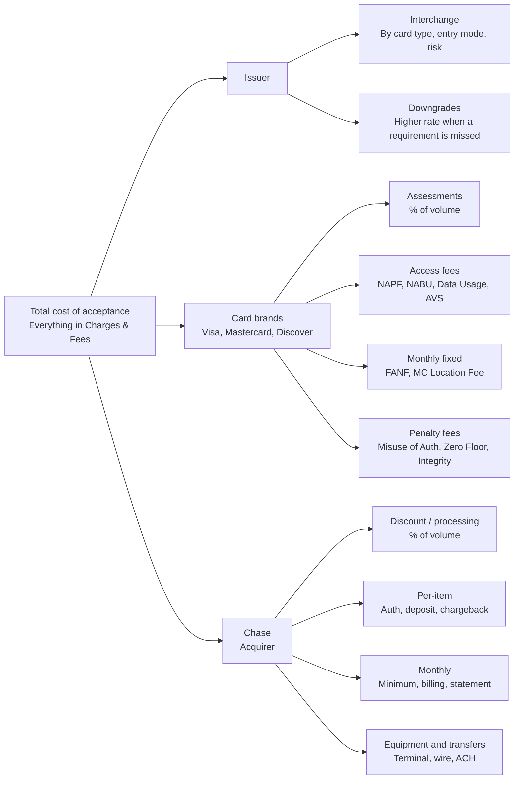

On pass-through pricing each box appears as its own lines. On flat-rate or swiped/keyed pricing the issuer and brand fees are folded into Chase's single rate.

## Interchange, discount rate and qualification

Interchange is the largest cost on almost every statement; most other terms describe how it is priced or why it went up.

| Term | What it means | Who receives it | What drives it |
| --- | --- | --- | --- |
| Interchange | Fee per transaction that compensates the issuing bank for credit risk and fraud | Issuer | Card type (credit, debit, rewards, commercial), how the card was taken (present, online, phone) and risk; brands reset rates twice a year, in April and October |
| Assessment | Small percentage of gross volume charged by the brand | Card brand | Volume by brand |
| Access fee | Per-item brand fee charged when authorizations or settlements are processed | Card brand | Number of authorizations or sales |
| Discount rate | The percentage agreed with Chase; it contains an interchange portion and Chase's revenue | Issuer and Chase | Contract. Example: 1.2% on $1,000 = $12 |
| Qualified / mid-qualified / non-qualified | Tiered pricing buckets, cheapest to most expensive | Chase sets the buckets | Whether the sale met the brand's requirements |
| Downgrade | A sale that missed a requirement and was charged a higher interchange rate | Issuer | Missing data, late settlement, wrong entry mode; each has a downgrade reason code |
| Non-qualified differential | The extra charged for the gap between target and actual interchange on non-qualified sales | Chase passes it through | Count and amount of downgraded sales |
| Effective merchant discount rate (EMDR) | Total cost of acceptance divided by volume | Summary metric | All of the above |

The EMDR and non-qualified terms come from Chase's statement guide. Downgrade reason codes (for example "Transaction greater than 2 days old" or "No Level 2 data") are listed in [Layer 3](#layer-3-capture-batching-and-settlement) and in the JPMorgan reporting glossary.

## Mastercard fees

Mastercard charges a volume assessment, per-item access fees, and two fees that punish poor authorization hygiene.

| Fee | What triggers it | Basis | Transaction or non-transaction | What to check in data |
| --- | --- | --- | --- | --- |
| Mastercard Assessment | Settled sales | % of volume | Transaction | Should track settled Mastercard volume exactly |
| NABU (Network Access and Brand Usage) | Domestic authorizations and refunds on U.S.-issued cards; not reversals, chargebacks or manual cash advances | Per item | Transaction | Count should equal qualifying auths plus refunds; a jump means retries or duplicate auths |
| Merchant Location Fee | Each merchant location, monthly; not charged under $200 monthly gross Mastercard volume | Per location per month | Non-transaction | Number of active locations above the threshold |
| AVS Auth Access, card present | Swiped transactions where the address check is used | Per item | Transaction | Card-present sales sending AVS unnecessarily |
| AVS Auth Access, card not present | All card-not-present and keyed transactions using the address check | Per item | Transaction | Should match card-not-present auth count with AVS data |
| Account Status | Requests to validate an account: status, address, CVC2 or a combination | Per item | Transaction | Zero-dollar verification volume, often from card-on-file sign-ups |
| Processing Integrity | An authorization not used in time or not reversed: card-present must reverse within 24 hours, card-not-present within 72 hours | Per item | Transaction | Unmatched auths older than 24 or 72 hours |
| Cross-Border Assessment | Cardholder country differs from merchant country | % of volume | Transaction | Share of foreign-issued Mastercard volume |

Source: [Chase statements and fees help](https://www.chase.com/business/support/payments/statements-and-fees).

## Visa fees

Visa's list is the longest. Two fees apply to all activity (NAPF on authorizations, FANF monthly); the rest fire only on specific events, so they double as quality signals.

| Fee | What triggers it | Basis | Transaction or non-transaction | What to check in data |
| --- | --- | --- | --- | --- |
| Network Acquirer Processing Fee (NAPF) | Every U.S.-acquired authorization on a Visa card, even if never used | Per authorization | Transaction | Auth count, including retries and abandoned carts |
| Fixed Acquirer Network Fee (FANF) | Monthly; set by Visa from the merchant's size, assessed across all accounts under one taxpayer ID | Fixed monthly amount | Non-transaction | Taxpayer ID grouping across MIDs; arrives once a month |
| Misuse of Authorization | An authorization not used in time or not reversed: card-present within 24 hours, card-not-present within 72 hours | Per item | Transaction | Approved auths with no matching sale or reversal |
| Zero Floor Limit | A settled sale that can't be matched to an approved or partially approved authorization | Per item | Transaction | Deposits with no auth, or auth data lost between systems |
| Transaction Integrity Fee | Visa non-PIN debit and prepaid sales that don't request or don't qualify for CPS interchange programmes | Per item | Transaction | Debit downgrades; missing or wrong qualification data |
| Zero-dollar Account Verification | $0 requests to check an account, address or CVV2 | Per item | Transaction | Verification volume; replaces $1 test auths |
| Partial Authorization Non-Participation | Automated fuel dispensers (MCC 5542) that don't support partial approval | Per item | Transaction | Fuel merchants' auth messages missing the partial-auth flag |
| International Acquiring Fee (IAF) | U.S.-acquired purchases on non-U.S.-issued cards | % of volume | Transaction | Foreign-issued Visa volume; usually appears with ISA |
| International Service Assessment (ISA) | Card issued outside the merchant's acquiring region; a higher tier applies when not settled in U.S. dollars | % of volume | Transaction | Foreign-issued volume, split by settlement currency |

**Fees not on Chase's list but common on Visa statements**

- **System Integrity Fee (excessive reattempts):** charged when a declined authorization is retried more often than Visa allows, or retried after a decline the issuer will never approve. It is set out in Visa's Excessive Reattempts rule.
- **FANF is a credit risk for the acquirer.** Visa collects FANF from the acquirer whether or not the merchant has paid it, so a merchant that closes or leaves mid-month can leave Chase with the loss.

Sources: [Chase statements and fees help](https://www.chase.com/business/support/payments/statements-and-fees), Chase's legacy [Statement Fees Defined](https://commercesolutions.jpmorganchase.com/statement_fees_defined.html) page (now redirects; definitions read from search results), [Host Merchant Services on Visa fees](https://www.hostmerchantservices.com/visa-assessment-and-passthrough-fees/), [Chargebacks911 on excessive reattempts](https://chargebacks911.com/visa-excessive-reattempts-rule/), [Digital Transactions on FANF](https://www.digitaltransactions.net/?p=5188), [Xplor Pay on FANF](https://xplorpay.com/insight/visafanf/).

## Discover fees

Discover's fees are fewer and mostly volume or item based; its two international fees can both apply to one sale.

| Fee | What triggers it | Basis | Transaction or non-transaction | What to check in data |
| --- | --- | --- | --- | --- |
| Discover Assessment | Settled Discover sales | % of volume | Transaction | Tracks settled Discover volume |
| Data Usage | Discover sales | Per item | Transaction | Discover sale count |
| International Service Fee (ISF) | Discover, JCB or China UnionPay U.S. transactions where the issuer is outside the U.S. | % of volume | Transaction | Foreign-issued volume on those brands |
| International Processing Fee (IPF) | Foreign-issued Discover-network transactions; stacks with ISF | % of volume | Transaction | Same population as ISF |

If Discover volume is conveyed rather than settled by Chase, these fees may not appear on the Chase statement at all. Check the merchant's capture flag for Discover.

Sources: [Chase statements and fees help](https://www.chase.com/business/support/payments/statements-and-fees), Chase's legacy [Statement Fees Defined](https://commercesolutions.jpmorganchase.com/statement_fees_defined.html) page, [CardFellow on Discover international fees](https://www.cardfellow.com/blog/discover-international-processing-service-fee).

## Chase account and processing fees

These are Chase's own charges. Unlike brand fees, they are set by the merchant's contract and pricing plan, so they vary from merchant to merchant.

| Fee | What it is | Basis | Transaction or non-transaction | Reporting subcategory |
| --- | --- | --- | --- | --- |
| Discount / processing fee | Chase's percentage on volume; on pass-through plans it sits on top of interchange | % of volume | Transaction | IC (interchange and discounts) |
| Authorization fee | Chase's per-auth charge, separate from brand per-auth fees | Per item | Transaction | AUTH |
| Deposit fee | Per settled item (settled deposit fee) or per conveyed item (conveyed deposit fee) | Per item | Transaction | DEP (service codes LC100, LC101) |
| Monthly billing fee | 0.03%, charged when fees are collected monthly instead of daily | % of volume | Non-transaction | MONTH |
| Account minimum fee | Charged when volume falls below the agreed minimum; may be labelled monthly service fee, internet service fee or another supplemental charge | Fixed, monthly | Non-transaction | MONTH or NON |
| Access fee | For online gateways or tools | Fixed or per item | Non-transaction if monthly | NON |
| Statement or account maintenance fee | Account upkeep or statement delivery | Fixed, monthly | Non-transaction | MONTH |
| Equipment fee | Terminal rental or purchase | Fixed | Non-transaction | EQUIP |
| Funds transfer fee | Wire or ACH transfer charges | Per transfer | Non-transaction | FT |
| Chargeback fee | Per chargeback case handled | Per item | Transaction, posted at account level | CB |

The account minimum fee is the one most often questioned. Because it can appear under several names, check the merchant's monthly volume against its contracted minimum before treating it as an error.

Sources: [Chase statements and fees help](https://www.chase.com/business/support/payments/statements-and-fees) for the monthly billing, minimum and access fees; subcategory and service codes from the [JPMorgan reporting attribute glossary](https://developer.payments.jpmorgan.com/docs/commerce/optimization-protection/capabilities/reporting/attribute-glossary).

## Penalty fees as data-quality signals

Some brand fees exist only because something upstream went wrong. Each one points to a specific break between authorization, settlement and reversal data, which makes them the most useful fees for a data team to monitor.

| Fee | What it says went wrong | How to find the cause in data |
| --- | --- | --- |
| Visa Misuse of Authorization, Mastercard Processing Integrity | An approved auth was never settled or reversed in time | Approved auths with no matching sale or reversal after 24 hours (card present) or 72 hours (card not present) |
| Visa Zero Floor Limit | A sale settled without a valid authorization | Settled sales whose auth code, date or amount does not match an approved auth |
| Visa Transaction Integrity | Debit or prepaid sales missed CPS qualification | Visa debit and prepaid sales with downgrade reason codes |
| Visa System Integrity (reattempts) | Declines retried too often or after a "never approve" response | Repeated auths on the same card and merchant after declines |
| Visa Partial Auth Non-Participation | A fuel merchant's auths lack partial-approval support | MCC 5542 auth messages without the partial-auth indicator |
| Mastercard Merchant Location Fee rising | More locations above the $200 threshold | Active locations by month; new MIDs |
| Cross-border and international fees rising | More foreign-issued cards | Issuer country mix by brand |

Merchants can usually prevent the first five by fixing their integration: reversing auths they won't use, using $0 verification instead of test auths, and stopping blind retries. That makes these fees a common topic in merchant reviews.

## Sources and caveats

- [Chase statements and fees help](https://www.chase.com/business/support/payments/statements-and-fees): statement sections, formulas, sign rules, pricing plans, Mastercard definitions, Visa and Discover fee names, monthly billing and minimum fees
- Chase's legacy [Statement Fees Defined](https://commercesolutions.jpmorganchase.com/statement_fees_defined.html) page: definitions for NAPF, Misuse of Authorization, Zero Floor Limit, Partial Auth, IAF, ISA and the Discover fees. The page now redirects to the help page above; definitions were read from search-engine copies
- [JPMorgan reporting attribute glossary](https://developer.payments.jpmorgan.com/docs/commerce/optimization-protection/capabilities/reporting/attribute-glossary): category, subcategory and service codes
- Third-party fee guides for detail Chase doesn't publish: [Host Merchant Services](https://www.hostmerchantservices.com/visa-assessment-and-passthrough-fees/), [Chargebacks911](https://chargebacks911.com/visa-excessive-reattempts-rule/), [Digital Transactions](https://www.digitaltransactions.net/?p=5188), [Xplor Pay](https://xplorpay.com/insight/visafanf/), [CardFellow](https://www.cardfellow.com/blog/discover-international-processing-service-fee)

**Caveats**

- Fee amounts are deliberately left out. Brands change them, often in April and October, and the statement already prints the rate or item charge used. Check current values against Visa, Mastercard and Discover fee schedules.
- American Express fees are not covered; Chase's page doesn't list them, and many merchants' Amex volume is conveyed.
- The basis column (percentage or per item) and the transaction or non-transaction column are this guide's classification from the definitions; confirm against the internal fee table.

---

# Part 4: Merchant hierarchy

Every card transaction posts at one place: the **Transaction Division (TD)**, the leaf of the tree, whose number is the merchant ID. Every level above it exists to group that activity for contracts, fees, statements and reports. Funding follows its own line, the **funds transfer instruction (FTI)**, which doesn't have to match any branch of the tree.

The examples use a made-up merchant, "Lakeview", with made-up numbers. An interactive version of this part, with a clickable tree, is in [`merchant-hierarchy-interactive.html`](merchant-hierarchy-interactive.html): download it and open it in a browser.

## The tree at a glance

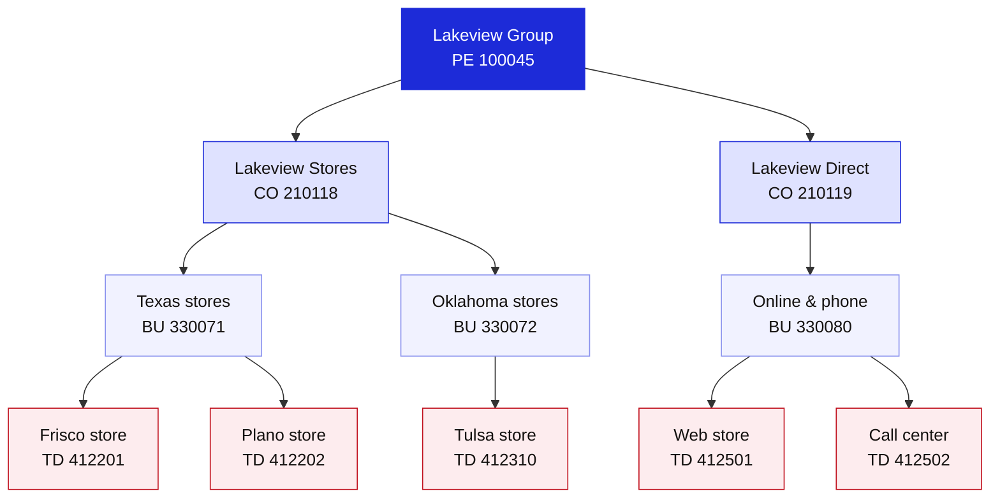

1. **Processing Entity (PE)** is the top of the tree and the level report files are produced for.
2. **Company (CO)** is the organization that contracts with Chase.
3. **Business Unit (BU)** groups TDs inside a Company, here by region and channel.
4. **Transaction Division (TD)** is a location or channel with its own merchant ID. Every transaction posts here.

Points marked **Confirm internally** are where public documentation stops; check them against the internal merchant set-up guide.

## Each level, top to leaf

### Processing Entity (PE)

The top of the tree in current JPMorgan reporting. Everything a client processes rolls up to it.

| | |
| --- | --- |
| Identifier | Processing Entity ID. Report file names, file headers and trailers carry it. |
| Set or held here | The client relationship as a whole; usually one per enterprise client. **Confirm internally** |
| In processing | Nothing is authorized or settled at this level. It exists to group. |
| In reports | Daily and monthly report files are produced per Processing Entity. A PE-level report is the whole client in one file. |
| Older name | Above the Company, Resource Online allowed up to four non-processing parent companies (NPCO). The PE plays that grouping role. **Confirm internally** |

### Company (CO)

The organization that contracts with Chase. Resource Online calls it the highest standard level.

| | |
| --- | --- |
| Identifier | Company number (CO). |
| Set or held here | The merchant agreement and, typically, the pricing schedule and billing set-up that its TDs inherit. **Confirm internally** |
| In processing | No transactions post here, but account-level items can: Entity Type Code CO marks an event that occurred at Company level, such as some monthly fees. |
| In reports | Statements, fee and financial summaries for the whole contract. A Company-level funding summary combines every FTI under it. |
| Watch for | One client can have several Companies, for example one per legal entity or country. |

### Business Unit (BU)

An optional grouping between a Company and its TDs, used to split a Company by region, brand or channel.

| | |
| --- | --- |
| Identifier | Business Unit number (BU). |
| Set or held here | The grouping itself. Public documentation lists BU only as an entity type; whether any settings live here varies by client. **Confirm internally** |
| In processing | Like the Company, a grouping level. Chargeback cases still carry the BU alongside CO and TD. |
| In reports | Run any report at BU level to see one region or channel. Because BU totals add up to the Company, never sum both. |
| Older name | Close to Chain in the FDMS-style hierarchy and Division on the Tandem front end. |

### Transaction Division (TD)

The leaf: one location, channel or account that processes cards. Every authorization, deposit, refund and chargeback belongs to a TD.

| | |
| --- | --- |
| Identifier | The TD number. Resource Online says the TD number is also the merchant ID (MID) unless stated otherwise. Salem (Stratus) MIDs are 6 digits; Tandem (PNS) merchant numbers are 12. |
| Set or held here | Merchant name and descriptor, MCC, card types accepted, the platform it is boarded on, its terminals and the FTI it funds to. |
| In processing | Auth requests carry the MID and terminal ID. Batches and deposits post to the TD, interchange is qualified per transaction there, and chargebacks are matched back to the original sale there. |
| In reports | The most detailed card processing and funding data. Deposit Details is keyed by TD External Identifier. |
| Below the leaf | Not hierarchy levels, but every TD owns terminals (TIDs), batches, orders and transactions. Those are the rows of the fact tables. |

## Funding, reporting groups and tax ID

These three group TDs differently from the parent-child line. Mixing them up is the most common cause of totals that don't reconcile.

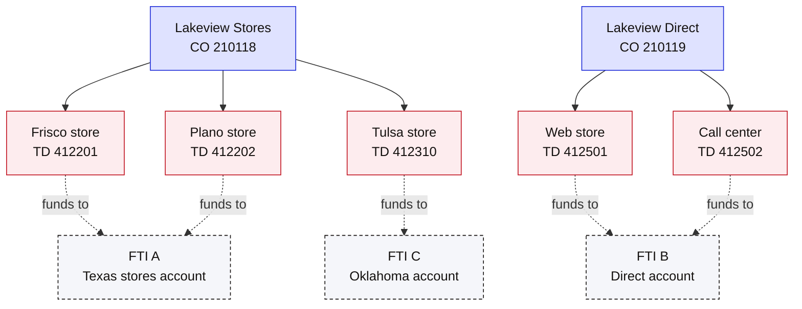

Business Units are left out of this drawing to keep it readable. Lakeview Stores is one Company paid through two FTIs, which is why a Company-level funding summary matches neither bank statement.

- **Funds transfer instruction (FTI).** The instruction that moves money to a bank account. JPMorgan's reporting docs state that funding occurs at the FTI level. One FTI can collect several TDs, and TDs under one Company can fund to different accounts. A Financial Activity Summary run at Company level combines all FTI activity and may not match any single bank statement; run it per FTI to reconcile to the bank.
- **Reporting group (RG).** A named set of entities chosen for reporting, from anywhere in the tree. Reports accept RG as an entity type next to PE, CO, BU, TD and FTI. An API request for a reporting group can carry only one entity type and ID. In Resource Online the equivalent was a custom hierarchy of up to three levels, such as 10 of a corporate office's 85 locations.
- **Tax ID.** The merchant's taxpayer ID cuts across the tree. Visa assesses its monthly Fixed Acquirer Network Fee (FANF) across all accounts under one taxpayer ID, and Form 1099-K is issued in the merchant's IRS filing name. Group TDs by tax ID, not by Company, when checking FANF or tax reporting. **Confirm internally** where the tax ID is stored in the merchant set-up.

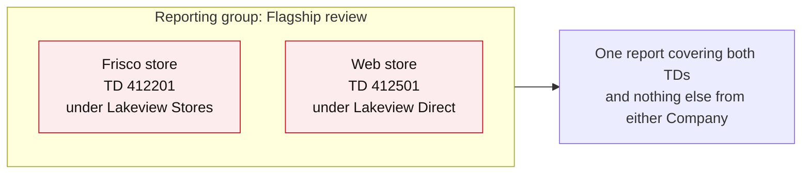

Reporting groups are for reporting only; they don't change funding, pricing or where transactions post.

## Follow one sale up the tree

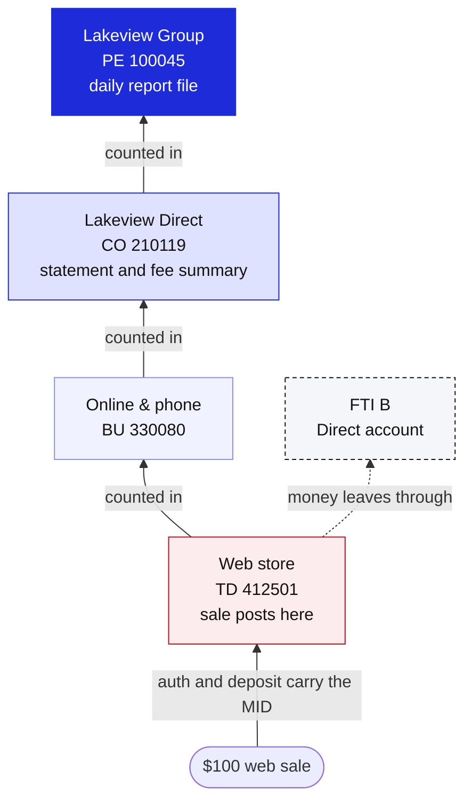

1. The authorization and deposit carry TD 412501's merchant ID. The sale posts there.
2. Business Unit "Online & phone" totals include it.
3. So does Company "Lakeview Direct", on its statement and fee summary.
4. The Processing Entity's daily report file includes it, under Entity Type Code TD.
5. The money itself leaves through FTI B, not up the tree.

## Where each process touches the hierarchy

Read across a row to see the level where something happens and the levels that only see it as a roll-up. ● happens or is set here · ○ visible as a roll-up · ◆ cuts across the tree.

| Process | How it uses the hierarchy | PE | CO | BU | TD | FTI |
| --- | --- | :-: | :-: | :-: | :-: | :-: |
| Boarding and set-up | Parents are created first; each location or channel becomes a TD with its own MID and FTI | ● | ● | ● | ● | ● |
| Authorization | The request carries the MID (TD) and terminal ID | | | | ● | |
| Capture and settlement | Batches and deposits post to the TD | ○ | ○ | ○ | ● | |
| Interchange and per-item fees | Qualified and priced per transaction at the TD | ○ | ○ | ○ | ● | |
| Account-level fees | Entity Type Code shows where each fee posted; some post above the TD | ○ | ● | ● | ● | |
| Funding | Money moves per FTI, which collects one or more TDs | | ○ | | ○ | ● |
| Chargebacks | Matched to the original sale; the case carries CO, BU and TD | ○ | ○ | ○ | ● | |
| Statements | Chosen by hierarchy or merchant number | ○ | ● | ● | ● | |
| Report runs | Any level can be picked, plus reporting groups | ● | ● | ● | ● | ● |
| Portal access | Users land at the highest level they are entitled to | ● | ● | ● | ● | |
| Visa FANF | Assessed across all accounts under one taxpayer ID | ◆ | ◆ | ◆ | ◆ | |
| Form 1099-K | Issued in the merchant's IRS filing name | ◆ | ◆ | ◆ | ◆ | |

## Older hierarchies you will still meet

Chase's front ends and older portals each used their own level names. The leaf is always the merchant location; the names above it change.

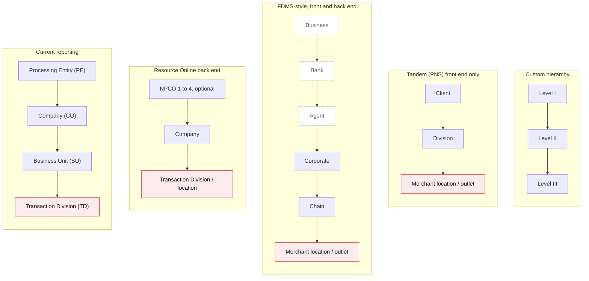

- Dashed levels (Business, Bank, Agent) are reserved for Chase Paymentech.
- Resource Online's guide says most merchants on the FDMS-style back end use only the bottom three levels, which roughly match NPCO 1, Company and TD.
- A custom hierarchy is built by Chase on request: data for one outlet, a group of unrelated merchants, or a subset of related ones.
- Front-end reports link back to the merchant through the Reporting Merchant # and, on Tandem (PNS), the PNS Merchant #.

## How the hierarchy shows up in merchant reports

**Choosing the level**

- Current reports take an entity picker: PE, CO, BU, TD, FTI or RG. Report file names and headers carry the Processing Entity ID.
- In Resource Online, users start at the highest level they're entitled to. They move with Drill Down and Drill Up, the Selected Hierarchy list, Quick Search by hierarchy or merchant number, and Top Level.
- Pre-generated reports are built at the user account's hierarchy level and can't be switched to another level.
- Statements are chosen by hierarchy or merchant number.

**Fields that carry the level**

- **Entity Type Code**: "the level at which the reported event occurred" (PE, CO, BU or TD).
- **Entity Identifier**: the CO, BU, TD or PE number that goes with it.
- **Transaction Division External Identifier**: part of the key of the Deposit Details report.
- Resource Online fields: Reporting Merch #, Client #, Division, Chain ID. Chargeback cases carry CO, BU and TD.

**One merchant, three levels in one file** (illustrative rows for the sample merchant)

| Entity Type Code | Entity Identifier | Event | Amount |
| --- | --- | --- | --: |
| TD | 412501 | Settled sale, web store | $100.00 |
| TD | 412201 | Chargeback debit, Frisco | −$42.10 |
| CO | 210118 | Monthly account fee | −$25.00 |

**Traps**

- Add a Company's total and its Business Units' totals together and you count the same money twice. Sum only one level.
- Rows posted above the TD, such as account fees, have no TD. Joining every row to a TD drops them.
- A Company-level funding summary won't match one bank statement. Reconcile per FTI.
- Changing a custom hierarchy can make month-to-month comparisons unreliable. Keep history of the tree.

## Modelling the hierarchy in the warehouse

Keep the tree as its own versioned dimension. Post facts at the level in Entity Type Code, then roll them up through the path that was valid on the event date, so a TD that moved to another Business Unit doesn't rewrite history. FTI and reporting-group membership go in bridge tables because they don't follow the tree.

```sql
-- One row per node at any level, versioned so a TD can move
create table dim_merchant_hierarchy (
  entity_type   char(2),      -- PE, CO, BU, TD
  entity_id     varchar,      -- the number at that level
  parent_type   char(2),
  parent_id     varchar,
  pe_id varchar, co_id varchar, bu_id varchar, td_id varchar,  -- flattened path
  platform      varchar,      -- Salem (6-digit MID) or PNS (12-digit)
  valid_from    date,
  valid_to      date          -- '9999-12-31' for the current row
);

-- Funding and reporting groups don't follow the tree
create table bridge_fti_td   (fti_id varchar, td_id varchar, valid_from date, valid_to date);
create table bridge_rg_entity (rg_id varchar, entity_type char(2), entity_id varchar);

-- Roll every fact up to Company as the tree stood on the event date
select h.co_id, f.event_date, sum(f.amount) as amount
from fact_financial_event f
join dim_merchant_hierarchy h
  on  h.entity_type = f.entity_type_code
  and h.entity_id   = f.entity_identifier
  and f.event_date between h.valid_from and h.valid_to
group by h.co_id, f.event_date;
```

## Sources for Part 4

- [Resource Online Reports Guide](https://merchantservices.chase.com/content/dam/chase/merchant-services/support/us/documents/resource_online_reports_guide.pdf), section 1.3, Understanding the Hierarchy: Company, TD, NPCO, FDMS levels, custom hierarchies, navigation
- [Resource Online PRO User Guide](https://merchantservices.chase.com/content/dam/chase/merchant-services/support/us/documents/resource_online_pro_user_guide.pdf), section 3.3: the three hierarchy options, custom hierarchy examples, statements by level
- [JPMorgan Financial Activity Summary report](https://developer.payments.jpmorgan.com/docs/commerce/optimization-protection/capabilities/reporting/preset-reports/financial-activity-summary-report): entity types, Entity Type Code, funding at FTI level
- [JPMorgan Deposit Details report](https://developer.payments.jpmorgan.com/docs/commerce/optimization-protection/capabilities/reporting/preset-reports/deposit-details-report): Entity Identifier, TD External Identifier
- [JPMorgan reporting attribute glossary](https://developer.payments.jpmorgan.com/docs/commerce/optimization-protection/capabilities/reporting/attribute-glossary): Entity Type Code values
- [JPMorgan Reporting API custom integration](https://developer.payments.jpmorgan.com/docs/commerce/optimization-protection/capabilities/reporting/integration-options/custom-integration): Processing Entity ID in file names and headers
- [JPMorgan Reporting API response codes](https://developer.payments.jpmorgan.com/api/commerce/optimization-protection/reporting/error-codes): one entity type and ID per reporting-group request
- [Chase 1099-K explanation form](https://merchantservices.chase.com/content/dam/chase/merchant-services/support/us/documents/1099-k_explanation_form.pdf): payee is the merchant's IRS filing name

Public documentation doesn't define the Processing Entity or Business Unit beyond their codes. Their descriptions here are the usual reading of how they're used, marked for confirmation.
